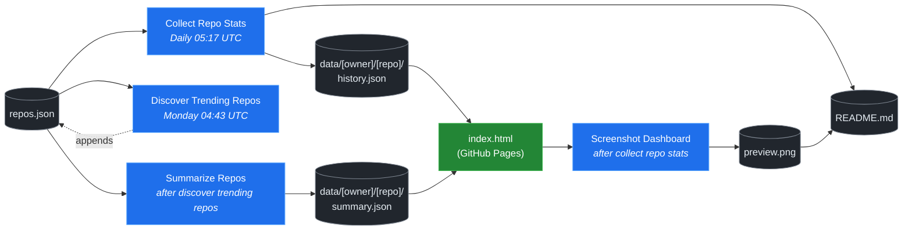

# 🚀 Rising Repos Tracker

> Automatically tracks daily GitHub stats (stars, forks, issues, velocity) for rising open source repos.

[](https://www.telosignal.com/)


**[→ View Live Dashboard](https://patrick-creates.github.io/rising-repos-tracker/)**

Built and maintained by [Telosignal](https://www.telosignal.com/).


<!-- AUTOGEN-STATS-START -->
## 📊 Current snapshot

> Auto-updated daily — last refreshed 2026-10-12

| Metric | Value |
|---|---|
| Repos tracked | **217** |
| Total stars | **10,825,077** |
| Total forks | **1,575,156** |
| Fastest growing | **VoiceStudio** (+1127.6/day) |

### 🔥 Top 5 by velocity

| # | Repo | Stars | Stars/day |
|---|---|---:|---:|
| 1 | [debpalash/VoiceStudio](https://github.com/debpalash/VoiceStudio) | 59,686 | +1127.6 |
| 2 | [DietrichGebert/ponytail](https://github.com/DietrichGebert/ponytail) | 161,557 | +1013.7 |
| 3 | [stablyai/orca](https://github.com/stablyai/orca) | 90,318 | +793.2 |
| 4 | [morluto/rea](https://github.com/morluto/rea) | 134,229 | +733.1 |
| 5 | [NousResearch/hermes-agent](https://github.com/NousResearch/hermes-agent) | 252,986 | +690.4 |

### 🆕 Recently added

- [morluto/rea](https://github.com/morluto/rea) — added 2026-10-12 — Reverse engineer anything with agents, from app behavior down to native binaries.
- [TencentCloud/Octop](https://github.com/TencentCloud/Octop) — added 2026-10-12 — A smarter, self-hosted AI assistant — multi-user, multi-agent.
- [tt-a1i/archify](https://github.com/tt-a1i/archify) — added 2026-10-05 — Turn any idea, plan, or codebase into a beautiful interactive diagram. An agent skill for Claude Code, Codex, and more.
<!-- AUTOGEN-STATS-END -->

<!-- AUTOGEN-DIAGRAM-START -->
## 🔄 How it works


<!-- AUTOGEN-DIAGRAM-END -->

<!-- AUTOGEN-WORKFLOWS-START -->
## ⚙️ Workflows

| File | Schedule | Name |
|---|---|---|
| `collect.yml` | Daily 05:17 UTC | Collect Repo Stats |
| `discover.yml` | Monday 04:43 UTC | Discover Trending Repos |
| `screenshot.yml` | After Collect Repo Stats | Screenshot Dashboard |
| `summarize.yml` | After Discover Trending Repos | Summarize Repos |

> All workflows commit results directly back to the repo. Schedules are best-effort — GitHub Actions cron can drift by a few minutes.
<!-- AUTOGEN-WORKFLOWS-END -->

<!-- AUTOGEN-REPOS-START -->
## 📋 All tracked repos

| Repo | Stars | Forks | Stars/day |
|---|---:|---:|---:|
| [openclaw/openclaw](https://github.com/openclaw/openclaw) | 391,754 | 82,372 | +133.4 |
| [obra/superpowers](https://github.com/obra/superpowers) | 297,996 | 26,622 | +557.3 |
| [affaan-m/everything-claude-code](https://github.com/affaan-m/everything-claude-code) | 277,577 | 41,388 | +635.1 |
| [affaan-m/ECC](https://github.com/affaan-m/ECC) | 277,577 | 41,388 | +609.6 |
| [NousResearch/hermes-agent](https://github.com/NousResearch/hermes-agent) | 252,986 | 54,797 | +690.4 |
| [microsoft/markitdown](https://github.com/microsoft/markitdown) | 189,727 | 14,118 | +438.9 |
| [Significant-Gravitas/AutoGPT](https://github.com/Significant-Gravitas/AutoGPT) | 187,527 | 45,943 | +21.4 |
| [f/prompts.chat](https://github.com/f/prompts.chat) | 172,683 | 22,147 | +69.2 |
| [DietrichGebert/ponytail](https://github.com/DietrichGebert/ponytail) | 161,557 | 8,716 | +1013.7 |
| [langgenius/dify](https://github.com/langgenius/dify) | 158,235 | 25,010 | +111.9 |
| [open-webui/open-webui](https://github.com/open-webui/open-webui) | 154,478 | 22,615 | +115.7 |
| [langchain-ai/langchain](https://github.com/langchain-ai/langchain) | 147,679 | 24,766 | +72.7 |
| [farion1231/cc-switch](https://github.com/farion1231/cc-switch) | 143,201 | 9,526 | +470.5 |
| [github/spec-kit](https://github.com/github/spec-kit) | 140,928 | 12,614 | +283.3 |
| [nextlevelbuilder/ui-ux-pro-max-skill](https://github.com/nextlevelbuilder/ui-ux-pro-max-skill) | 135,041 | 14,355 | +376.0 |
| [morluto/rea](https://github.com/morluto/rea) | 134,229 | 30,035 | +733.1 |
| [Graphify-Labs/graphify](https://github.com/Graphify-Labs/graphify) | 125,731 | 12,139 | +377.1 |
| [microsoft/generative-ai-for-beginners](https://github.com/microsoft/generative-ai-for-beginners) | 121,251 | 63,894 | +69.1 |
| [JuliusBrussee/caveman](https://github.com/JuliusBrussee/caveman) | 111,154 | 6,436 | +337.7 |
| [nexu-io/open-design](https://github.com/nexu-io/open-design) | 100,687 | 11,589 | +384.4 |
| [thedotmack/claude-mem](https://github.com/thedotmack/claude-mem) | 99,953 | 8,766 | +161.7 |
| [ruvnet/RuView](https://github.com/ruvnet/RuView) | 97,496 | 12,785 | +225.7 |
| [Panniantong/Agent-Reach](https://github.com/Panniantong/Agent-Reach) | 96,421 | 8,436 | +578.9 |
| [Leonxlnx/taste-skill](https://github.com/Leonxlnx/taste-skill) | 94,968 | 6,463 | +485.4 |
| [vllm-project/vllm](https://github.com/vllm-project/vllm) | 93,632 | 23,278 | +90.4 |
| [OpenHands/OpenHands](https://github.com/OpenHands/OpenHands) | 90,692 | 12,008 | +114.0 |
| [stablyai/orca](https://github.com/stablyai/orca) | 90,318 | 5,774 | +793.2 |
| [ChatGPTNextWeb/NextChat](https://github.com/ChatGPTNextWeb/NextChat) | 88,840 | 58,859 | +5.5 |
| [koala73/worldmonitor](https://github.com/koala73/worldmonitor) | 88,289 | 13,498 | +230.8 |
| [lobehub/lobehub](https://github.com/lobehub/lobehub) | 83,168 | 15,970 | +40.6 |
| [rtk-ai/rtk](https://github.com/rtk-ai/rtk) | 83,063 | 5,273 | +227.8 |
| [datawhalechina/hello-agents](https://github.com/datawhalechina/hello-agents) | 82,714 | 10,257 | +218.1 |
| [tt-a1i/archify](https://github.com/tt-a1i/archify) | 82,381 | 5,557 | +649.7 |
| [dair-ai/Prompt-Engineering-Guide](https://github.com/dair-ai/Prompt-Engineering-Guide) | 79,070 | 8,681 | +29.7 |
| [shareAI-lab/learn-claude-code](https://github.com/shareAI-lab/learn-claude-code) | 78,432 | 12,567 | +118.1 |
| [unslothai/unsloth](https://github.com/unslothai/unsloth) | 77,856 | 7,193 | +90.9 |
| [ComposioHQ/awesome-claude-skills](https://github.com/ComposioHQ/awesome-claude-skills) | 76,917 | 9,057 | +112.4 |
| [openai/openai-cookbook](https://github.com/openai/openai-cookbook) | 76,571 | 12,934 | +20.1 |
| [diegosouzapw/OmniRoute](https://github.com/diegosouzapw/OmniRoute) | 75,536 | 10,909 | +646.8 |
| [chopratejas/headroom](https://github.com/chopratejas/headroom) | 75,109 | 5,825 | +394.5 |
| [headroomlabs-ai/headroom](https://github.com/headroomlabs-ai/headroom) | 75,109 | 5,825 | +260.8 |
| [ruvnet/ruflo](https://github.com/ruvnet/ruflo) | 74,398 | 8,847 | +72.4 |
| [santifer/career-ops](https://github.com/santifer/career-ops) | 74,131 | 13,904 | +196.5 |
| [career-ops-hq/career-ops](https://github.com/career-ops-hq/career-ops) | 74,131 | 13,904 | +107.1 |
| [Fission-AI/OpenSpec](https://github.com/Fission-AI/OpenSpec) | 71,708 | 4,892 | +155.9 |
| [code-yeongyu/oh-my-openagent](https://github.com/code-yeongyu/oh-my-openagent) | 69,971 | 5,747 | +79.2 |
| [asgeirtj/system_prompts_leaks](https://github.com/asgeirtj/system_prompts_leaks) | 69,457 | 11,297 | +197.8 |
| [usestrix/strix](https://github.com/usestrix/strix) | 68,085 | 7,538 | +318.6 |
| [rohitg00/ai-engineering-from-scratch](https://github.com/rohitg00/ai-engineering-from-scratch) | 67,839 | 11,889 | +311.8 |
| [shanraisshan/claude-code-best-practice](https://github.com/shanraisshan/claude-code-best-practice) | 67,438 | 6,730 | +94.8 |
| [calesthio/OpenMontage](https://github.com/calesthio/OpenMontage) | 67,318 | 8,586 | +375.9 |
| [xtekky/gpt4free](https://github.com/xtekky/gpt4free) | 66,803 | 13,478 | +3.8 |
| [ZhuLinsen/daily_stock_analysis](https://github.com/ZhuLinsen/daily_stock_analysis) | 66,225 | 55,144 | +195.6 |
| [mvanhorn/last30days-skill](https://github.com/mvanhorn/last30days-skill) | 64,045 | 5,583 | +249.0 |
| [tw93/Pake](https://github.com/tw93/Pake) | 62,020 | 12,771 | +90.1 |
| [heygen-com/hyperframes](https://github.com/heygen-com/hyperframes) | 61,439 | 5,499 | +284.7 |
| [BerriAI/litellm](https://github.com/BerriAI/litellm) | 61,050 | 12,247 | +92.9 |
| [debpalash/VoiceStudio](https://github.com/debpalash/VoiceStudio) | 59,686 | 6,685 | +1127.6 |
| [MemPalace/mempalace](https://github.com/MemPalace/mempalace) | 59,519 | 7,560 | +48.4 |
| [jamiepine/voicebox](https://github.com/jamiepine/voicebox) | 57,006 | 7,097 | +210.4 |
| [blader/humanizer](https://github.com/blader/humanizer) | 56,022 | 4,429 | +250.6 |
| [FlowiseAI/Flowise](https://github.com/FlowiseAI/Flowise) | 55,495 | 25,056 | +17.7 |
| [hesreallyhim/awesome-claude-code](https://github.com/hesreallyhim/awesome-claude-code) | 55,489 | 4,812 | +77.5 |
| [router-for-me/CLIProxyAPI](https://github.com/router-for-me/CLIProxyAPI) | 54,925 | 8,391 | +144.2 |
| [ggml-org/whisper.cpp](https://github.com/ggml-org/whisper.cpp) | 54,313 | 6,235 | +30.5 |
| [coreyhaines31/marketingskills](https://github.com/coreyhaines31/marketingskills) | 54,301 | 8,062 | +171.9 |
| [bojieli/ai-agent-book](https://github.com/bojieli/ai-agent-book) | 53,676 | 6,084 | +544.3 |
| [ChromeDevTools/chrome-devtools-mcp](https://github.com/ChromeDevTools/chrome-devtools-mcp) | 53,332 | 6,332 | +91.5 |
| [Imbad0202/academic-research-skills](https://github.com/Imbad0202/academic-research-skills) | 51,496 | 3,957 | +153.3 |
| [elder-plinius/CL4R1T4S](https://github.com/elder-plinius/CL4R1T4S) | 51,157 | 10,489 | +103.1 |
| [QuantumNous/new-api](https://github.com/QuantumNous/new-api) | 49,782 | 11,971 | +103.0 |
| [Aider-AI/aider](https://github.com/Aider-AI/aider) | 49,491 | 5,047 | +30.8 |
| [kepano/obsidian-skills](https://github.com/kepano/obsidian-skills) | 49,436 | 3,501 | +116.9 |
| [HKUDS/nanobot](https://github.com/HKUDS/nanobot) | 48,968 | 8,628 | +42.8 |
| [K-Dense-AI/scientific-agent-skills](https://github.com/K-Dense-AI/scientific-agent-skills) | 48,517 | 4,358 | +144.0 |
| [sickn33/antigravity-awesome-skills](https://github.com/sickn33/antigravity-awesome-skills) | 47,494 | 6,925 | +63.0 |
| [sickn33/agentic-awesome-skills](https://github.com/sickn33/agentic-awesome-skills) | 47,493 | 6,925 | +48.9 |
| [zhayujie/CowAgent](https://github.com/zhayujie/CowAgent) | 47,352 | 10,384 | +19.0 |
| [DeusData/codebase-memory-mcp](https://github.com/DeusData/codebase-memory-mcp) | 46,414 | 3,813 | +245.6 |
| [alibaba/open-code-review](https://github.com/alibaba/open-code-review) | 46,409 | 3,378 | +371.7 |
| [MadsLorentzen/ai-job-search](https://github.com/MadsLorentzen/ai-job-search) | 46,273 | 15,964 | +271.3 |
| [danny-avila/LibreChat](https://github.com/danny-avila/LibreChat) | 45,573 | 9,363 | +57.9 |
| [LibreChat-AI/LibreChat](https://github.com/LibreChat-AI/LibreChat) | 45,573 | 9,363 | +39.2 |
| [chatanywhere/GPT_API_free](https://github.com/chatanywhere/GPT_API_free) | 44,054 | 2,746 | +42.1 |
| [ogulcancelik/herdr](https://github.com/ogulcancelik/herdr) | 43,530 | 3,436 | +317.7 |
| [herdrdev/herdr](https://github.com/herdrdev/herdr) | 43,529 | 3,436 | +282.0 |
| [langchain-ai/langgraph](https://github.com/langchain-ai/langgraph) | 43,129 | 7,331 | +68.8 |
| [chatboxai/chatbox](https://github.com/chatboxai/chatbox) | 42,002 | 4,272 | +13.6 |
| [tinyhumansai/openhuman](https://github.com/tinyhumansai/openhuman) | 41,875 | 4,118 | +68.2 |
| [AstrBotDevs/AstrBot](https://github.com/AstrBotDevs/AstrBot) | 41,769 | 3,046 | +61.5 |
| [Hmbown/CodeWhale](https://github.com/Hmbown/CodeWhale) | 41,073 | 3,566 | +45.7 |
| [Hmbown/Codewhale](https://github.com/Hmbown/Codewhale) | 41,072 | 3,566 | +4.5 |
| [codewhale-hq/Codewhale](https://github.com/codewhale-hq/Codewhale) | 41,072 | 3,566 | +3.4 |
| [wshobson/agents](https://github.com/wshobson/agents) | 40,453 | 4,308 | +32.3 |
| [github/awesome-copilot](https://github.com/github/awesome-copilot) | 39,946 | 5,101 | +43.9 |
| [Yeachan-Heo/oh-my-claudecode](https://github.com/Yeachan-Heo/oh-my-claudecode) | 39,820 | 3,566 | +35.7 |
| [mindsdb/mindshub](https://github.com/mindsdb/mindshub) | 39,789 | 6,239 | +4.3 |
| [volcengine/OpenViking](https://github.com/volcengine/OpenViking) | 39,744 | 3,143 | +114.4 |
| [google/langextract](https://github.com/google/langextract) | 38,935 | 2,719 | +17.0 |
| [AlexsJones/llmfit](https://github.com/AlexsJones/llmfit) | 37,838 | 2,428 | +81.5 |
| [anthropics/claude-plugins-official](https://github.com/anthropics/claude-plugins-official) | 37,717 | 4,245 | +65.5 |
| [PDFMathTranslate/PDFMathTranslate](https://github.com/PDFMathTranslate/PDFMathTranslate) | 37,511 | 3,352 | +25.0 |
| [songquanpeng/one-api](https://github.com/songquanpeng/one-api) | 37,126 | 6,882 | +20.8 |
| [JCodesMore/ai-website-cloner-template](https://github.com/JCodesMore/ai-website-cloner-template) | 36,612 | 5,367 | +164.9 |
| [esengine/DeepSeek-Reasonix](https://github.com/esengine/DeepSeek-Reasonix) | 35,769 | 2,444 | +128.9 |
| [agentscope-ai/QwenPaw](https://github.com/agentscope-ai/QwenPaw) | 35,623 | 3,170 | +150.0 |
| [HKUDS/Vibe-Trading](https://github.com/HKUDS/Vibe-Trading) | 35,293 | 5,733 | +195.8 |
| [can1357/oh-my-pi](https://github.com/can1357/oh-my-pi) | 35,166 | 3,824 | +189.0 |
| [p-e-w/heretic](https://github.com/p-e-w/heretic) | 34,713 | 3,893 | +85.2 |
| [virgiliojr94/book-to-skill](https://github.com/virgiliojr94/book-to-skill) | 34,624 | 3,633 | +199.9 |
| [mukul975/Anthropic-Cybersecurity-Skills](https://github.com/mukul975/Anthropic-Cybersecurity-Skills) | 34,281 | 4,168 | +144.3 |
| [Gitlawb/openclaude](https://github.com/Gitlawb/openclaude) | 33,761 | 9,109 | +42.3 |
| [Twigpine/openclaude](https://github.com/Twigpine/openclaude) | 33,760 | 9,109 | +16.4 |
| [iOfficeAI/AionUi](https://github.com/iOfficeAI/AionUi) | 33,461 | 3,473 | +46.0 |
| [Tencent/WeKnora](https://github.com/Tencent/WeKnora) | 33,449 | 4,455 | +144.2 |
| [zeroclaw-labs/zeroclaw](https://github.com/zeroclaw-labs/zeroclaw) | 32,965 | 4,966 | +9.7 |
| [tirth8205/code-review-graph](https://github.com/tirth8205/code-review-graph) | 32,071 | 2,936 | +113.9 |
| [iOfficeAI/OfficeCLI](https://github.com/iOfficeAI/OfficeCLI) | 31,893 | 2,169 | +239.8 |
| [googleworkspace/cli](https://github.com/googleworkspace/cli) | 31,392 | 1,875 | +35.1 |
| [decolua/9router](https://github.com/decolua/9router) | 30,660 | 5,847 | +110.0 |
| [langchain-ai/deepagents](https://github.com/langchain-ai/deepagents) | 30,151 | 4,228 | +47.6 |
| [jackwener/OpenCLI](https://github.com/jackwener/OpenCLI) | 30,096 | 2,936 | +50.0 |
| [alibaba/page-agent](https://github.com/alibaba/page-agent) | 29,399 | 2,644 | +91.1 |
| [rohitg00/agentmemory](https://github.com/rohitg00/agentmemory) | 29,341 | 2,575 | +59.7 |
| [voideditor/void](https://github.com/voideditor/void) | 28,762 | 2,654 | — |
| [jarrodwatts/claude-hud](https://github.com/jarrodwatts/claude-hud) | 28,464 | 1,316 | +30.0 |
| [BloopAI/vibe-kanban](https://github.com/BloopAI/vibe-kanban) | 28,335 | 3,034 | +12.2 |
| [manaflow-ai/cmux](https://github.com/manaflow-ai/cmux) | 28,121 | 2,490 | +41.4 |
| [TencentCloud/TencentDB-Agent-Memory](https://github.com/TencentCloud/TencentDB-Agent-Memory) | 27,948 | 2,721 | +211.3 |
| [mksglu/context-mode](https://github.com/mksglu/context-mode) | 26,856 | 1,926 | +78.9 |
| [zai-org/Open-AutoGLM](https://github.com/zai-org/Open-AutoGLM) | 26,383 | 4,053 | +7.3 |
| [t8y2/dbx](https://github.com/t8y2/dbx) | 25,951 | 2,359 | +183.3 |
| [toon-format/toon](https://github.com/toon-format/toon) | 25,492 | 1,122 | +7.9 |
| [pascalorg/editor](https://github.com/pascalorg/editor) | 24,816 | 3,078 | +56.6 |
| [ifixai-ai/iFixAi](https://github.com/ifixai-ai/iFixAi) | 23,992 | 1,445 | +251.1 |
| [guillaumemeyer/watermarks-remover](https://github.com/guillaumemeyer/watermarks-remover) | 23,909 | 2,745 | +129.7 |
| [every-app/open-seo](https://github.com/every-app/open-seo) | 23,224 | 3,052 | +163.1 |
| [jundot/omlx](https://github.com/jundot/omlx) | 22,731 | 2,005 | +51.3 |
| [pranshuparmar/witr](https://github.com/pranshuparmar/witr) | 22,658 | 794 | +44.1 |
| [winfunc/opcode](https://github.com/winfunc/opcode) | 22,415 | 1,714 | +3.3 |
| [steipete/CodexBar](https://github.com/steipete/CodexBar) | 22,410 | 2,093 | +64.3 |
| [coze-dev/coze-studio](https://github.com/coze-dev/coze-studio) | 21,699 | 3,127 | +6.0 |
| [NirDiamant/agents-towards-production](https://github.com/NirDiamant/agents-towards-production) | 21,659 | 2,873 | +8.1 |
| [hypit-ai/hypit](https://github.com/hypit-ai/hypit) | 21,476 | 2,358 | +312.6 |
| [KKKKhazix/khazix-skills](https://github.com/KKKKhazix/khazix-skills) | 21,332 | 2,254 | +46.1 |
| [jnMetaCode/agency-agents-zh](https://github.com/jnMetaCode/agency-agents-zh) | 21,207 | 3,402 | +51.8 |
| [1jehuang/jcode](https://github.com/1jehuang/jcode) | 20,554 | 2,393 | +134.6 |
| [NVIDIA/SkillSpector](https://github.com/NVIDIA/SkillSpector) | 20,021 | 1,753 | +102.9 |
| [walkinglabs/learn-harness-engineering](https://github.com/walkinglabs/learn-harness-engineering) | 19,744 | 2,161 | +100.6 |
| [tanweai/pua](https://github.com/tanweai/pua) | 19,710 | 1,202 | +12.3 |
| [datawhalechina/easy-vibe](https://github.com/datawhalechina/easy-vibe) | 19,694 | 1,882 | +23.1 |
| [danielmiessler/LifeOS](https://github.com/danielmiessler/LifeOS) | 19,412 | 2,491 | +29.9 |
| [nesquena/hermes-webui](https://github.com/nesquena/hermes-webui) | 18,875 | 2,711 | +36.0 |
| [jlcodes99/cockpit-tools](https://github.com/jlcodes99/cockpit-tools) | 18,864 | 1,675 | +53.8 |
| [AgriciDaniel/claude-seo](https://github.com/AgriciDaniel/claude-seo) | 18,753 | 2,748 | +66.7 |
| [microsoft/agent-lightning](https://github.com/microsoft/agent-lightning) | 18,668 | 1,670 | +11.4 |
| [browser-use/browser-harness](https://github.com/browser-use/browser-harness) | 18,401 | 1,804 | +27.8 |
| [RightNow-AI/openfang](https://github.com/RightNow-AI/openfang) | 18,218 | 2,291 | +3.3 |
| [rocketride-org/rocketride-server](https://github.com/rocketride-org/rocketride-server) | 17,798 | 7,567 | — |
| [tradecatlabs/vibe-coding-cn](https://github.com/tradecatlabs/vibe-coding-cn) | 17,474 | 1,761 | +49.8 |
| [wanshuiyin/Auto-claude-code-research-in-sleep](https://github.com/wanshuiyin/Auto-claude-code-research-in-sleep) | 17,323 | 1,455 | +43.3 |
| [MemoriLabs/Memori](https://github.com/MemoriLabs/Memori) | 17,145 | 3,710 | +16.1 |
| [cft0808/edict](https://github.com/cft0808/edict) | 16,990 | 1,765 | +7.8 |
| [composio-community/awesome-codex-skills](https://github.com/composio-community/awesome-codex-skills) | 16,868 | 1,664 | +18.6 |
| [xbtlin/ai-berkshire](https://github.com/xbtlin/ai-berkshire) | 16,718 | 2,487 | +60.6 |
| [xpzouying/xiaohongshu-mcp](https://github.com/xpzouying/xiaohongshu-mcp) | 16,226 | 2,385 | +17.3 |
| [Anionex/banana-slides](https://github.com/Anionex/banana-slides) | 15,735 | 1,786 | +5.2 |
| [yusufkaraaslan/Skill_Seekers](https://github.com/yusufkaraaslan/Skill_Seekers) | 15,137 | 1,541 | +8.1 |
| [superset-sh/superset](https://github.com/superset-sh/superset) | 15,092 | 1,345 | +27.9 |
| [NanmiCoder/cc-haha](https://github.com/NanmiCoder/cc-haha) | 14,973 | 8,609 | +15.7 |
| [kyegomez/OpenMythos](https://github.com/kyegomez/OpenMythos) | 14,908 | 3,278 | +6.7 |
| [NevaMind-AI/memU](https://github.com/NevaMind-AI/memU) | 14,530 | 1,089 | +5.6 |
| [XiaomiMiMo/MiMo-Code](https://github.com/XiaomiMiMo/MiMo-Code) | 13,634 | 1,429 | +24.9 |
| [dataelement/dsh-desktop](https://github.com/dataelement/dsh-desktop) | 13,527 | 484 | +261.2 |
| [EverMind-AI/EverOS](https://github.com/EverMind-AI/EverOS) | 13,406 | 929 | +35.2 |
| [sirmalloc/ccstatusline](https://github.com/sirmalloc/ccstatusline) | 13,255 | 592 | +18.8 |
| [ConardLi/garden-skills](https://github.com/ConardLi/garden-skills) | 12,840 | 1,543 | +37.3 |
| [brokermr810/QuantDinger](https://github.com/brokermr810/QuantDinger) | 12,701 | 2,579 | +34.9 |
| [OpenByteInc/QuantDinger](https://github.com/OpenByteInc/QuantDinger) | 12,700 | 2,579 | +34.5 |
| [0x4m4/hexstrike-ai](https://github.com/0x4m4/hexstrike-ai) | 12,687 | 2,577 | +25.5 |
| [MemTensor/MemOS](https://github.com/MemTensor/MemOS) | 11,827 | 1,074 | +17.1 |
| [holaboss-ai/holaOS](https://github.com/holaboss-ai/holaOS) | 11,450 | 729 | +55.0 |
| [getagentseal/codeburn](https://github.com/getagentseal/codeburn) | 11,407 | 880 | +30.0 |
| [EKKOLearnAI/hermes-studio](https://github.com/EKKOLearnAI/hermes-studio) | 11,374 | 1,400 | +25.7 |
| [EKKOLearnAI/ekko-studio](https://github.com/EKKOLearnAI/ekko-studio) | 11,374 | 1,400 | +10.7 |
| [aden-hive/hive](https://github.com/aden-hive/hive) | 11,099 | 5,647 | +4.6 |
| [openai/codex-security](https://github.com/openai/codex-security) | 11,070 | 858 | +39.8 |
| [ValueCell-ai/valuecell](https://github.com/ValueCell-ai/valuecell) | 11,019 | 1,801 | +1.4 |
| [Kuberwastaken/claurst](https://github.com/Kuberwastaken/claurst) | 10,323 | 7,699 | +4.4 |
| [StarTrail-org/PixelRAG](https://github.com/StarTrail-org/PixelRAG) | 10,255 | 901 | +40.3 |
| [ykdojo/claude-code-tips](https://github.com/ykdojo/claude-code-tips) | 10,211 | 828 | +12.2 |
| [Companion-Inc/feynman](https://github.com/Companion-Inc/feynman) | 9,945 | 1,097 | +9.5 |
| [trailhq/Graft](https://github.com/trailhq/Graft) | 9,901 | 876 | +82.6 |
| [frankbria/ralph-claude-code](https://github.com/frankbria/ralph-claude-code) | 9,677 | 731 | +3.7 |
| [modem-dev/hunk](https://github.com/modem-dev/hunk) | 9,580 | 314 | +31.6 |
| [Nasiko-Labs/nasiko](https://github.com/Nasiko-Labs/nasiko) | 9,500 | 2,061 | +35.1 |
| [genspark-ai/genoffice](https://github.com/genspark-ai/genoffice) | 9,405 | 1,201 | +96.0 |
| [1weiho/open-slide](https://github.com/1weiho/open-slide) | 9,191 | 661 | +48.8 |
| [open-slide/open-slide](https://github.com/open-slide/open-slide) | 9,191 | 661 | +65.0 |
| [EvoMap/evolver](https://github.com/EvoMap/evolver) | 9,143 | 848 | +2.9 |
| [iflytek/astron-agent](https://github.com/iflytek/astron-agent) | 8,893 | 895 | +2.9 |
| [TencentCloud/Octop](https://github.com/TencentCloud/Octop) | 8,837 | 1,087 | +93.0 |
| [Tencent/BrowserSkill](https://github.com/Tencent/BrowserSkill) | 8,702 | 620 | +74.4 |
| [MiroMindAI/MiroThinker](https://github.com/MiroMindAI/MiroThinker) | 8,424 | 645 | +1.0 |
| [mmulet/term.everything](https://github.com/mmulet/term.everything) | 8,114 | 195 | +0.9 |
| [rorkai/App-Store-Connect-CLI](https://github.com/rorkai/App-Store-Connect-CLI) | 7,806 | 661 | +25.9 |
| [ValueCell-ai/ClawX](https://github.com/ValueCell-ai/ClawX) | 7,606 | 1,140 | +0.7 |
| [WenyuChiou/awesome-agentic-ai-zh](https://github.com/WenyuChiou/awesome-agentic-ai-zh) | 7,540 | 1,002 | +23.5 |
| [opensquilla/opensquilla](https://github.com/opensquilla/opensquilla) | 7,098 | 580 | +10.6 |
| [TokenRhythm/opensquilla](https://github.com/TokenRhythm/opensquilla) | 7,098 | 580 | +3.7 |
| [tech-leads-club/agent-skills](https://github.com/tech-leads-club/agent-skills) | 7,051 | 560 | +22.9 |
| [Andyyyy64/whichllm](https://github.com/Andyyyy64/whichllm) | 6,751 | 375 | +10.5 |
| [steipete/summarize](https://github.com/steipete/summarize) | 6,699 | 450 | +3.2 |
| [Arthur-Ficial/apfel](https://github.com/Arthur-Ficial/apfel) | 6,468 | 246 | +3.9 |
| [microsoft/fara](https://github.com/microsoft/fara) | 6,216 | 606 | +2.4 |
| [UfoMiao/zcf](https://github.com/UfoMiao/zcf) | 6,075 | 423 | +0.1 |
| [re4/LibreCode](https://github.com/re4/LibreCode) | 89 | 4 | — |
<!-- AUTOGEN-REPOS-END -->

---

## What it does

- Collects daily snapshots of stars, forks, watchers and open issues for every tracked repo
- Discovers new trending repos automatically every Monday using the GitHub Search API
- Generates AI summaries (use cases, similar tools, tags) for each tracked repo via GitHub Models
- Stores all history as plain JSON — no database, no backend
- Renders a live dashboard via GitHub Pages — updates daily, zero maintenance

## Tracked repos

Data lives in [`data/`](./data) — one folder per repo, one `history.json` per entry.  
The full watch list is in [`repos.json`](./repos.json).

## Fork & use it for yourself

This is my personal tracker — the watch list reflects what I find interesting. If you want to track different repos, the best path is to **fork this repo and run your own**.

### Setup

1. Fork this repo to your account
2. Replace the contents of [`repos.json`](./repos.json) with the repos you want to track (or just leave one entry — `discover.yml` will auto-add more every Monday)
3. Go to **Settings → Pages** and enable GitHub Pages from the `main` branch
4. Go to **Actions** and run **Collect Repo Stats** once manually to seed your first data point
5. Your dashboard will be live at `https://YOUR-USERNAME.github.io/rising-repos-tracker/`

That's it — daily collection and weekly discovery run automatically on schedule. Zero ongoing maintenance.

### Customizing what gets discovered

Edit [`scripts/discover.js`](./scripts/discover.js) to change:

- `MIN_STARS` — minimum star threshold for candidates
- `MAX_AGE_DAYS` — how recent a repo must be
- `MAX_NEW_REPOS` — how many to add per discovery run
- The `queries` array — GitHub Search API queries that define what "trending" means to you

### Adding a repo manually

Just edit `repos.json` directly:

```json
{
  "owner": "OWNER",
  "repo": "REPO",
  "added": "YYYY-MM-DD",
  "notes": "why you're tracking this"
}
```

The next daily collect run picks it up automatically.

## Stack

- **GitHub Actions** — scheduling and automation
- **GitHub Pages** — dashboard hosting
- **GitHub API** — data source
- **GitHub Models** — free AI summaries (gpt-4o-mini)
- **Chart.js** — star growth visualization
- **Mermaid** — architecture diagram (rendered by GitHub)
- No dependencies, no build step, no database

## License

MIT
