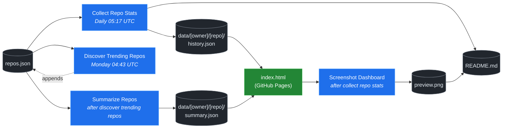

# 🚀 Rising Repos Tracker

> Automatically tracks daily GitHub stats (stars, forks, issues, velocity) for rising open source repos.

[](https://www.telosignal.com/)


**[→ View Live Dashboard](https://patrick-creates.github.io/rising-repos-tracker/)**

Built and maintained by [Telosignal](https://www.telosignal.com/).


<!-- AUTOGEN-STATS-START -->
## 📊 Current snapshot

> Auto-updated daily — last refreshed 2026-10-18

| Metric | Value |
|---|---|
| Repos tracked | **217** |
| Total stars | **11,161,748** |
| Total forks | **1,646,446** |
| Fastest growing | **rea** (+29877.7/day) |

### 🔥 Top 5 by velocity

| # | Repo | Stars | Stars/day |
|---|---|---:|---:|
| 1 | [morluto/rea](https://github.com/morluto/rea) | 313,495 | +29877.7 |
| 2 | [debpalash/VoiceStudio](https://github.com/debpalash/VoiceStudio) | 74,020 | +1312.2 |
| 3 | [DietrichGebert/ponytail](https://github.com/DietrichGebert/ponytail) | 166,502 | +1004.1 |
| 4 | [stablyai/orca](https://github.com/stablyai/orca) | 95,824 | +800.4 |
| 5 | [NousResearch/hermes-agent](https://github.com/NousResearch/hermes-agent) | 254,786 | +675.6 |

### 🆕 Recently added

- [morluto/rea](https://github.com/morluto/rea) — added 2026-10-12 — Reverse engineer anything with agents, from app behavior down to native binaries.
- [TencentCloud/Octop](https://github.com/TencentCloud/Octop) — added 2026-10-12 — A smarter, self-hosted AI assistant — multi-user, multi-agent.
- [tt-a1i/archify](https://github.com/tt-a1i/archify) — added 2026-10-05 — Turn any idea, plan, or codebase into a beautiful interactive diagram. An agent skill for Claude Code, Codex, and more.
<!-- AUTOGEN-STATS-END -->

<!-- AUTOGEN-DIAGRAM-START -->
## 🔄 How it works


<!-- AUTOGEN-DIAGRAM-END -->

<!-- AUTOGEN-WORKFLOWS-START -->
## ⚙️ Workflows

| File | Schedule | Name |
|---|---|---|
| `collect.yml` | Daily 05:17 UTC | Collect Repo Stats |
| `discover.yml` | Monday 04:43 UTC | Discover Trending Repos |
| `screenshot.yml` | After Collect Repo Stats | Screenshot Dashboard |
| `summarize.yml` | After Discover Trending Repos | Summarize Repos |

> All workflows commit results directly back to the repo. Schedules are best-effort — GitHub Actions cron can drift by a few minutes.
<!-- AUTOGEN-WORKFLOWS-END -->

<!-- AUTOGEN-REPOS-START -->
## 📋 All tracked repos

| Repo | Stars | Forks | Stars/day |
|---|---:|---:|---:|
| [openclaw/openclaw](https://github.com/openclaw/openclaw) | 392,323 | 82,472 | +132.0 |
| [morluto/rea](https://github.com/morluto/rea) | 313,495 | 79,466 | +29877.7 |
| [obra/superpowers](https://github.com/obra/superpowers) | 301,371 | 26,911 | +557.6 |
| [affaan-m/everything-claude-code](https://github.com/affaan-m/everything-claude-code) | 282,850 | 42,013 | +644.3 |
| [affaan-m/ECC](https://github.com/affaan-m/ECC) | 282,850 | 42,013 | +620.7 |
| [NousResearch/hermes-agent](https://github.com/NousResearch/hermes-agent) | 254,786 | 55,409 | +675.6 |
| [microsoft/markitdown](https://github.com/microsoft/markitdown) | 190,826 | 14,192 | +429.2 |
| [Significant-Gravitas/AutoGPT](https://github.com/Significant-Gravitas/AutoGPT) | 187,634 | 45,913 | +21.2 |
| [f/prompts.chat](https://github.com/f/prompts.chat) | 173,288 | 22,165 | +70.4 |
| [DietrichGebert/ponytail](https://github.com/DietrichGebert/ponytail) | 166,502 | 9,010 | +1004.1 |
| [langgenius/dify](https://github.com/langgenius/dify) | 158,756 | 25,091 | +111.0 |
| [open-webui/open-webui](https://github.com/open-webui/open-webui) | 156,024 | 22,710 | +121.1 |
| [langchain-ai/langchain](https://github.com/langchain-ai/langchain) | 148,014 | 24,842 | +72.0 |
| [farion1231/cc-switch](https://github.com/farion1231/cc-switch) | 145,696 | 9,635 | +468.3 |
| [github/spec-kit](https://github.com/github/spec-kit) | 141,721 | 12,677 | +277.6 |
| [nextlevelbuilder/ui-ux-pro-max-skill](https://github.com/nextlevelbuilder/ui-ux-pro-max-skill) | 137,008 | 14,559 | +374.1 |
| [Graphify-Labs/graphify](https://github.com/Graphify-Labs/graphify) | 127,978 | 12,338 | +376.9 |
| [microsoft/generative-ai-for-beginners](https://github.com/microsoft/generative-ai-for-beginners) | 121,553 | 64,054 | +68.4 |
| [JuliusBrussee/caveman](https://github.com/JuliusBrussee/caveman) | 113,355 | 6,558 | +338.8 |
| [nexu-io/open-design](https://github.com/nexu-io/open-design) | 102,045 | 11,720 | +378.2 |
| [thedotmack/claude-mem](https://github.com/thedotmack/claude-mem) | 101,501 | 8,904 | +165.3 |
| [Panniantong/Agent-Reach](https://github.com/Panniantong/Agent-Reach) | 98,870 | 8,708 | +571.2 |
| [Leonxlnx/taste-skill](https://github.com/Leonxlnx/taste-skill) | 98,603 | 6,694 | +490.6 |
| [ruvnet/RuView](https://github.com/ruvnet/RuView) | 98,548 | 12,909 | +223.7 |
| [stablyai/orca](https://github.com/stablyai/orca) | 95,824 | 6,130 | +800.4 |
| [vllm-project/vllm](https://github.com/vllm-project/vllm) | 94,038 | 23,523 | +89.6 |
| [OpenHands/OpenHands](https://github.com/OpenHands/OpenHands) | 91,171 | 12,099 | +112.7 |
| [ChatGPTNextWeb/NextChat](https://github.com/ChatGPTNextWeb/NextChat) | 88,853 | 58,784 | +5.3 |
| [koala73/worldmonitor](https://github.com/koala73/worldmonitor) | 88,664 | 13,591 | +224.2 |
| [tt-a1i/archify](https://github.com/tt-a1i/archify) | 85,087 | 5,768 | +558.0 |
| [rtk-ai/rtk](https://github.com/rtk-ai/rtk) | 83,815 | 5,328 | +223.8 |
| [datawhalechina/hello-agents](https://github.com/datawhalechina/hello-agents) | 83,542 | 10,353 | +214.9 |
| [lobehub/lobehub](https://github.com/lobehub/lobehub) | 83,301 | 15,995 | +39.9 |
| [dair-ai/Prompt-Engineering-Guide](https://github.com/dair-ai/Prompt-Engineering-Guide) | 79,278 | 8,704 | +29.9 |
| [shareAI-lab/learn-claude-code](https://github.com/shareAI-lab/learn-claude-code) | 78,760 | 12,598 | +115.6 |
| [unslothai/unsloth](https://github.com/unslothai/unsloth) | 78,209 | 7,228 | +89.6 |
| [diegosouzapw/OmniRoute](https://github.com/diegosouzapw/OmniRoute) | 77,861 | 11,286 | +631.8 |
| [ComposioHQ/awesome-claude-skills](https://github.com/ComposioHQ/awesome-claude-skills) | 77,342 | 9,172 | +110.8 |
| [openai/openai-cookbook](https://github.com/openai/openai-cookbook) | 76,675 | 12,950 | +20.0 |
| [ruvnet/ruflo](https://github.com/ruvnet/ruflo) | 76,246 | 9,012 | +181.2 |
| [chopratejas/headroom](https://github.com/chopratejas/headroom) | 75,632 | 5,874 | +379.8 |
| [headroomlabs-ai/headroom](https://github.com/headroomlabs-ai/headroom) | 75,632 | 5,874 | +251.9 |
| [santifer/career-ops](https://github.com/santifer/career-ops) | 75,405 | 14,056 | +197.1 |
| [career-ops-hq/career-ops](https://github.com/career-ops-hq/career-ops) | 75,405 | 14,056 | +122.5 |
| [debpalash/VoiceStudio](https://github.com/debpalash/VoiceStudio) | 74,020 | 8,104 | +1312.2 |
| [Fission-AI/OpenSpec](https://github.com/Fission-AI/OpenSpec) | 72,293 | 4,942 | +153.6 |
| [rohitg00/ai-engineering-from-scratch](https://github.com/rohitg00/ai-engineering-from-scratch) | 70,803 | 12,456 | +319.7 |
| [code-yeongyu/oh-my-openagent](https://github.com/code-yeongyu/oh-my-openagent) | 70,153 | 5,771 | +77.3 |
| [asgeirtj/system_prompts_leaks](https://github.com/asgeirtj/system_prompts_leaks) | 69,830 | 11,348 | +192.5 |
| [calesthio/OpenMontage](https://github.com/calesthio/OpenMontage) | 69,321 | 8,930 | +373.6 |
| [usestrix/strix](https://github.com/usestrix/strix) | 69,306 | 7,690 | +313.6 |
| [shanraisshan/claude-code-best-practice](https://github.com/shanraisshan/claude-code-best-practice) | 67,681 | 6,743 | +92.7 |
| [xtekky/gpt4free](https://github.com/xtekky/gpt4free) | 66,893 | 13,471 | +4.3 |
| [ZhuLinsen/daily_stock_analysis](https://github.com/ZhuLinsen/daily_stock_analysis) | 66,666 | 55,389 | +190.6 |
| [heygen-com/hyperframes](https://github.com/heygen-com/hyperframes) | 66,214 | 5,984 | +308.0 |
| [mvanhorn/last30days-skill](https://github.com/mvanhorn/last30days-skill) | 64,616 | 5,639 | +242.0 |
| [tw93/Pake](https://github.com/tw93/Pake) | 62,156 | 12,784 | +87.4 |
| [BerriAI/litellm](https://github.com/BerriAI/litellm) | 61,465 | 12,448 | +92.0 |
| [MemPalace/mempalace](https://github.com/MemPalace/mempalace) | 59,622 | 7,563 | +47.2 |
| [blader/humanizer](https://github.com/blader/humanizer) | 57,931 | 4,592 | +270.9 |
| [jamiepine/voicebox](https://github.com/jamiepine/voicebox) | 57,901 | 7,257 | +207.8 |
| [hesreallyhim/awesome-claude-code](https://github.com/hesreallyhim/awesome-claude-code) | 55,926 | 4,836 | +77.3 |
| [router-for-me/CLIProxyAPI](https://github.com/router-for-me/CLIProxyAPI) | 55,563 | 8,492 | +142.6 |
| [FlowiseAI/Flowise](https://github.com/FlowiseAI/Flowise) | 55,511 | 25,057 | +17.1 |
| [coreyhaines31/marketingskills](https://github.com/coreyhaines31/marketingskills) | 55,294 | 8,191 | +171.6 |
| [bojieli/ai-agent-book](https://github.com/bojieli/ai-agent-book) | 54,739 | 6,247 | +519.8 |
| [ggml-org/whisper.cpp](https://github.com/ggml-org/whisper.cpp) | 54,458 | 6,266 | +30.3 |
| [ChromeDevTools/chrome-devtools-mcp](https://github.com/ChromeDevTools/chrome-devtools-mcp) | 53,759 | 6,885 | +90.7 |
| [Imbad0202/academic-research-skills](https://github.com/Imbad0202/academic-research-skills) | 52,613 | 4,034 | +155.7 |
| [K-Dense-AI/scientific-agent-skills](https://github.com/K-Dense-AI/scientific-agent-skills) | 52,490 | 4,645 | +219.9 |
| [elder-plinius/CL4R1T4S](https://github.com/elder-plinius/CL4R1T4S) | 51,340 | 10,520 | +99.6 |
| [MadsLorentzen/ai-job-search](https://github.com/MadsLorentzen/ai-job-search) | 51,173 | 17,028 | +305.1 |
| [QuantumNous/new-api](https://github.com/QuantumNous/new-api) | 50,155 | 12,080 | +101.4 |
| [kepano/obsidian-skills](https://github.com/kepano/obsidian-skills) | 49,706 | 3,521 | +113.8 |
| [Aider-AI/aider](https://github.com/Aider-AI/aider) | 49,606 | 5,070 | +30.4 |
| [HKUDS/nanobot](https://github.com/HKUDS/nanobot) | 49,143 | 8,638 | +42.2 |
| [sickn33/antigravity-awesome-skills](https://github.com/sickn33/antigravity-awesome-skills) | 47,820 | 6,978 | +62.6 |
| [sickn33/agentic-awesome-skills](https://github.com/sickn33/agentic-awesome-skills) | 47,820 | 6,978 | +49.3 |
| [alibaba/open-code-review](https://github.com/alibaba/open-code-review) | 47,560 | 3,472 | +361.3 |
| [zhayujie/CowAgent](https://github.com/zhayujie/CowAgent) | 47,449 | 10,392 | +18.9 |
| [DeusData/codebase-memory-mcp](https://github.com/DeusData/codebase-memory-mcp) | 46,804 | 3,861 | +235.8 |
| [danny-avila/LibreChat](https://github.com/danny-avila/LibreChat) | 45,910 | 9,440 | +57.8 |
| [LibreChat-AI/LibreChat](https://github.com/LibreChat-AI/LibreChat) | 45,910 | 9,440 | +44.3 |
| [ogulcancelik/herdr](https://github.com/ogulcancelik/herdr) | 44,568 | 3,543 | +309.3 |
| [herdrdev/herdr](https://github.com/herdrdev/herdr) | 44,568 | 3,543 | +273.4 |
| [chatanywhere/GPT_API_free](https://github.com/chatanywhere/GPT_API_free) | 44,416 | 2,748 | +42.9 |
| [langchain-ai/langgraph](https://github.com/langchain-ai/langgraph) | 43,435 | 7,403 | +67.9 |
| [anthropics/claude-plugins-official](https://github.com/anthropics/claude-plugins-official) | 42,175 | 4,497 | +94.7 |
| [tinyhumansai/openhuman](https://github.com/tinyhumansai/openhuman) | 42,138 | 4,160 | +64.6 |
| [AstrBotDevs/AstrBot](https://github.com/AstrBotDevs/AstrBot) | 42,098 | 3,081 | +61.2 |
| [chatboxai/chatbox](https://github.com/chatboxai/chatbox) | 42,060 | 4,278 | +13.5 |
| [Hmbown/CodeWhale](https://github.com/Hmbown/CodeWhale) | 41,102 | 3,567 | +44.1 |
| [Hmbown/Codewhale](https://github.com/Hmbown/Codewhale) | 41,102 | 3,567 | +4.5 |
| [codewhale-hq/Codewhale](https://github.com/codewhale-hq/Codewhale) | 41,102 | 3,567 | +4.2 |
| [wshobson/agents](https://github.com/wshobson/agents) | 40,990 | 4,354 | +34.6 |
| [volcengine/OpenViking](https://github.com/volcengine/OpenViking) | 40,217 | 3,214 | +112.8 |
| [github/awesome-copilot](https://github.com/github/awesome-copilot) | 40,144 | 5,151 | +43.4 |
| [Yeachan-Heo/oh-my-claudecode](https://github.com/Yeachan-Heo/oh-my-claudecode) | 40,023 | 3,587 | +35.6 |
| [mindsdb/mindshub](https://github.com/mindsdb/mindshub) | 39,800 | 6,241 | +4.1 |
| [google/langextract](https://github.com/google/langextract) | 38,968 | 2,716 | +16.5 |
| [AlexsJones/llmfit](https://github.com/AlexsJones/llmfit) | 38,048 | 2,447 | +79.5 |
| [PDFMathTranslate/PDFMathTranslate](https://github.com/PDFMathTranslate/PDFMathTranslate) | 37,623 | 3,371 | +24.7 |
| [songquanpeng/one-api](https://github.com/songquanpeng/one-api) | 37,194 | 6,889 | +20.4 |
| [JCodesMore/ai-website-cloner-template](https://github.com/JCodesMore/ai-website-cloner-template) | 36,948 | 5,431 | +159.6 |
| [esengine/DeepSeek-Reasonix](https://github.com/esengine/DeepSeek-Reasonix) | 35,837 | 2,461 | +123.6 |
| [agentscope-ai/QwenPaw](https://github.com/agentscope-ai/QwenPaw) | 35,818 | 3,188 | +144.3 |
| [can1357/oh-my-pi](https://github.com/can1357/oh-my-pi) | 35,805 | 3,936 | +184.8 |
| [HKUDS/Vibe-Trading](https://github.com/HKUDS/Vibe-Trading) | 35,765 | 5,806 | +189.4 |
| [p-e-w/heretic](https://github.com/p-e-w/heretic) | 35,690 | 4,048 | +88.8 |
| [virgiliojr94/book-to-skill](https://github.com/virgiliojr94/book-to-skill) | 35,198 | 3,701 | +188.5 |
| [mukul975/Anthropic-Cybersecurity-Skills](https://github.com/mukul975/Anthropic-Cybersecurity-Skills) | 34,636 | 4,235 | +139.9 |
| [Tencent/WeKnora](https://github.com/Tencent/WeKnora) | 34,567 | 4,600 | +146.2 |
| [Gitlawb/openclaude](https://github.com/Gitlawb/openclaude) | 33,977 | 9,203 | +42.0 |
| [Twigpine/openclaude](https://github.com/Twigpine/openclaude) | 33,977 | 9,205 | +25.5 |
| [iOfficeAI/AionUi](https://github.com/iOfficeAI/AionUi) | 33,609 | 3,492 | +45.0 |
| [zeroclaw-labs/zeroclaw](https://github.com/zeroclaw-labs/zeroclaw) | 32,988 | 4,977 | +9.4 |
| [tirth8205/code-review-graph](https://github.com/tirth8205/code-review-graph) | 32,230 | 3,026 | +109.7 |
| [iOfficeAI/OfficeCLI](https://github.com/iOfficeAI/OfficeCLI) | 32,126 | 2,189 | +228.2 |
| [googleworkspace/cli](https://github.com/googleworkspace/cli) | 31,633 | 1,985 | +35.4 |
| [decolua/9router](https://github.com/decolua/9router) | 30,989 | 6,157 | +107.3 |
| [mksglu/context-mode](https://github.com/mksglu/context-mode) | 30,583 | 2,232 | +104.9 |
| [jackwener/OpenCLI](https://github.com/jackwener/OpenCLI) | 30,390 | 3,030 | +49.9 |
| [langchain-ai/deepagents](https://github.com/langchain-ai/deepagents) | 30,383 | 4,280 | +47.2 |
| [rohitg00/agentmemory](https://github.com/rohitg00/agentmemory) | 29,637 | 2,609 | +59.2 |
| [TencentCloud/TencentDB-Agent-Memory](https://github.com/TencentCloud/TencentDB-Agent-Memory) | 29,540 | 2,932 | +214.7 |
| [alibaba/page-agent](https://github.com/alibaba/page-agent) | 29,476 | 2,791 | +87.3 |
| [ifixai-ai/iFixAi](https://github.com/ifixai-ai/iFixAi) | 29,263 | 1,610 | +305.7 |
| [voideditor/void](https://github.com/voideditor/void) | 28,747 | 2,655 | — |
| [jarrodwatts/claude-hud](https://github.com/jarrodwatts/claude-hud) | 28,617 | 1,373 | +29.8 |
| [BloopAI/vibe-kanban](https://github.com/BloopAI/vibe-kanban) | 28,383 | 3,033 | +12.0 |
| [manaflow-ai/cmux](https://github.com/manaflow-ai/cmux) | 28,234 | 2,528 | +40.0 |
| [t8y2/dbx](https://github.com/t8y2/dbx) | 27,086 | 2,454 | +183.7 |
| [zai-org/Open-AutoGLM](https://github.com/zai-org/Open-AutoGLM) | 26,425 | 4,056 | +7.3 |
| [toon-format/toon](https://github.com/toon-format/toon) | 25,508 | 1,209 | +7.7 |
| [pascalorg/editor](https://github.com/pascalorg/editor) | 24,952 | 3,103 | +53.7 |
| [guillaumemeyer/watermarks-remover](https://github.com/guillaumemeyer/watermarks-remover) | 24,340 | 2,791 | +123.4 |
| [every-app/open-seo](https://github.com/every-app/open-seo) | 23,964 | 3,208 | +156.1 |
| [hypit-ai/hypit](https://github.com/hypit-ai/hypit) | 23,282 | 2,718 | +309.1 |
| [jundot/omlx](https://github.com/jundot/omlx) | 22,896 | 2,122 | +50.1 |
| [pranshuparmar/witr](https://github.com/pranshuparmar/witr) | 22,716 | 862 | +42.2 |
| [steipete/CodexBar](https://github.com/steipete/CodexBar) | 22,612 | 2,128 | +62.8 |
| [winfunc/opcode](https://github.com/winfunc/opcode) | 22,410 | 1,802 | +3.1 |
| [coze-dev/coze-studio](https://github.com/coze-dev/coze-studio) | 21,725 | 3,129 | +5.9 |
| [NirDiamant/agents-towards-production](https://github.com/NirDiamant/agents-towards-production) | 21,725 | 2,881 | +8.3 |
| [KKKKhazix/khazix-skills](https://github.com/KKKKhazix/khazix-skills) | 21,485 | 2,331 | +44.7 |
| [jnMetaCode/agency-agents-zh](https://github.com/jnMetaCode/agency-agents-zh) | 21,336 | 3,537 | +50.3 |
| [1jehuang/jcode](https://github.com/1jehuang/jcode) | 20,989 | 2,431 | +130.8 |
| [walkinglabs/learn-harness-engineering](https://github.com/walkinglabs/learn-harness-engineering) | 20,622 | 2,414 | +103.2 |
| [NVIDIA/SkillSpector](https://github.com/NVIDIA/SkillSpector) | 20,455 | 1,802 | +97.5 |
| [datawhalechina/easy-vibe](https://github.com/datawhalechina/easy-vibe) | 19,768 | 1,885 | +22.6 |
| [tanweai/pua](https://github.com/tanweai/pua) | 19,717 | 1,202 | +11.8 |
| [danielmiessler/LifeOS](https://github.com/danielmiessler/LifeOS) | 19,495 | 2,500 | +29.1 |
| [AgriciDaniel/claude-seo](https://github.com/AgriciDaniel/claude-seo) | 19,151 | 2,787 | +66.6 |
| [jlcodes99/cockpit-tools](https://github.com/jlcodes99/cockpit-tools) | 19,071 | 1,686 | +52.2 |
| [nesquena/hermes-webui](https://github.com/nesquena/hermes-webui) | 19,002 | 2,746 | +35.3 |
| [microsoft/agent-lightning](https://github.com/microsoft/agent-lightning) | 18,742 | 1,785 | +11.4 |
| [browser-use/browser-harness](https://github.com/browser-use/browser-harness) | 18,470 | 1,901 | +26.9 |
| [RightNow-AI/openfang](https://github.com/RightNow-AI/openfang) | 18,211 | 2,391 | +3.1 |
| [rocketride-org/rocketride-server](https://github.com/rocketride-org/rocketride-server) | 17,753 | 7,524 | — |
| [tradecatlabs/vibe-coding-cn](https://github.com/tradecatlabs/vibe-coding-cn) | 17,663 | 1,837 | +44.3 |
| [wanshuiyin/Auto-claude-code-research-in-sleep](https://github.com/wanshuiyin/Auto-claude-code-research-in-sleep) | 17,643 | 1,593 | +43.9 |
| [MemoriLabs/Memori](https://github.com/MemoriLabs/Memori) | 17,151 | 3,786 | +15.3 |
| [cft0808/edict](https://github.com/cft0808/edict) | 16,997 | 1,888 | +7.5 |
| [composio-community/awesome-codex-skills](https://github.com/composio-community/awesome-codex-skills) | 16,946 | 1,727 | +18.2 |
| [xbtlin/ai-berkshire](https://github.com/xbtlin/ai-berkshire) | 16,779 | 2,587 | +57.7 |
| [xpzouying/xiaohongshu-mcp](https://github.com/xpzouying/xiaohongshu-mcp) | 16,347 | 2,513 | +17.5 |
| [Anionex/banana-slides](https://github.com/Anionex/banana-slides) | 15,771 | 1,859 | +5.3 |
| [superset-sh/superset](https://github.com/superset-sh/superset) | 15,330 | 1,360 | +28.6 |
| [yusufkaraaslan/Skill_Seekers](https://github.com/yusufkaraaslan/Skill_Seekers) | 15,176 | 1,668 | +8.1 |
| [dataelement/dsh-desktop](https://github.com/dataelement/dsh-desktop) | 15,081 | 516 | +260.8 |
| [NanmiCoder/cc-haha](https://github.com/NanmiCoder/cc-haha) | 15,057 | 8,607 | +15.5 |
| [kyegomez/OpenMythos](https://github.com/kyegomez/OpenMythos) | 14,912 | 3,276 | +6.4 |
| [NevaMind-AI/memU](https://github.com/NevaMind-AI/memU) | 14,553 | 1,091 | +5.5 |
| [XiaomiMiMo/MiMo-Code](https://github.com/XiaomiMiMo/MiMo-Code) | 13,681 | 1,499 | +23.9 |
| [EverMind-AI/EverOS](https://github.com/EverMind-AI/EverOS) | 13,467 | 995 | +33.8 |
| [sirmalloc/ccstatusline](https://github.com/sirmalloc/ccstatusline) | 13,321 | 651 | +18.4 |
| [ConardLi/garden-skills](https://github.com/ConardLi/garden-skills) | 12,968 | 1,551 | +36.4 |
| [0x4m4/hexstrike-ai](https://github.com/0x4m4/hexstrike-ai) | 12,896 | 2,724 | +26.0 |
| [brokermr810/QuantDinger](https://github.com/brokermr810/QuantDinger) | 12,882 | 2,739 | +34.6 |
| [OpenByteInc/QuantDinger](https://github.com/OpenByteInc/QuantDinger) | 12,882 | 2,739 | +34.2 |
| [MemTensor/MemOS](https://github.com/MemTensor/MemOS) | 11,917 | 1,200 | +17.0 |
| [getagentseal/codeburn](https://github.com/getagentseal/codeburn) | 11,496 | 947 | +29.1 |
| [EKKOLearnAI/hermes-studio](https://github.com/EKKOLearnAI/hermes-studio) | 11,456 | 1,414 | +25.0 |
| [EKKOLearnAI/ekko-studio](https://github.com/EKKOLearnAI/ekko-studio) | 11,456 | 1,414 | +11.6 |
| [holaboss-ai/holaOS](https://github.com/holaboss-ai/holaOS) | 11,451 | 862 | +49.7 |
| [openai/codex-security](https://github.com/openai/codex-security) | 11,125 | 935 | +37.4 |
| [aden-hive/hive](https://github.com/aden-hive/hive) | 11,110 | 5,651 | +4.5 |
| [ValueCell-ai/valuecell](https://github.com/ValueCell-ai/valuecell) | 11,025 | 1,802 | +1.4 |
| [trailhq/Graft](https://github.com/trailhq/Graft) | 10,347 | 906 | +81.1 |
| [Kuberwastaken/claurst](https://github.com/Kuberwastaken/claurst) | 10,321 | 7,756 | +4.1 |
| [StarTrail-org/PixelRAG](https://github.com/StarTrail-org/PixelRAG) | 10,298 | 908 | +38.3 |
| [ykdojo/claude-code-tips](https://github.com/ykdojo/claude-code-tips) | 10,246 | 887 | +11.8 |
| [Companion-Inc/feynman](https://github.com/Companion-Inc/feynman) | 9,983 | 1,110 | +8.6 |
| [genspark-ai/genoffice](https://github.com/genspark-ai/genoffice) | 9,924 | 1,262 | +93.9 |
| [TencentCloud/Octop](https://github.com/TencentCloud/Octop) | 9,828 | 1,260 | +165.2 |
| [frankbria/ralph-claude-code](https://github.com/frankbria/ralph-claude-code) | 9,706 | 744 | +3.8 |
| [modem-dev/hunk](https://github.com/modem-dev/hunk) | 9,627 | 316 | +30.1 |
| [Nasiko-Labs/nasiko](https://github.com/Nasiko-Labs/nasiko) | 9,476 | 2,061 | +23.4 |
| [1weiho/open-slide](https://github.com/1weiho/open-slide) | 9,294 | 669 | +46.0 |
| [open-slide/open-slide](https://github.com/open-slide/open-slide) | 9,294 | 669 | +50.6 |
| [Tencent/BrowserSkill](https://github.com/Tencent/BrowserSkill) | 9,136 | 657 | +73.8 |
| [iflytek/astron-agent](https://github.com/iflytek/astron-agent) | 8,911 | 902 | +2.9 |
| [EvoMap/evolver](https://github.com/EvoMap/evolver) | 8,686 | 840 | — |
| [MiroMindAI/MiroThinker](https://github.com/MiroMindAI/MiroThinker) | 8,420 | 647 | +0.9 |
| [mmulet/term.everything](https://github.com/mmulet/term.everything) | 8,114 | 197 | +0.9 |
| [rorkai/App-Store-Connect-CLI](https://github.com/rorkai/App-Store-Connect-CLI) | 7,957 | 680 | +25.8 |
| [WenyuChiou/awesome-agentic-ai-zh](https://github.com/WenyuChiou/awesome-agentic-ai-zh) | 7,724 | 1,014 | +24.4 |
| [ValueCell-ai/ClawX](https://github.com/ValueCell-ai/ClawX) | 7,602 | 1,144 | +0.6 |
| [opensquilla/opensquilla](https://github.com/opensquilla/opensquilla) | 7,105 | 581 | +10.0 |
| [TokenRhythm/opensquilla](https://github.com/TokenRhythm/opensquilla) | 7,105 | 581 | +3.3 |
| [tech-leads-club/agent-skills](https://github.com/tech-leads-club/agent-skills) | 7,068 | 561 | +18.4 |
| [Andyyyy64/whichllm](https://github.com/Andyyyy64/whichllm) | 6,765 | 373 | +10.0 |
| [steipete/summarize](https://github.com/steipete/summarize) | 6,719 | 451 | +3.2 |
| [Arthur-Ficial/apfel](https://github.com/Arthur-Ficial/apfel) | 6,481 | 255 | +3.8 |
| [microsoft/fara](https://github.com/microsoft/fara) | 6,221 | 604 | +2.3 |
| [UfoMiao/zcf](https://github.com/UfoMiao/zcf) | 6,081 | 428 | +0.1 |
| [re4/LibreCode](https://github.com/re4/LibreCode) | 88 | 4 | — |
<!-- AUTOGEN-REPOS-END -->

---

## What it does

- Collects daily snapshots of stars, forks, watchers and open issues for every tracked repo
- Discovers new trending repos automatically every Monday using the GitHub Search API
- Generates AI summaries (use cases, similar tools, tags) for each tracked repo via GitHub Models
- Stores all history as plain JSON — no database, no backend
- Renders a live dashboard via GitHub Pages — updates daily, zero maintenance

## Tracked repos

Data lives in [`data/`](./data) — one folder per repo, one `history.json` per entry.  
The full watch list is in [`repos.json`](./repos.json).

## Fork & use it for yourself

This is my personal tracker — the watch list reflects what I find interesting. If you want to track different repos, the best path is to **fork this repo and run your own**.

### Setup

1. Fork this repo to your account
2. Replace the contents of [`repos.json`](./repos.json) with the repos you want to track (or just leave one entry — `discover.yml` will auto-add more every Monday)
3. Go to **Settings → Pages** and enable GitHub Pages from the `main` branch
4. Go to **Actions** and run **Collect Repo Stats** once manually to seed your first data point
5. Your dashboard will be live at `https://YOUR-USERNAME.github.io/rising-repos-tracker/`

That's it — daily collection and weekly discovery run automatically on schedule. Zero ongoing maintenance.

### Customizing what gets discovered

Edit [`scripts/discover.js`](./scripts/discover.js) to change:

- `MIN_STARS` — minimum star threshold for candidates
- `MAX_AGE_DAYS` — how recent a repo must be
- `MAX_NEW_REPOS` — how many to add per discovery run
- The `queries` array — GitHub Search API queries that define what "trending" means to you

### Adding a repo manually

Just edit `repos.json` directly:

```json
{
  "owner": "OWNER",
  "repo": "REPO",
  "added": "YYYY-MM-DD",
  "notes": "why you're tracking this"
}
```

The next daily collect run picks it up automatically.

## Stack

- **GitHub Actions** — scheduling and automation
- **GitHub Pages** — dashboard hosting
- **GitHub API** — data source
- **GitHub Models** — free AI summaries (gpt-4o-mini)
- **Chart.js** — star growth visualization
- **Mermaid** — architecture diagram (rendered by GitHub)
- No dependencies, no build step, no database

## License

MIT
