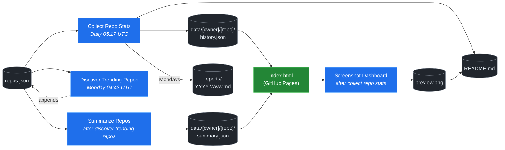

# 🚀 Rising Repos Tracker

> Automatically tracks daily GitHub stats (stars, forks, issues, velocity) for rising open source repos.

**GitHub shows a repo's star count, not how fast it is growing — this keeps a daily history so you can see which repos are actually taking off.** Runs entirely on GitHub Actions + Pages: no server, no database.

**Quick start:** 1. Fork this repo · 2. Delete my `data/` and `reports/`, put the repos you care about in [`repos.json`](./repos.json) · 3. Enable GitHub Pages and run **Collect Repo Stats** once. Details in [Fork & use it for yourself](#fork--use-it-for-yourself).

⭐ If the dashboard is useful to you, a star helps others find it.

[](https://www.telosignal.com/)


**[→ View Live Dashboard](https://patrick-creates.github.io/rising-repos-tracker/)** · **[→ Weekly reports](./reports/README.md)**

Built and maintained by [Telosignal](https://www.telosignal.com/).


<!-- AUTOGEN-STATS-START -->
## 📊 Current snapshot

> Auto-updated daily — last refreshed 2026-11-17

| Metric | Value |
|---|---|
| Repos tracked | **219** |
| Total stars | **11,821,020** |
| Total forks | **1,716,912** |
| Fastest growing | **rea** (+9201.9/day) |

### 🔥 Top 5 by velocity

| # | Repo | Stars | Stars/day |
|---|---|---:|---:|
| 1 | [morluto/rea](https://github.com/morluto/rea) | 465,498 | +9201.9 |
| 2 | [Ebony-Vinyl/dsh-our-free-model](https://github.com/Ebony-Vinyl/dsh-our-free-model) | 78,272 | +1783.6 |
| 3 | [pingdotgg/t3code](https://github.com/pingdotgg/t3code) | 63,660 | +1388.0 |
| 4 | [debpalash/VoiceStudio](https://github.com/debpalash/VoiceStudio) | 112,467 | +1299.3 |
| 5 | [ccch1mneyyy/dsh-Go](https://github.com/ccch1mneyyy/dsh-Go) | 25,689 | +1214.0 |

### 🆕 Recently added

- [pingdotgg/t3code](https://github.com/pingdotgg/t3code) — added 2026-11-16 — The best way to control Claude Code, Codex and more from any computer or phone
- [ccch1mneyyy/dsh-Go](https://github.com/ccch1mneyyy/dsh-Go) — added 2026-11-16 — dsh-go — DeepSeek Harness 装进口袋：手机本机运行，也能遥控你的电脑。
- [DuarteSantos8/openGym](https://github.com/DuarteSantos8/openGym) — added 2026-11-09 — Open-source gym & body-weight tracker, now in the App Store (iPhone + Apple Watch) and as an Android APK. Plan routines, log workouts, see which muscles are trained, import from Strong/Hevy/FitNotes. Self-host it or use it on the phone alone.
<!-- AUTOGEN-STATS-END -->

<!-- AUTOGEN-DIAGRAM-START -->
## 🔄 How it works


<!-- AUTOGEN-DIAGRAM-END -->

<!-- AUTOGEN-WORKFLOWS-START -->
## ⚙️ Workflows

| File | Schedule | Name |
|---|---|---|
| `collect.yml` | Daily 05:17 UTC | Collect Repo Stats |
| `discover.yml` | Monday 04:43 UTC | Discover Trending Repos |
| `screenshot.yml` | After Collect Repo Stats | Screenshot Dashboard |
| `summarize.yml` | After Discover Trending Repos | Summarize Repos |

> All workflows commit results directly back to the repo. Schedules are best-effort — GitHub Actions cron can drift by a few minutes.
<!-- AUTOGEN-WORKFLOWS-END -->

<!-- AUTOGEN-REPOS-START -->
## 📋 All tracked repos

| Repo | Stars | Forks | Stars/day |
|---|---:|---:|---:|
| [morluto/rea](https://github.com/morluto/rea) | 465,498 | 113,928 | +9201.9 |
| [openclaw/openclaw](https://github.com/openclaw/openclaw) | 394,631 | 82,904 | +123.2 |
| [obra/superpowers](https://github.com/obra/superpowers) | 319,030 | 28,443 | +563.9 |
| [affaan-m/ECC](https://github.com/affaan-m/ECC) | 305,085 | 44,926 | +659.8 |
| [NousResearch/hermes-agent](https://github.com/NousResearch/hermes-agent) | 264,101 | 59,572 | +617.3 |
| [microsoft/markitdown](https://github.com/microsoft/markitdown) | 195,982 | 14,820 | +388.2 |
| [DietrichGebert/ponytail](https://github.com/DietrichGebert/ponytail) | 192,639 | 10,810 | +977.2 |
| [Significant-Gravitas/AutoGPT](https://github.com/Significant-Gravitas/AutoGPT) | 188,074 | 45,867 | +20.2 |
| [f/prompts.chat](https://github.com/f/prompts.chat) | 177,730 | 22,667 | +82.8 |
| [langgenius/dify](https://github.com/langgenius/dify) | 161,355 | 25,513 | +107.1 |
| [open-webui/open-webui](https://github.com/open-webui/open-webui) | 158,919 | 23,097 | +117.2 |
| [farion1231/cc-switch](https://github.com/farion1231/cc-switch) | 155,163 | 10,157 | +443.3 |
| [nextlevelbuilder/ui-ux-pro-max-skill](https://github.com/nextlevelbuilder/ui-ux-pro-max-skill) | 150,736 | 15,932 | +387.5 |
| [github/spec-kit](https://github.com/github/spec-kit) | 150,213 | 13,495 | +278.5 |
| [langchain-ai/langchain](https://github.com/langchain-ai/langchain) | 149,769 | 25,149 | +69.9 |
| [Graphify-Labs/graphify](https://github.com/Graphify-Labs/graphify) | 149,378 | 14,362 | +466.2 |
| [stablyai/orca](https://github.com/stablyai/orca) | 127,450 | 8,083 | +857.2 |
| [microsoft/generative-ai-for-beginners](https://github.com/microsoft/generative-ai-for-beginners) | 123,727 | 66,577 | +69.0 |
| [JuliusBrussee/caveman](https://github.com/JuliusBrussee/caveman) | 120,949 | 7,066 | +324.8 |
| [thedotmack/claude-mem](https://github.com/thedotmack/claude-mem) | 117,871 | 10,243 | +226.0 |
| [Leonxlnx/taste-skill](https://github.com/Leonxlnx/taste-skill) | 117,435 | 7,856 | +514.9 |
| [paperclipai/paperclip](https://github.com/paperclipai/paperclip) | 114,487 | 18,988 | +347.6 |
| [Panniantong/Agent-Reach](https://github.com/Panniantong/Agent-Reach) | 112,620 | 10,090 | +550.3 |
| [debpalash/VoiceStudio](https://github.com/debpalash/VoiceStudio) | 112,467 | 12,486 | +1299.3 |
| [pbakaus/impeccable](https://github.com/pbakaus/impeccable) | 111,866 | 6,677 | +788.1 |
| [nexu-io/open-design](https://github.com/nexu-io/open-design) | 108,052 | 12,268 | +349.1 |
| [ruvnet/RuView](https://github.com/ruvnet/RuView) | 104,504 | 13,588 | +219.4 |
| [tt-a1i/archify](https://github.com/tt-a1i/archify) | 97,363 | 6,645 | +454.2 |
| [vllm-project/vllm](https://github.com/vllm-project/vllm) | 97,101 | 24,930 | +91.6 |
| [OpenHands/OpenHands](https://github.com/OpenHands/OpenHands) | 93,643 | 12,540 | +107.7 |
| [koala73/worldmonitor](https://github.com/koala73/worldmonitor) | 90,827 | 14,098 | +199.2 |
| [ChatGPTNextWeb/NextChat](https://github.com/ChatGPTNextWeb/NextChat) | 88,970 | 58,496 | +5.1 |
| [cheaper-inference/OmniRoute](https://github.com/cheaper-inference/OmniRoute) | 88,273 | 13,561 | +568.1 |
| [datawhalechina/hello-agents](https://github.com/datawhalechina/hello-agents) | 87,223 | 10,903 | +199.8 |
| [rtk-ai/rtk](https://github.com/rtk-ai/rtk) | 86,875 | 5,581 | +203.8 |
| [lobehub/lobehub](https://github.com/lobehub/lobehub) | 85,696 | 16,341 | +46.3 |
| [heygen-com/hyperframes](https://github.com/heygen-com/hyperframes) | 85,684 | 7,943 | +371.1 |
| [career-ops-hq/career-ops](https://github.com/career-ops-hq/career-ops) | 83,231 | 15,286 | +207.6 |
| [ruvnet/ruflo](https://github.com/ruvnet/ruflo) | 81,930 | 9,668 | +187.0 |
| [OpenMontageInc/OpenMontage](https://github.com/OpenMontageInc/OpenMontage) | 81,233 | 11,008 | +378.6 |
| [shareAI-lab/learn-claude-code](https://github.com/shareAI-lab/learn-claude-code) | 80,538 | 12,881 | +106.3 |
| [dair-ai/Prompt-Engineering-Guide](https://github.com/dair-ai/Prompt-Engineering-Guide) | 80,150 | 8,790 | +29.8 |
| [headroomlabs-ai/headroom](https://github.com/headroomlabs-ai/headroom) | 79,884 | 6,264 | +333.7 |
| [ComposioHQ/awesome-claude-skills](https://github.com/ComposioHQ/awesome-claude-skills) | 79,702 | 9,759 | +105.5 |
| [unslothai/unsloth](https://github.com/unslothai/unsloth) | 79,672 | 7,439 | +82.9 |
| [rohitg00/ai-engineering-from-scratch](https://github.com/rohitg00/ai-engineering-from-scratch) | 79,224 | 14,143 | +312.8 |
| [Ebony-Vinyl/dsh-our-free-model](https://github.com/Ebony-Vinyl/dsh-our-free-model) | 78,272 | 2,206 | +1783.6 |
| [openai/openai-cookbook](https://github.com/openai/openai-cookbook) | 77,213 | 13,073 | +19.7 |
| [usestrix/strix](https://github.com/usestrix/strix) | 76,234 | 8,651 | +299.0 |
| [Fission-AI/OpenSpec](https://github.com/Fission-AI/OpenSpec) | 75,070 | 5,150 | +143.6 |
| [ZhuLinsen/daily_stock_analysis](https://github.com/ZhuLinsen/daily_stock_analysis) | 73,012 | 57,752 | +194.2 |
| [ai-job-search-dev/ai-job-search](https://github.com/ai-job-search-dev/ai-job-search) | 72,210 | 23,220 | +398.6 |
| [asgeirtj/system_prompts_leaks](https://github.com/asgeirtj/system_prompts_leaks) | 71,615 | 11,524 | +170.7 |
| [code-yeongyu/oh-my-openagent](https://github.com/code-yeongyu/oh-my-openagent) | 70,966 | 5,847 | +69.1 |
| [blader/humanizer](https://github.com/blader/humanizer) | 70,201 | 5,508 | +353.8 |
| [shanraisshan/claude-code-best-practice](https://github.com/shanraisshan/claude-code-best-practice) | 69,154 | 6,878 | +85.6 |
| [mvanhorn/last30days-skill](https://github.com/mvanhorn/last30days-skill) | 68,643 | 6,112 | +222.0 |
| [xtekky/gpt4free](https://github.com/xtekky/gpt4free) | 67,077 | 13,456 | +4.6 |
| [tw93/Pake](https://github.com/tw93/Pake) | 63,734 | 13,029 | +81.7 |
| [pingdotgg/t3code](https://github.com/pingdotgg/t3code) | 63,660 | 11,237 | +1388.0 |
| [BerriAI/litellm](https://github.com/BerriAI/litellm) | 63,413 | 13,354 | +87.6 |
| [coreyhaines31/marketingskills](https://github.com/coreyhaines31/marketingskills) | 60,950 | 8,878 | +174.6 |
| [jamiepine/voicebox](https://github.com/jamiepine/voicebox) | 60,808 | 7,654 | +188.1 |
| [MemPalace/mempalace](https://github.com/MemPalace/mempalace) | 60,594 | 7,675 | +44.8 |
| [router-for-me/CLIProxyAPI](https://github.com/router-for-me/CLIProxyAPI) | 58,821 | 9,017 | +136.8 |
| [bojieli/ai-agent-book](https://github.com/bojieli/ai-agent-book) | 58,511 | 6,843 | +421.3 |
| [hesreallyhim/awesome-claude-code](https://github.com/hesreallyhim/awesome-claude-code) | 58,215 | 4,978 | +77.2 |
| [ChromeDevTools/chrome-devtools-mcp](https://github.com/ChromeDevTools/chrome-devtools-mcp) | 57,956 | 4,865 | +98.8 |
| [K-Dense-AI/scientific-agent-skills](https://github.com/K-Dense-AI/scientific-agent-skills) | 57,558 | 5,057 | +198.3 |
| [Imbad0202/academic-research-skills](https://github.com/Imbad0202/academic-research-skills) | 57,263 | 4,357 | +155.5 |
| [FlowiseAI/Flowise](https://github.com/FlowiseAI/Flowise) | 55,573 | 25,096 | +14.6 |
| [ggml-org/whisper.cpp](https://github.com/ggml-org/whisper.cpp) | 55,265 | 6,316 | +29.7 |
| [elder-plinius/CL4R1T4S](https://github.com/elder-plinius/CL4R1T4S) | 53,597 | 11,200 | +94.9 |
| [alibaba/open-code-review](https://github.com/alibaba/open-code-review) | 53,454 | 4,395 | +324.4 |
| [obsidianmd/obsidian-skills](https://github.com/obsidianmd/obsidian-skills) | 53,028 | 3,776 | +113.3 |
| [QuantumNous/new-api](https://github.com/QuantumNous/new-api) | 52,083 | 12,719 | +95.0 |
| [herdrdev/herdr](https://github.com/herdrdev/herdr) | 51,527 | 4,171 | +292.0 |
| [Aider-AI/aider](https://github.com/Aider-AI/aider) | 50,154 | 5,173 | +28.4 |
| [HKUDS/nanobot](https://github.com/HKUDS/nanobot) | 50,148 | 8,755 | +40.8 |
| [sickn33/agentic-awesome-skills](https://github.com/sickn33/agentic-awesome-skills) | 49,868 | 7,228 | +63.6 |
| [DeusData/codebase-memory-mcp](https://github.com/DeusData/codebase-memory-mcp) | 48,761 | 4,048 | +199.5 |
| [zhayujie/CowAgent](https://github.com/zhayujie/CowAgent) | 47,973 | 10,434 | +18.7 |
| [anthropics/claude-plugins-official](https://github.com/anthropics/claude-plugins-official) | 47,538 | 4,936 | +109.6 |
| [LibreChat-AI/LibreChat](https://github.com/LibreChat-AI/LibreChat) | 47,229 | 9,735 | +55.5 |
| [AstrBotDevs/AstrBot](https://github.com/AstrBotDevs/AstrBot) | 47,104 | 3,609 | +80.0 |
| [chatanywhere/GPT_API_free](https://github.com/chatanywhere/GPT_API_free) | 46,226 | 2,779 | +45.9 |
| [ifixai-ai/iFixAi](https://github.com/ifixai-ai/iFixAi) | 46,196 | 1,827 | +384.1 |
| [langchain-ai/langgraph](https://github.com/langchain-ai/langgraph) | 45,067 | 7,777 | +65.2 |
| [tinyhumansai/openhuman](https://github.com/tinyhumansai/openhuman) | 42,727 | 4,221 | +45.6 |
| [wshobson/agents](https://github.com/wshobson/agents) | 42,607 | 4,502 | +37.9 |
| [chatboxai/chatbox](https://github.com/chatboxai/chatbox) | 42,378 | 4,339 | +13.0 |
| [volcengine/OpenViking](https://github.com/volcengine/OpenViking) | 42,363 | 3,507 | +105.2 |
| [p-e-w/heretic](https://github.com/p-e-w/heretic) | 41,334 | 4,891 | +107.2 |
| [github/awesome-copilot](https://github.com/github/awesome-copilot) | 41,261 | 5,377 | +42.4 |
| [codewhale-hq/Codewhale](https://github.com/codewhale-hq/Codewhale) | 41,182 | 3,573 | +37.0 |
| [Yeachan-Heo/oh-my-claudecode](https://github.com/Yeachan-Heo/oh-my-claudecode) | 40,888 | 3,649 | +34.5 |
| [mindsdb/mindshub](https://github.com/mindsdb/mindshub) | 39,860 | 6,230 | +3.6 |
| [JCodesMore/ai-website-cloner-template](https://github.com/JCodesMore/ai-website-cloner-template) | 39,347 | 5,868 | +144.2 |
| [google/langextract](https://github.com/google/langextract) | 39,329 | 2,754 | +15.8 |
| [can1357/oh-my-pi](https://github.com/can1357/oh-my-pi) | 39,275 | 4,501 | +170.8 |
| [AlexsJones/llmfit](https://github.com/AlexsJones/llmfit) | 39,036 | 2,529 | +71.2 |
| [PDFMathTranslate/PDFMathTranslate](https://github.com/PDFMathTranslate/PDFMathTranslate) | 38,483 | 3,452 | +25.4 |
| [HKUDS/Vibe-Trading](https://github.com/HKUDS/Vibe-Trading) | 38,425 | 6,254 | +168.0 |
| [virgiliojr94/book-to-skill](https://github.com/virgiliojr94/book-to-skill) | 38,237 | 4,064 | +157.7 |
| [yetone/magpie](https://github.com/yetone/magpie) | 37,999 | 3,432 | +719.4 |
| [agentscope-ai/QwenPaw](https://github.com/agentscope-ai/QwenPaw) | 37,875 | 3,293 | +129.7 |
| [Tencent/WeKnora](https://github.com/Tencent/WeKnora) | 37,650 | 5,233 | +137.8 |
| [songquanpeng/one-api](https://github.com/songquanpeng/one-api) | 37,438 | 6,887 | +18.3 |
| [mukul975/Anthropic-Cybersecurity-Skills](https://github.com/mukul975/Anthropic-Cybersecurity-Skills) | 36,285 | 4,438 | +122.7 |
| [esengine/DeepSeek-Reasonix](https://github.com/esengine/DeepSeek-Reasonix) | 36,105 | 2,578 | +102.3 |
| [Twigpine/openclaude](https://github.com/Twigpine/openclaude) | 34,403 | 9,116 | +37.1 |
| [iOfficeAI/AionUi](https://github.com/iOfficeAI/AionUi) | 34,340 | 3,592 | +41.4 |
| [mksglu/context-mode](https://github.com/mksglu/context-mode) | 34,215 | 2,352 | +108.0 |
| [zeroclaw-labs/zeroclaw](https://github.com/zeroclaw-labs/zeroclaw) | 33,384 | 5,022 | +10.1 |
| [iOfficeAI/OfficeCLI](https://github.com/iOfficeAI/OfficeCLI) | 33,375 | 2,277 | +186.4 |
| [tirth8205/code-review-graph](https://github.com/tirth8205/code-review-graph) | 32,821 | 2,986 | +92.3 |
| [decolua/9router](https://github.com/decolua/9router) | 32,549 | 6,373 | +96.6 |
| [googleworkspace/cli](https://github.com/googleworkspace/cli) | 32,362 | 1,997 | +33.4 |
| [langchain-ai/deepagents](https://github.com/langchain-ai/deepagents) | 31,355 | 4,428 | +44.4 |
| [jackwener/OpenCLI](https://github.com/jackwener/OpenCLI) | 31,141 | 3,046 | +45.3 |
| [TencentCloud/TencentDB-Agent-Memory](https://github.com/TencentCloud/TencentDB-Agent-Memory) | 30,966 | 3,030 | +175.2 |
| [t8y2/dbx](https://github.com/t8y2/dbx) | 30,608 | 2,788 | +166.1 |
| [rohitg00/agentmemory](https://github.com/rohitg00/agentmemory) | 30,424 | 2,710 | +53.1 |
| [hypit-ai/hypit](https://github.com/hypit-ai/hypit) | 30,372 | 3,567 | +265.5 |
| [AgriciDaniel/claude-seo](https://github.com/AgriciDaniel/claude-seo) | 30,247 | 3,793 | +208.8 |
| [alibaba/page-agent](https://github.com/alibaba/page-agent) | 29,704 | 2,647 | +71.9 |
| [jarrodwatts/claude-hud](https://github.com/jarrodwatts/claude-hud) | 29,228 | 1,339 | +28.0 |
| [manaflow-ai/cmux](https://github.com/manaflow-ai/cmux) | 28,810 | 2,678 | +35.1 |
| [BloopAI/vibe-kanban](https://github.com/BloopAI/vibe-kanban) | 28,718 | 3,063 | +11.9 |
| [voideditor/void](https://github.com/voideditor/void) | 28,707 | 2,660 | — |
| [every-app/open-seo](https://github.com/every-app/open-seo) | 28,035 | 3,953 | +146.5 |
| [guillaumemeyer/watermarks-remover](https://github.com/guillaumemeyer/watermarks-remover) | 27,660 | 3,130 | +118.9 |
| [zai-org/Open-AutoGLM](https://github.com/zai-org/Open-AutoGLM) | 26,615 | 4,064 | +7.1 |
| [NVIDIA/SkillSpector](https://github.com/NVIDIA/SkillSpector) | 26,566 | 2,363 | +147.3 |
| [ccch1mneyyy/dsh-Go](https://github.com/ccch1mneyyy/dsh-Go) | 25,689 | 1,232 | +1214.0 |
| [toon-format/toon](https://github.com/toon-format/toon) | 25,636 | 1,126 | +7.0 |
| [pascalorg/editor](https://github.com/pascalorg/editor) | 25,575 | 3,179 | +43.7 |
| [walkinglabs/learn-harness-engineering](https://github.com/walkinglabs/learn-harness-engineering) | 25,244 | 2,893 | +114.6 |
| [vercel-labs/agent-desktop](https://github.com/vercel-labs/agent-desktop) | 24,883 | 1,858 | +598.8 |
| [jundot/omlx](https://github.com/jundot/omlx) | 23,689 | 2,146 | +45.5 |
| [steipete/CodexBar](https://github.com/steipete/CodexBar) | 23,193 | 2,237 | +54.0 |
| [pranshuparmar/witr](https://github.com/pranshuparmar/witr) | 23,027 | 811 | +35.4 |
| [winfunc/opcode](https://github.com/winfunc/opcode) | 22,450 | 1,702 | +2.7 |
| [DuarteSantos8/openGym](https://github.com/DuarteSantos8/openGym) | 22,414 | 2,980 | +237.3 |
| [KKKKhazix/khazix-skills](https://github.com/KKKKhazix/khazix-skills) | 22,349 | 2,347 | +40.8 |
| [jnMetaCode/agency-agents-zh](https://github.com/jnMetaCode/agency-agents-zh) | 22,143 | 3,555 | +45.5 |
| [NirDiamant/agents-towards-production](https://github.com/NirDiamant/agents-towards-production) | 21,913 | 2,893 | +7.9 |
| [1jehuang/jcode](https://github.com/1jehuang/jcode) | 21,837 | 2,545 | +106.6 |
| [coze-dev/coze-studio](https://github.com/coze-dev/coze-studio) | 21,816 | 3,140 | +5.4 |
| [datawhalechina/easy-vibe](https://github.com/datawhalechina/easy-vibe) | 20,451 | 1,975 | +22.6 |
| [jlcodes99/cockpit-tools](https://github.com/jlcodes99/cockpit-tools) | 20,071 | 1,821 | +46.5 |
| [rocketride-org/rocketride-server](https://github.com/rocketride-org/rocketride-server) | 20,019 | 8,691 | +49.4 |
| [danielmiessler/LifeOS](https://github.com/danielmiessler/LifeOS) | 19,916 | 2,527 | +26.0 |
| [tanweai/pua](https://github.com/tanweai/pua) | 19,857 | 1,204 | +10.4 |
| [dataelement/dsh-desktop](https://github.com/dataelement/dsh-desktop) | 19,585 | 664 | +208.9 |
| [nesquena/hermes-webui](https://github.com/nesquena/hermes-webui) | 19,548 | 2,841 | +31.8 |
| [wanshuiyin/Auto-claude-code-research-in-sleep](https://github.com/wanshuiyin/Auto-claude-code-research-in-sleep) | 19,369 | 1,554 | +46.8 |
| [xerj-org/xerj](https://github.com/xerj-org/xerj) | 19,186 | 1,440 | +158.0 |
| [browser-use/browser-harness](https://github.com/browser-use/browser-harness) | 19,111 | 1,894 | +25.8 |
| [microsoft/agent-lightning](https://github.com/microsoft/agent-lightning) | 18,970 | 1,723 | +10.7 |
| [RightNow-AI/openfang](https://github.com/RightNow-AI/openfang) | 18,255 | 2,283 | +2.8 |
| [tradecatlabs/vibe-coding-cn](https://github.com/tradecatlabs/vibe-coding-cn) | 17,751 | 1,791 | +36.1 |
| [MemoriLabs/Memori](https://github.com/MemoriLabs/Memori) | 17,594 | 4,000 | +15.2 |
| [composio-community/awesome-codex-skills](https://github.com/composio-community/awesome-codex-skills) | 17,349 | 1,781 | +16.8 |
| [xpzouying/xiaohongshu-mcp](https://github.com/xpzouying/xiaohongshu-mcp) | 17,177 | 2,531 | +19.5 |
| [xbtlin/ai-berkshire](https://github.com/xbtlin/ai-berkshire) | 17,170 | 2,527 | +47.7 |
| [cft0808/edict](https://github.com/cft0808/edict) | 17,077 | 1,771 | +6.5 |
| [ParadevAI/Paradev](https://github.com/ParadevAI/Paradev) | 16,358 | 1,468 | +29.8 |
| [Anionex/banana-slides](https://github.com/Anionex/banana-slides) | 16,023 | 1,801 | +6.1 |
| [NanmiCoder/cc-haha](https://github.com/NanmiCoder/cc-haha) | 15,474 | 8,620 | +15.1 |
| [ConardLi/garden-skills](https://github.com/ConardLi/garden-skills) | 15,348 | 1,742 | +46.0 |
| [yusufkaraaslan/Skill_Seekers](https://github.com/yusufkaraaslan/Skill_Seekers) | 15,328 | 1,564 | +7.4 |
| [kyegomez/OpenMythos](https://github.com/kyegomez/OpenMythos) | 14,928 | 3,266 | +5.2 |
| [NevaMind-AI/memU](https://github.com/NevaMind-AI/memU) | 14,625 | 1,104 | +4.9 |
| [EverMind-AI/EverOS](https://github.com/EverMind-AI/EverOS) | 13,928 | 978 | +29.9 |
| [openai/codex-security](https://github.com/openai/codex-security) | 13,887 | 1,088 | +52.9 |
| [OpenByteInc/QuantDinger](https://github.com/OpenByteInc/QuantDinger) | 13,818 | 2,817 | +33.8 |
| [XiaomiMiMo/MiMo-Code](https://github.com/XiaomiMiMo/MiMo-Code) | 13,786 | 1,478 | +19.6 |
| [0x4m4/hexstrike-ai](https://github.com/0x4m4/hexstrike-ai) | 13,683 | 2,788 | +26.0 |
| [sirmalloc/ccstatusline](https://github.com/sirmalloc/ccstatusline) | 13,616 | 611 | +16.6 |
| [Tracer-Cloud/opensre](https://github.com/Tracer-Cloud/opensre) | 12,839 | 1,884 | +12.1 |
| [genspark-ai/genoffice](https://github.com/genspark-ai/genoffice) | 12,494 | 1,751 | +89.5 |
| [MemTensor/MemOS](https://github.com/MemTensor/MemOS) | 12,432 | 1,126 | +17.1 |
| [TencentCloud/Octop](https://github.com/TencentCloud/Octop) | 12,163 | 1,721 | +92.4 |
| [Nasiko-Labs/nasiko](https://github.com/Nasiko-Labs/nasiko) | 11,948 | 3,244 | +58.8 |
| [getagentseal/codeburn](https://github.com/getagentseal/codeburn) | 11,846 | 912 | +25.2 |
| [EKKOLearnAI/ekko-studio](https://github.com/EKKOLearnAI/ekko-studio) | 11,787 | 1,476 | +21.8 |
| [holaboss-ai/holaOS](https://github.com/holaboss-ai/holaOS) | 11,445 | 727 | +33.4 |
| [trailhq/Trail-Code](https://github.com/trailhq/Trail-Code) | 11,315 | 1,017 | +58.2 |
| [aden-hive/hive](https://github.com/aden-hive/hive) | 11,167 | 5,630 | +3.9 |
| [ValueCell-ai/valuecell](https://github.com/ValueCell-ai/valuecell) | 11,058 | 1,807 | +1.3 |
| [StarTrail-org/PixelRAG](https://github.com/StarTrail-org/PixelRAG) | 10,958 | 987 | +34.4 |
| [MakazhanAlpamys/Soup](https://github.com/MakazhanAlpamys/Soup) | 10,604 | 1,760 | +42.0 |
| [Tencent/BrowserSkill](https://github.com/Tencent/BrowserSkill) | 10,501 | 758 | +56.8 |
| [ykdojo/claude-code-tips](https://github.com/ykdojo/claude-code-tips) | 10,351 | 825 | +10.0 |
| [Kuberwastaken/claurst](https://github.com/Kuberwastaken/claurst) | 10,347 | 7,647 | +3.4 |
| [makecindy/cindy](https://github.com/makecindy/cindy) | 10,251 | 1,292 | +84.2 |
| [Companion-Inc/feynman](https://github.com/Companion-Inc/feynman) | 10,127 | 1,110 | +6.3 |
| [modem-dev/hunk](https://github.com/modem-dev/hunk) | 9,839 | 336 | +24.7 |
| [open-slide/open-slide](https://github.com/open-slide/open-slide) | 9,791 | 719 | +37.1 |
| [frankbria/ralph-claude-code](https://github.com/frankbria/ralph-claude-code) | 9,735 | 728 | +3.3 |
| [Jakeschincariol/replica-skill](https://github.com/Jakeschincariol/replica-skill) | 9,667 | 1,757 | +135.5 |
| [iflytek/astron-agent](https://github.com/iflytek/astron-agent) | 8,939 | 913 | +2.5 |
| [WenyuChiou/awesome-agentic-ai-zh](https://github.com/WenyuChiou/awesome-agentic-ai-zh) | 8,803 | 1,090 | +28.9 |
| [EvoMap/evolver](https://github.com/EvoMap/evolver) | 8,746 | 853 | — |
| [MiroMindAI/MiroThinker](https://github.com/MiroMindAI/MiroThinker) | 8,453 | 647 | +0.9 |
| [rorkai/App-Store-Connect-CLI](https://github.com/rorkai/App-Store-Connect-CLI) | 8,372 | 738 | +20.8 |
| [JetBrains/thinkrail](https://github.com/JetBrains/thinkrail) | 8,322 | 533 | +35.9 |
| [mmulet/term.everything](https://github.com/mmulet/term.everything) | 8,124 | 197 | +0.7 |
| [ValueCell-ai/ClawX](https://github.com/ValueCell-ai/ClawX) | 7,596 | 1,136 | +0.4 |
| [ZSeven-W/openpencil](https://github.com/ZSeven-W/openpencil) | 7,260 | 638 | +25.7 |
| [tech-leads-club/agent-skills](https://github.com/tech-leads-club/agent-skills) | 7,171 | 568 | +10.5 |
| [TokenRhythm/opensquilla](https://github.com/TokenRhythm/opensquilla) | 7,157 | 595 | +7.9 |
| [steipete/summarize](https://github.com/steipete/summarize) | 6,855 | 462 | +3.5 |
| [Andyyyy64/whichllm](https://github.com/Andyyyy64/whichllm) | 6,838 | 379 | +8.1 |
| [Arthur-Ficial/apfel](https://github.com/Arthur-Ficial/apfel) | 6,611 | 251 | +3.9 |
| [microsoft/fara](https://github.com/microsoft/fara) | 6,256 | 607 | +2.0 |
| [UfoMiao/zcf](https://github.com/UfoMiao/zcf) | 6,070 | 419 | — |
| [re4/LibreCode](https://github.com/re4/LibreCode) | 86 | 4 | — |
<!-- AUTOGEN-REPOS-END -->

---

## What it does

- Collects daily snapshots of stars, forks, watchers and open issues for every tracked repo
- Discovers new trending repos automatically every Monday using the GitHub Search API
- Shows each repo's GitHub description and topics in the dashboard, refreshed with every daily snapshot
- Writes a weekly report every Monday to [`reports/`](./reports/README.md): top 10 by stars gained, top 10 by growth rate, newly tracked repos; unusual jumps (over 50% in a week or 25% in a day) are marked ⚠️
- Stores all history as plain JSON — no database, no backend
- Renders a live dashboard via GitHub Pages — updates daily, zero maintenance

Star counts come from the GitHub API as they are. A viral launch, bulk starring or a repo rename can all show up as a jump; check the repo before quoting a number.

## Tracked repos

Data lives in [`data/`](./data) — one folder per repo, one `history.json` per entry.  
The full watch list is in [`repos.json`](./repos.json).

## Fork & use it for yourself

This is my personal tracker — the watch list reflects what I find interesting. If you want to track different repos, the best path is to **fork this repo and run your own**.

### Setup

1. Fork this repo to your account
2. Clear my data and set your own watch list. The fork brings my full history (one folder per repo in `data/`, plus `reports/`), which would mix into your charts:
   ```bash
   git rm -r -q data reports
   ```
   Then replace the contents of [`repos.json`](./repos.json) with the repos you want to track (or leave one entry — `discover.yml` auto-adds more every Monday) and commit.
3. Go to **Settings → Pages** and enable GitHub Pages from the `main` branch
4. Go to **Actions**, enable workflows (GitHub disables them on forks by default) and run **Collect Repo Stats** once manually to seed your first data point
5. Your dashboard will be live at `https://YOUR-USERNAME.github.io/rising-repos-tracker/`

That's it — daily collection, weekly discovery and the Monday report run automatically on schedule. Zero ongoing maintenance.

### Repo descriptions

Clicking a repo in the dashboard shows its GitHub description and topics, taken from the daily snapshot. Until 2026 the tracker also generated AI summaries with GitHub Models; GitHub retired that service on 2026-07-30. The summaries generated before then stay in `data/<owner>/<repo>/summary.json` and are shown below the description, dated; no new ones are generated.

### Customizing what gets discovered

Edit [`scripts/discover.js`](./scripts/discover.js) to change:

- `MIN_STARS` — minimum star threshold for candidates
- `MAX_AGE_DAYS` — how recent a repo must be
- `MAX_NEW_REPOS` — how many to add per discovery run
- The `queries` array — GitHub Search API queries that define what "trending" means to you

### Adding a repo manually

Just edit `repos.json` directly:

```json
{
  "owner": "OWNER",
  "repo": "REPO",
  "added": "YYYY-MM-DD",
  "notes": "why you're tracking this",
  "created_at": "YYYY-MM-DD"
}
```

`created_at` (the repo's creation date) is optional; without it the repo only shows under "all ages" in the dashboard's age filter. The next daily collect run picks it up automatically.

## Stack

- **GitHub Actions** — scheduling and automation
- **GitHub Pages** — dashboard hosting
- **GitHub API** — data source
- **Chart.js** — star growth visualization
- **Mermaid** — architecture diagram (rendered by GitHub)
- Collecting, reports and README use Node built-ins only; the screenshot workflow installs Puppeteer. No build step, no database

## License

MIT
