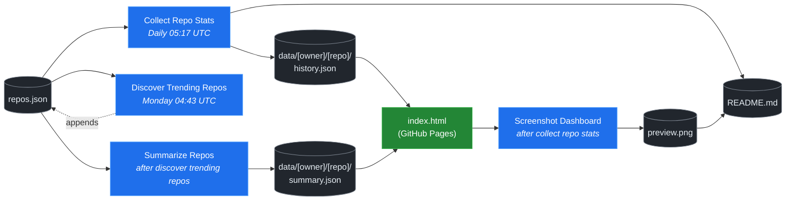

# 🚀 Rising Repos Tracker

> Automatically tracks daily GitHub stats (stars, forks, issues, velocity) for rising open source repos.

[](https://www.telosignal.com/)


**[→ View Live Dashboard](https://patrick-creates.github.io/rising-repos-tracker/)**

Built and maintained by [Telosignal](https://www.telosignal.com/).


<!-- AUTOGEN-STATS-START -->
## 📊 Current snapshot

> Auto-updated daily — last refreshed 2026-10-20

| Metric | Value |
|---|---|
| Repos tracked | **220** |
| Total stars | **11,396,491** |
| Total forks | **1,683,591** |
| Fastest growing | **rea** (+25962.8/day) |

### 🔥 Top 5 by velocity

| # | Repo | Stars | Stars/day |
|---|---|---:|---:|
| 1 | [morluto/rea](https://github.com/morluto/rea) | 341,931 | +25962.8 |
| 2 | [Ebony-Vinyl/dsh-our-free-model](https://github.com/Ebony-Vinyl/dsh-our-free-model) | 29,447 | +2899.0 |
| 3 | [debpalash/VoiceStudio](https://github.com/debpalash/VoiceStudio) | 78,109 | +1346.3 |
| 4 | [DietrichGebert/ponytail](https://github.com/DietrichGebert/ponytail) | 168,538 | +1004.3 |
| 5 | [stablyai/orca](https://github.com/stablyai/orca) | 98,912 | +814.4 |

### 🆕 Recently added

- [paperclipai/paperclip](https://github.com/paperclipai/paperclip) — added 2026-10-19 — The open-source app everyone uses to manage agents at work
- [Ebony-Vinyl/dsh-our-free-model](https://github.com/Ebony-Vinyl/dsh-our-free-model) — added 2026-10-19 — 在 dsh 里装上这个插件即可，无需登录、注册或填 API Key，就能使用包括 DeepSeek V4.1 Flash、Kimi K3 在内的前沿模型——完全免费，不限量。 All you do is install this plugin in dsh: no login, no sign-up, no API key — the frontier models are just there, DeepSeek V4.1 Flash and Kimi K3 among them. Completely free, with no usage cap.
- [trailhq/Trail-Code](https://github.com/trailhq/Trail-Code) — added 2026-10-19 — Turbocharge Claude Code, Cursor, Codex, Gemini & every coding agent: faster, cheaper, with contextual understanding specific to your codebase.
<!-- AUTOGEN-STATS-END -->

<!-- AUTOGEN-DIAGRAM-START -->
## 🔄 How it works


<!-- AUTOGEN-DIAGRAM-END -->

<!-- AUTOGEN-WORKFLOWS-START -->
## ⚙️ Workflows

| File | Schedule | Name |
|---|---|---|
| `collect.yml` | Daily 05:17 UTC | Collect Repo Stats |
| `discover.yml` | Monday 04:43 UTC | Discover Trending Repos |
| `screenshot.yml` | After Collect Repo Stats | Screenshot Dashboard |
| `summarize.yml` | After Discover Trending Repos | Summarize Repos |

> All workflows commit results directly back to the repo. Schedules are best-effort — GitHub Actions cron can drift by a few minutes.
<!-- AUTOGEN-WORKFLOWS-END -->

<!-- AUTOGEN-REPOS-START -->
## 📋 All tracked repos

| Repo | Stars | Forks | Stars/day |
|---|---:|---:|---:|
| [openclaw/openclaw](https://github.com/openclaw/openclaw) | 392,932 | 82,542 | +134.1 |
| [morluto/rea](https://github.com/morluto/rea) | 341,931 | 86,260 | +25962.8 |
| [obra/superpowers](https://github.com/obra/superpowers) | 302,347 | 27,001 | +556.4 |
| [affaan-m/everything-claude-code](https://github.com/affaan-m/everything-claude-code) | 284,401 | 42,244 | +646.0 |
| [affaan-m/ECC](https://github.com/affaan-m/ECC) | 284,401 | 42,244 | +622.8 |
| [NousResearch/hermes-agent](https://github.com/NousResearch/hermes-agent) | 255,399 | 55,628 | +671.0 |
| [microsoft/markitdown](https://github.com/microsoft/markitdown) | 191,210 | 14,233 | +426.3 |
| [Significant-Gravitas/AutoGPT](https://github.com/Significant-Gravitas/AutoGPT) | 187,667 | 45,916 | +21.2 |
| [f/prompts.chat](https://github.com/f/prompts.chat) | 173,626 | 22,213 | +71.6 |
| [DietrichGebert/ponytail](https://github.com/DietrichGebert/ponytail) | 168,538 | 9,164 | +1004.3 |
| [langgenius/dify](https://github.com/langgenius/dify) | 158,999 | 25,133 | +111.1 |
| [open-webui/open-webui](https://github.com/open-webui/open-webui) | 156,240 | 22,737 | +120.9 |
| [langchain-ai/langchain](https://github.com/langchain-ai/langchain) | 148,121 | 24,859 | +71.8 |
| [farion1231/cc-switch](https://github.com/farion1231/cc-switch) | 146,648 | 9,687 | +468.4 |
| [github/spec-kit](https://github.com/github/spec-kit) | 142,032 | 12,707 | +276.1 |
| [nextlevelbuilder/ui-ux-pro-max-skill](https://github.com/nextlevelbuilder/ui-ux-pro-max-skill) | 137,774 | 14,621 | +374.3 |
| [Graphify-Labs/graphify](https://github.com/Graphify-Labs/graphify) | 129,447 | 12,479 | +385.3 |
| [microsoft/generative-ai-for-beginners](https://github.com/microsoft/generative-ai-for-beginners) | 121,685 | 64,131 | +68.3 |
| [JuliusBrussee/caveman](https://github.com/JuliusBrussee/caveman) | 113,752 | 6,578 | +337.0 |
| [paperclipai/paperclip](https://github.com/paperclipai/paperclip) | 104,979 | 17,488 | +573.0 |
| [nexu-io/open-design](https://github.com/nexu-io/open-design) | 102,668 | 11,764 | +377.4 |
| [thedotmack/claude-mem](https://github.com/thedotmack/claude-mem) | 101,871 | 8,963 | +165.6 |
| [Panniantong/Agent-Reach](https://github.com/Panniantong/Agent-Reach) | 100,008 | 8,838 | +571.1 |
| [Leonxlnx/taste-skill](https://github.com/Leonxlnx/taste-skill) | 99,605 | 6,772 | +490.7 |
| [stablyai/orca](https://github.com/stablyai/orca) | 98,912 | 6,300 | +814.4 |
| [ruvnet/RuView](https://github.com/ruvnet/RuView) | 98,870 | 12,941 | +222.8 |
| [vllm-project/vllm](https://github.com/vllm-project/vllm) | 94,205 | 23,633 | +89.5 |
| [OpenHands/OpenHands](https://github.com/OpenHands/OpenHands) | 91,349 | 12,124 | +112.4 |
| [koala73/worldmonitor](https://github.com/koala73/worldmonitor) | 88,894 | 13,641 | +222.7 |
| [ChatGPTNextWeb/NextChat](https://github.com/ChatGPTNextWeb/NextChat) | 88,874 | 58,767 | +5.4 |
| [tt-a1i/archify](https://github.com/tt-a1i/archify) | 86,077 | 5,865 | +549.6 |
| [rtk-ai/rtk](https://github.com/rtk-ai/rtk) | 84,024 | 5,337 | +222.2 |
| [datawhalechina/hello-agents](https://github.com/datawhalechina/hello-agents) | 83,864 | 10,395 | +214.2 |
| [lobehub/lobehub](https://github.com/lobehub/lobehub) | 83,356 | 16,003 | +39.7 |
| [dair-ai/Prompt-Engineering-Guide](https://github.com/dair-ai/Prompt-Engineering-Guide) | 79,364 | 8,716 | +30.1 |
| [shareAI-lab/learn-claude-code](https://github.com/shareAI-lab/learn-claude-code) | 78,882 | 12,621 | +114.9 |
| [diegosouzapw/OmniRoute](https://github.com/diegosouzapw/OmniRoute) | 78,700 | 11,449 | +627.8 |
| [unslothai/unsloth](https://github.com/unslothai/unsloth) | 78,300 | 7,246 | +89.0 |
| [debpalash/VoiceStudio](https://github.com/debpalash/VoiceStudio) | 78,109 | 8,569 | +1346.3 |
| [ComposioHQ/awesome-claude-skills](https://github.com/ComposioHQ/awesome-claude-skills) | 77,476 | 9,220 | +110.2 |
| [ruvnet/ruflo](https://github.com/ruvnet/ruflo) | 77,472 | 9,121 | +238.7 |
| [openai/openai-cookbook](https://github.com/openai/openai-cookbook) | 76,711 | 12,964 | +20.0 |
| [chopratejas/headroom](https://github.com/chopratejas/headroom) | 76,476 | 5,938 | +380.4 |
| [headroomlabs-ai/headroom](https://github.com/headroomlabs-ai/headroom) | 76,476 | 5,938 | +254.8 |
| [career-ops-hq/career-ops](https://github.com/career-ops-hq/career-ops) | 75,741 | 14,092 | +124.6 |
| [santifer/career-ops](https://github.com/santifer/career-ops) | 75,740 | 14,092 | +196.7 |
| [Fission-AI/OpenSpec](https://github.com/Fission-AI/OpenSpec) | 72,502 | 4,951 | +153.0 |
| [rohitg00/ai-engineering-from-scratch](https://github.com/rohitg00/ai-engineering-from-scratch) | 71,604 | 12,594 | +320.9 |
| [usestrix/strix](https://github.com/usestrix/strix) | 70,229 | 7,838 | +315.7 |
| [code-yeongyu/oh-my-openagent](https://github.com/code-yeongyu/oh-my-openagent) | 70,216 | 5,773 | +76.7 |
| [calesthio/OpenMontage](https://github.com/calesthio/OpenMontage) | 70,114 | 9,080 | +374.0 |
| [asgeirtj/system_prompts_leaks](https://github.com/asgeirtj/system_prompts_leaks) | 69,939 | 11,362 | +190.7 |
| [heygen-com/hyperframes](https://github.com/heygen-com/hyperframes) | 68,003 | 6,140 | +316.7 |
| [shanraisshan/claude-code-best-practice](https://github.com/shanraisshan/claude-code-best-practice) | 67,815 | 6,753 | +92.4 |
| [xtekky/gpt4free](https://github.com/xtekky/gpt4free) | 66,903 | 13,469 | +4.3 |
| [ZhuLinsen/daily_stock_analysis](https://github.com/ZhuLinsen/daily_stock_analysis) | 66,775 | 55,465 | +188.8 |
| [mvanhorn/last30days-skill](https://github.com/mvanhorn/last30days-skill) | 64,830 | 5,660 | +240.0 |
| [tw93/Pake](https://github.com/tw93/Pake) | 62,211 | 12,794 | +86.7 |
| [BerriAI/litellm](https://github.com/BerriAI/litellm) | 61,640 | 12,502 | +91.9 |
| [MemPalace/mempalace](https://github.com/MemPalace/mempalace) | 59,652 | 7,569 | +46.8 |
| [MadsLorentzen/ai-job-search](https://github.com/MadsLorentzen/ai-job-search) | 58,788 | 18,495 | +375.8 |
| [blader/humanizer](https://github.com/blader/humanizer) | 58,680 | 4,649 | +280.3 |
| [jamiepine/voicebox](https://github.com/jamiepine/voicebox) | 58,059 | 7,278 | +205.9 |
| [hesreallyhim/awesome-claude-code](https://github.com/hesreallyhim/awesome-claude-code) | 56,064 | 4,846 | +77.2 |
| [router-for-me/CLIProxyAPI](https://github.com/router-for-me/CLIProxyAPI) | 55,766 | 8,519 | +142.0 |
| [coreyhaines31/marketingskills](https://github.com/coreyhaines31/marketingskills) | 55,600 | 8,231 | +171.4 |
| [FlowiseAI/Flowise](https://github.com/FlowiseAI/Flowise) | 55,512 | 25,068 | +16.9 |
| [bojieli/ai-agent-book](https://github.com/bojieli/ai-agent-book) | 55,079 | 6,299 | +512.2 |
| [ggml-org/whisper.cpp](https://github.com/ggml-org/whisper.cpp) | 54,500 | 6,271 | +30.2 |
| [ChromeDevTools/chrome-devtools-mcp](https://github.com/ChromeDevTools/chrome-devtools-mcp) | 53,894 | 7,031 | +90.4 |
| [K-Dense-AI/scientific-agent-skills](https://github.com/K-Dense-AI/scientific-agent-skills) | 53,110 | 4,697 | +224.0 |
| [Imbad0202/academic-research-skills](https://github.com/Imbad0202/academic-research-skills) | 53,080 | 4,074 | +157.5 |
| [elder-plinius/CL4R1T4S](https://github.com/elder-plinius/CL4R1T4S) | 51,390 | 10,517 | +98.4 |
| [QuantumNous/new-api](https://github.com/QuantumNous/new-api) | 50,322 | 12,153 | +101.1 |
| [kepano/obsidian-skills](https://github.com/kepano/obsidian-skills) | 49,800 | 3,523 | +112.9 |
| [Aider-AI/aider](https://github.com/Aider-AI/aider) | 49,653 | 5,087 | +30.3 |
| [HKUDS/nanobot](https://github.com/HKUDS/nanobot) | 49,210 | 8,653 | +42.1 |
| [sickn33/antigravity-awesome-skills](https://github.com/sickn33/antigravity-awesome-skills) | 47,979 | 7,008 | +62.8 |
| [sickn33/agentic-awesome-skills](https://github.com/sickn33/agentic-awesome-skills) | 47,979 | 7,008 | +49.9 |
| [alibaba/open-code-review](https://github.com/alibaba/open-code-review) | 47,700 | 3,482 | +355.8 |
| [zhayujie/CowAgent](https://github.com/zhayujie/CowAgent) | 47,472 | 10,398 | +18.8 |
| [DeusData/codebase-memory-mcp](https://github.com/DeusData/codebase-memory-mcp) | 46,992 | 3,890 | +233.3 |
| [danny-avila/LibreChat](https://github.com/danny-avila/LibreChat) | 46,047 | 9,463 | +58.0 |
| [LibreChat-AI/LibreChat](https://github.com/LibreChat-AI/LibreChat) | 46,047 | 9,463 | +46.5 |
| [ogulcancelik/herdr](https://github.com/ogulcancelik/herdr) | 44,896 | 3,576 | +306.6 |
| [herdrdev/herdr](https://github.com/herdrdev/herdr) | 44,896 | 3,576 | +270.6 |
| [chatanywhere/GPT_API_free](https://github.com/chatanywhere/GPT_API_free) | 44,550 | 2,750 | +43.2 |
| [langchain-ai/langgraph](https://github.com/langchain-ai/langgraph) | 43,569 | 7,439 | +67.9 |
| [anthropics/claude-plugins-official](https://github.com/anthropics/claude-plugins-official) | 43,281 | 4,578 | +101.2 |
| [AstrBotDevs/AstrBot](https://github.com/AstrBotDevs/AstrBot) | 42,358 | 3,103 | +62.2 |
| [tinyhumansai/openhuman](https://github.com/tinyhumansai/openhuman) | 42,173 | 4,166 | +62.4 |
| [chatboxai/chatbox](https://github.com/chatboxai/chatbox) | 42,080 | 4,281 | +13.4 |
| [wshobson/agents](https://github.com/wshobson/agents) | 41,211 | 4,385 | +35.6 |
| [Hmbown/CodeWhale](https://github.com/Hmbown/CodeWhale) | 41,103 | 3,570 | +43.5 |
| [Hmbown/Codewhale](https://github.com/Hmbown/Codewhale) | 41,103 | 3,570 | +4.3 |
| [codewhale-hq/Codewhale](https://github.com/codewhale-hq/Codewhale) | 41,103 | 3,570 | +3.7 |
| [volcengine/OpenViking](https://github.com/volcengine/OpenViking) | 40,414 | 3,247 | +112.6 |
| [github/awesome-copilot](https://github.com/github/awesome-copilot) | 40,214 | 5,162 | +43.3 |
| [Yeachan-Heo/oh-my-claudecode](https://github.com/Yeachan-Heo/oh-my-claudecode) | 40,099 | 3,594 | +35.6 |
| [mindsdb/mindshub](https://github.com/mindsdb/mindshub) | 39,802 | 6,241 | +4.1 |
| [google/langextract](https://github.com/google/langextract) | 38,977 | 2,720 | +16.4 |
| [AlexsJones/llmfit](https://github.com/AlexsJones/llmfit) | 38,156 | 2,457 | +79.1 |
| [PDFMathTranslate/PDFMathTranslate](https://github.com/PDFMathTranslate/PDFMathTranslate) | 37,696 | 3,377 | +24.9 |
| [songquanpeng/one-api](https://github.com/songquanpeng/one-api) | 37,211 | 6,887 | +20.3 |
| [JCodesMore/ai-website-cloner-template](https://github.com/JCodesMore/ai-website-cloner-template) | 37,030 | 5,452 | +157.8 |
| [can1357/oh-my-pi](https://github.com/can1357/oh-my-pi) | 36,017 | 3,973 | +183.5 |
| [HKUDS/Vibe-Trading](https://github.com/HKUDS/Vibe-Trading) | 35,994 | 5,854 | +188.1 |
| [p-e-w/heretic](https://github.com/p-e-w/heretic) | 35,955 | 4,069 | +89.4 |
| [esengine/DeepSeek-Reasonix](https://github.com/esengine/DeepSeek-Reasonix) | 35,879 | 2,465 | +122.0 |
| [agentscope-ai/QwenPaw](https://github.com/agentscope-ai/QwenPaw) | 35,871 | 3,196 | +142.5 |
| [virgiliojr94/book-to-skill](https://github.com/virgiliojr94/book-to-skill) | 35,420 | 3,741 | +185.8 |
| [Tencent/WeKnora](https://github.com/Tencent/WeKnora) | 34,813 | 4,645 | +145.8 |
| [mukul975/Anthropic-Cybersecurity-Skills](https://github.com/mukul975/Anthropic-Cybersecurity-Skills) | 34,748 | 4,249 | +138.6 |
| [Gitlawb/openclaude](https://github.com/Gitlawb/openclaude) | 34,036 | 9,264 | +41.9 |
| [Twigpine/openclaude](https://github.com/Twigpine/openclaude) | 34,036 | 9,264 | +26.1 |
| [iOfficeAI/AionUi](https://github.com/iOfficeAI/AionUi) | 33,658 | 3,496 | +44.8 |
| [zeroclaw-labs/zeroclaw](https://github.com/zeroclaw-labs/zeroclaw) | 33,010 | 4,983 | +9.5 |
| [tirth8205/code-review-graph](https://github.com/tirth8205/code-review-graph) | 32,275 | 3,098 | +108.4 |
| [iOfficeAI/OfficeCLI](https://github.com/iOfficeAI/OfficeCLI) | 32,214 | 2,195 | +224.7 |
| [googleworkspace/cli](https://github.com/googleworkspace/cli) | 31,710 | 2,053 | +35.4 |
| [mksglu/context-mode](https://github.com/mksglu/context-mode) | 31,232 | 2,388 | +108.4 |
| [decolua/9router](https://github.com/decolua/9router) | 31,113 | 6,290 | +106.6 |
| [jackwener/OpenCLI](https://github.com/jackwener/OpenCLI) | 30,463 | 3,090 | +49.7 |
| [langchain-ai/deepagents](https://github.com/langchain-ai/deepagents) | 30,441 | 4,293 | +46.9 |
| [ifixai-ai/iFixAi](https://github.com/ifixai-ai/iFixAi) | 30,306 | 1,696 | +311.7 |
| [rohitg00/agentmemory](https://github.com/rohitg00/agentmemory) | 29,701 | 2,622 | +58.8 |
| [TencentCloud/TencentDB-Agent-Memory](https://github.com/TencentCloud/TencentDB-Agent-Memory) | 29,679 | 3,011 | +211.7 |
| [alibaba/page-agent](https://github.com/alibaba/page-agent) | 29,520 | 2,912 | +86.3 |
| [Ebony-Vinyl/dsh-our-free-model](https://github.com/Ebony-Vinyl/dsh-our-free-model) | 29,447 | 640 | +2899.0 |
| [voideditor/void](https://github.com/voideditor/void) | 28,747 | 2,655 | — |
| [jarrodwatts/claude-hud](https://github.com/jarrodwatts/claude-hud) | 28,671 | 1,441 | +29.7 |
| [BloopAI/vibe-kanban](https://github.com/BloopAI/vibe-kanban) | 28,410 | 3,034 | +12.1 |
| [manaflow-ai/cmux](https://github.com/manaflow-ai/cmux) | 28,294 | 2,555 | +39.8 |
| [t8y2/dbx](https://github.com/t8y2/dbx) | 27,341 | 2,489 | +182.4 |
| [zai-org/Open-AutoGLM](https://github.com/zai-org/Open-AutoGLM) | 26,438 | 4,050 | +7.3 |
| [toon-format/toon](https://github.com/toon-format/toon) | 25,528 | 1,280 | +7.7 |
| [pascalorg/editor](https://github.com/pascalorg/editor) | 25,003 | 3,111 | +52.9 |
| [guillaumemeyer/watermarks-remover](https://github.com/guillaumemeyer/watermarks-remover) | 24,509 | 2,807 | +122.1 |
| [every-app/open-seo](https://github.com/every-app/open-seo) | 24,224 | 3,251 | +154.7 |
| [hypit-ai/hypit](https://github.com/hypit-ai/hypit) | 24,193 | 2,923 | +322.5 |
| [jundot/omlx](https://github.com/jundot/omlx) | 22,952 | 2,216 | +49.8 |
| [pranshuparmar/witr](https://github.com/pranshuparmar/witr) | 22,728 | 917 | +41.6 |
| [steipete/CodexBar](https://github.com/steipete/CodexBar) | 22,677 | 2,140 | +62.3 |
| [winfunc/opcode](https://github.com/winfunc/opcode) | 22,418 | 1,863 | +3.1 |
| [NirDiamant/agents-towards-production](https://github.com/NirDiamant/agents-towards-production) | 21,732 | 2,880 | +8.2 |
| [coze-dev/coze-studio](https://github.com/coze-dev/coze-studio) | 21,731 | 3,130 | +5.8 |
| [KKKKhazix/khazix-skills](https://github.com/KKKKhazix/khazix-skills) | 21,525 | 2,378 | +44.2 |
| [jnMetaCode/agency-agents-zh](https://github.com/jnMetaCode/agency-agents-zh) | 21,418 | 3,661 | +50.1 |
| [1jehuang/jcode](https://github.com/1jehuang/jcode) | 21,055 | 2,440 | +128.8 |
| [walkinglabs/learn-harness-engineering](https://github.com/walkinglabs/learn-harness-engineering) | 20,990 | 2,577 | +104.8 |
| [NVIDIA/SkillSpector](https://github.com/NVIDIA/SkillSpector) | 20,655 | 1,812 | +97.6 |
| [datawhalechina/easy-vibe](https://github.com/datawhalechina/easy-vibe) | 20,043 | 1,938 | +24.4 |
| [tanweai/pua](https://github.com/tanweai/pua) | 19,721 | 1,202 | +11.6 |
| [danielmiessler/LifeOS](https://github.com/danielmiessler/LifeOS) | 19,527 | 2,497 | +28.8 |
| [AgriciDaniel/claude-seo](https://github.com/AgriciDaniel/claude-seo) | 19,398 | 2,816 | +69.8 |
| [jlcodes99/cockpit-tools](https://github.com/jlcodes99/cockpit-tools) | 19,138 | 1,700 | +51.6 |
| [nesquena/hermes-webui](https://github.com/nesquena/hermes-webui) | 19,052 | 2,758 | +35.1 |
| [microsoft/agent-lightning](https://github.com/microsoft/agent-lightning) | 18,765 | 1,871 | +11.4 |
| [browser-use/browser-harness](https://github.com/browser-use/browser-harness) | 18,510 | 1,981 | +26.8 |
| [RightNow-AI/openfang](https://github.com/RightNow-AI/openfang) | 18,212 | 2,500 | +3.0 |
| [wanshuiyin/Auto-claude-code-research-in-sleep](https://github.com/wanshuiyin/Auto-claude-code-research-in-sleep) | 17,771 | 1,719 | +44.2 |
| [rocketride-org/rocketride-server](https://github.com/rocketride-org/rocketride-server) | 17,734 | 7,515 | — |
| [tradecatlabs/vibe-coding-cn](https://github.com/tradecatlabs/vibe-coding-cn) | 17,698 | 1,883 | +41.9 |
| [MemoriLabs/Memori](https://github.com/MemoriLabs/Memori) | 17,150 | 3,852 | +15.1 |
| [cft0808/edict](https://github.com/cft0808/edict) | 17,004 | 1,989 | +7.4 |
| [composio-community/awesome-codex-skills](https://github.com/composio-community/awesome-codex-skills) | 16,969 | 1,790 | +18.0 |
| [xbtlin/ai-berkshire](https://github.com/xbtlin/ai-berkshire) | 16,812 | 2,676 | +56.9 |
| [xpzouying/xiaohongshu-mcp](https://github.com/xpzouying/xiaohongshu-mcp) | 16,391 | 2,609 | +17.5 |
| [dataelement/dsh-desktop](https://github.com/dataelement/dsh-desktop) | 15,806 | 529 | +266.4 |
| [Anionex/banana-slides](https://github.com/Anionex/banana-slides) | 15,794 | 1,930 | +5.4 |
| [superset-sh/superset](https://github.com/superset-sh/superset) | 15,388 | 1,362 | +28.6 |
| [yusufkaraaslan/Skill_Seekers](https://github.com/yusufkaraaslan/Skill_Seekers) | 15,185 | 1,781 | +8.0 |
| [NanmiCoder/cc-haha](https://github.com/NanmiCoder/cc-haha) | 15,082 | 8,605 | +15.5 |
| [kyegomez/OpenMythos](https://github.com/kyegomez/OpenMythos) | 14,909 | 3,277 | +6.3 |
| [NevaMind-AI/memU](https://github.com/NevaMind-AI/memU) | 14,555 | 1,090 | +5.5 |
| [XiaomiMiMo/MiMo-Code](https://github.com/XiaomiMiMo/MiMo-Code) | 13,692 | 1,560 | +23.6 |
| [EverMind-AI/EverOS](https://github.com/EverMind-AI/EverOS) | 13,524 | 1,073 | +33.7 |
| [sirmalloc/ccstatusline](https://github.com/sirmalloc/ccstatusline) | 13,349 | 702 | +18.3 |
| [ConardLi/garden-skills](https://github.com/ConardLi/garden-skills) | 13,026 | 1,555 | +36.3 |
| [0x4m4/hexstrike-ai](https://github.com/0x4m4/hexstrike-ai) | 12,963 | 2,829 | +26.1 |
| [brokermr810/QuantDinger](https://github.com/brokermr810/QuantDinger) | 12,951 | 2,881 | +34.6 |
| [OpenByteInc/QuantDinger](https://github.com/OpenByteInc/QuantDinger) | 12,951 | 2,881 | +34.2 |
| [MemTensor/MemOS](https://github.com/MemTensor/MemOS) | 11,958 | 1,300 | +17.1 |
| [getagentseal/codeburn](https://github.com/getagentseal/codeburn) | 11,527 | 994 | +28.8 |
| [EKKOLearnAI/hermes-studio](https://github.com/EKKOLearnAI/hermes-studio) | 11,480 | 1,418 | +24.7 |
| [EKKOLearnAI/ekko-studio](https://github.com/EKKOLearnAI/ekko-studio) | 11,480 | 1,418 | +11.6 |
| [holaboss-ai/holaOS](https://github.com/holaboss-ai/holaOS) | 11,456 | 962 | +48.2 |
| [openai/codex-security](https://github.com/openai/codex-security) | 11,142 | 1,002 | +36.7 |
| [aden-hive/hive](https://github.com/aden-hive/hive) | 11,112 | 5,649 | +4.4 |
| [ValueCell-ai/valuecell](https://github.com/ValueCell-ai/valuecell) | 11,028 | 1,803 | +1.4 |
| [trailhq/Graft](https://github.com/trailhq/Graft) | 10,474 | 921 | +80.1 |
| [trailhq/Trail-Code](https://github.com/trailhq/Trail-Code) | 10,474 | 921 | +48.0 |
| [TencentCloud/Octop](https://github.com/TencentCloud/Octop) | 10,393 | 1,322 | +194.5 |
| [Kuberwastaken/claurst](https://github.com/Kuberwastaken/claurst) | 10,325 | 7,816 | +4.1 |
| [StarTrail-org/PixelRAG](https://github.com/StarTrail-org/PixelRAG) | 10,317 | 910 | +37.7 |
| [ykdojo/claude-code-tips](https://github.com/ykdojo/claude-code-tips) | 10,253 | 943 | +11.7 |
| [genspark-ai/genoffice](https://github.com/genspark-ai/genoffice) | 10,107 | 1,285 | +93.7 |
| [Companion-Inc/feynman](https://github.com/Companion-Inc/feynman) | 9,998 | 1,117 | +8.5 |
| [frankbria/ralph-claude-code](https://github.com/frankbria/ralph-claude-code) | 9,711 | 755 | +3.7 |
| [modem-dev/hunk](https://github.com/modem-dev/hunk) | 9,640 | 320 | +29.6 |
| [Nasiko-Labs/nasiko](https://github.com/Nasiko-Labs/nasiko) | 9,465 | 2,065 | +20.8 |
| [1weiho/open-slide](https://github.com/1weiho/open-slide) | 9,317 | 674 | +45.1 |
| [open-slide/open-slide](https://github.com/open-slide/open-slide) | 9,317 | 674 | +47.1 |
| [Tencent/BrowserSkill](https://github.com/Tencent/BrowserSkill) | 9,255 | 663 | +72.5 |
| [iflytek/astron-agent](https://github.com/iflytek/astron-agent) | 8,918 | 903 | +2.9 |
| [EvoMap/evolver](https://github.com/EvoMap/evolver) | 8,688 | 840 | — |
| [MiroMindAI/MiroThinker](https://github.com/MiroMindAI/MiroThinker) | 8,422 | 648 | +0.9 |
| [mmulet/term.everything](https://github.com/mmulet/term.everything) | 8,117 | 197 | +0.9 |
| [rorkai/App-Store-Connect-CLI](https://github.com/rorkai/App-Store-Connect-CLI) | 7,990 | 682 | +25.4 |
| [WenyuChiou/awesome-agentic-ai-zh](https://github.com/WenyuChiou/awesome-agentic-ai-zh) | 7,746 | 1,016 | +23.9 |
| [ValueCell-ai/ClawX](https://github.com/ValueCell-ai/ClawX) | 7,605 | 1,142 | +0.6 |
| [opensquilla/opensquilla](https://github.com/opensquilla/opensquilla) | 7,114 | 583 | +9.8 |
| [TokenRhythm/opensquilla](https://github.com/TokenRhythm/opensquilla) | 7,114 | 583 | +3.4 |
| [tech-leads-club/agent-skills](https://github.com/tech-leads-club/agent-skills) | 7,074 | 561 | +17.3 |
| [Andyyyy64/whichllm](https://github.com/Andyyyy64/whichllm) | 6,772 | 373 | +9.8 |
| [steipete/summarize](https://github.com/steipete/summarize) | 6,726 | 455 | +3.2 |
| [Arthur-Ficial/apfel](https://github.com/Arthur-Ficial/apfel) | 6,505 | 259 | +3.9 |
| [microsoft/fara](https://github.com/microsoft/fara) | 6,221 | 604 | +2.2 |
| [UfoMiao/zcf](https://github.com/UfoMiao/zcf) | 6,084 | 433 | +0.1 |
| [re4/LibreCode](https://github.com/re4/LibreCode) | 88 | 4 | — |
<!-- AUTOGEN-REPOS-END -->

---

## What it does

- Collects daily snapshots of stars, forks, watchers and open issues for every tracked repo
- Discovers new trending repos automatically every Monday using the GitHub Search API
- Generates AI summaries (use cases, similar tools, tags) for each tracked repo via GitHub Models
- Stores all history as plain JSON — no database, no backend
- Renders a live dashboard via GitHub Pages — updates daily, zero maintenance

## Tracked repos

Data lives in [`data/`](./data) — one folder per repo, one `history.json` per entry.  
The full watch list is in [`repos.json`](./repos.json).

## Fork & use it for yourself

This is my personal tracker — the watch list reflects what I find interesting. If you want to track different repos, the best path is to **fork this repo and run your own**.

### Setup

1. Fork this repo to your account
2. Replace the contents of [`repos.json`](./repos.json) with the repos you want to track (or just leave one entry — `discover.yml` will auto-add more every Monday)
3. Go to **Settings → Pages** and enable GitHub Pages from the `main` branch
4. Go to **Actions** and run **Collect Repo Stats** once manually to seed your first data point
5. Your dashboard will be live at `https://YOUR-USERNAME.github.io/rising-repos-tracker/`

That's it — daily collection and weekly discovery run automatically on schedule. Zero ongoing maintenance.

### Customizing what gets discovered

Edit [`scripts/discover.js`](./scripts/discover.js) to change:

- `MIN_STARS` — minimum star threshold for candidates
- `MAX_AGE_DAYS` — how recent a repo must be
- `MAX_NEW_REPOS` — how many to add per discovery run
- The `queries` array — GitHub Search API queries that define what "trending" means to you

### Adding a repo manually

Just edit `repos.json` directly:

```json
{
  "owner": "OWNER",
  "repo": "REPO",
  "added": "YYYY-MM-DD",
  "notes": "why you're tracking this"
}
```

The next daily collect run picks it up automatically.

## Stack

- **GitHub Actions** — scheduling and automation
- **GitHub Pages** — dashboard hosting
- **GitHub API** — data source
- **GitHub Models** — free AI summaries (gpt-4o-mini)
- **Chart.js** — star growth visualization
- **Mermaid** — architecture diagram (rendered by GitHub)
- No dependencies, no build step, no database

## License

MIT
