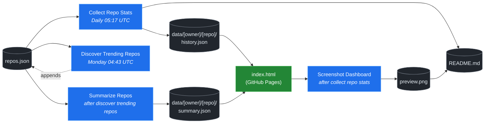

# 🚀 Rising Repos Tracker

> Automatically tracks daily GitHub stats (stars, forks, issues, velocity) for rising open source repos.

[](https://www.telosignal.com/)


**[→ View Live Dashboard](https://patrick-creates.github.io/rising-repos-tracker/)**

Built and maintained by [Telosignal](https://www.telosignal.com/).


<!-- AUTOGEN-STATS-START -->
## 📊 Current snapshot

> Auto-updated daily — last refreshed 2026-10-19

| Metric | Value |
|---|---|
| Repos tracked | **220** |
| Total stars | **11,350,868** |
| Total forks | **1,674,927** |
| Fastest growing | **rea** (+27918.9/day) |

### 🔥 Top 5 by velocity

| # | Repo | Stars | Stars/day |
|---|---|---:|---:|
| 1 | [morluto/rea](https://github.com/morluto/rea) | 329,661 | +27918.9 |
| 2 | [debpalash/VoiceStudio](https://github.com/debpalash/VoiceStudio) | 76,562 | +1341.5 |
| 3 | [Ebony-Vinyl/dsh-our-free-model](https://github.com/Ebony-Vinyl/dsh-our-free-model) | 26,548 | +1103.1 |
| 4 | [DietrichGebert/ponytail](https://github.com/DietrichGebert/ponytail) | 167,480 | +1003.9 |
| 5 | [stablyai/orca](https://github.com/stablyai/orca) | 97,428 | +808.0 |

### 🆕 Recently added

- [paperclipai/paperclip](https://github.com/paperclipai/paperclip) — added 2026-10-19 — The open-source app everyone uses to manage agents at work
- [Ebony-Vinyl/dsh-our-free-model](https://github.com/Ebony-Vinyl/dsh-our-free-model) — added 2026-10-19 — 在 dsh 里装上这个插件即可，无需登录、注册或填 API Key，就能使用包括 DeepSeek V4.1 Flash、Kimi K3 在内的前沿模型——完全免费，不限量。 All you do is install this plugin in dsh: no login, no sign-up, no API key — the frontier models are just there, DeepSeek V4.1 Flash and Kimi K3 among them. Completely free, with no usage cap.
- [trailhq/Trail-Code](https://github.com/trailhq/Trail-Code) — added 2026-10-19 — Turbocharge Claude Code, Cursor, Codex, Gemini & every coding agent: faster, cheaper, with contextual understanding specific to your codebase.
<!-- AUTOGEN-STATS-END -->

<!-- AUTOGEN-DIAGRAM-START -->
## 🔄 How it works


<!-- AUTOGEN-DIAGRAM-END -->

<!-- AUTOGEN-WORKFLOWS-START -->
## ⚙️ Workflows

| File | Schedule | Name |
|---|---|---|
| `collect.yml` | Daily 05:17 UTC | Collect Repo Stats |
| `discover.yml` | Monday 04:43 UTC | Discover Trending Repos |
| `screenshot.yml` | After Collect Repo Stats | Screenshot Dashboard |
| `summarize.yml` | After Discover Trending Repos | Summarize Repos |

> All workflows commit results directly back to the repo. Schedules are best-effort — GitHub Actions cron can drift by a few minutes.
<!-- AUTOGEN-WORKFLOWS-END -->

<!-- AUTOGEN-REPOS-START -->
## 📋 All tracked repos

| Repo | Stars | Forks | Stars/day |
|---|---:|---:|---:|
| [openclaw/openclaw](https://github.com/openclaw/openclaw) | 392,441 | 82,493 | +131.9 |
| [morluto/rea](https://github.com/morluto/rea) | 329,661 | 83,425 | +27918.9 |
| [obra/superpowers](https://github.com/obra/superpowers) | 301,851 | 26,953 | +556.9 |
| [affaan-m/ECC](https://github.com/affaan-m/ECC) | 283,602 | 42,124 | +621.6 |
| [affaan-m/everything-claude-code](https://github.com/affaan-m/everything-claude-code) | 283,601 | 42,124 | +645.0 |
| [NousResearch/hermes-agent](https://github.com/NousResearch/hermes-agent) | 255,096 | 55,498 | +673.3 |
| [microsoft/markitdown](https://github.com/microsoft/markitdown) | 191,019 | 14,210 | +427.7 |
| [Significant-Gravitas/AutoGPT](https://github.com/Significant-Gravitas/AutoGPT) | 187,650 | 45,913 | +21.2 |
| [f/prompts.chat](https://github.com/f/prompts.chat) | 173,509 | 22,194 | +71.3 |
| [DietrichGebert/ponytail](https://github.com/DietrichGebert/ponytail) | 167,480 | 9,092 | +1003.9 |
| [langgenius/dify](https://github.com/langgenius/dify) | 158,872 | 25,107 | +111.0 |
| [open-webui/open-webui](https://github.com/open-webui/open-webui) | 156,137 | 22,725 | +121.0 |
| [langchain-ai/langchain](https://github.com/langchain-ai/langchain) | 148,069 | 24,849 | +71.9 |
| [farion1231/cc-switch](https://github.com/farion1231/cc-switch) | 146,188 | 9,658 | +468.5 |
| [github/spec-kit](https://github.com/github/spec-kit) | 141,877 | 12,688 | +276.8 |
| [nextlevelbuilder/ui-ux-pro-max-skill](https://github.com/nextlevelbuilder/ui-ux-pro-max-skill) | 137,428 | 14,594 | +374.4 |
| [Graphify-Labs/graphify](https://github.com/Graphify-Labs/graphify) | 128,708 | 12,401 | +381.1 |
| [microsoft/generative-ai-for-beginners](https://github.com/microsoft/generative-ai-for-beginners) | 121,617 | 64,091 | +68.3 |
| [JuliusBrussee/caveman](https://github.com/JuliusBrussee/caveman) | 113,564 | 6,572 | +338.0 |
| [paperclipai/paperclip](https://github.com/paperclipai/paperclip) | 104,406 | 17,428 | +453.9 |
| [nexu-io/open-design](https://github.com/nexu-io/open-design) | 102,374 | 11,743 | +377.9 |
| [thedotmack/claude-mem](https://github.com/thedotmack/claude-mem) | 101,706 | 8,938 | +165.6 |
| [Panniantong/Agent-Reach](https://github.com/Panniantong/Agent-Reach) | 99,354 | 8,769 | +570.5 |
| [Leonxlnx/taste-skill](https://github.com/Leonxlnx/taste-skill) | 99,097 | 6,739 | +490.6 |
| [ruvnet/RuView](https://github.com/ruvnet/RuView) | 98,726 | 12,926 | +223.4 |
| [stablyai/orca](https://github.com/stablyai/orca) | 97,428 | 6,216 | +808.0 |
| [vllm-project/vllm](https://github.com/vllm-project/vllm) | 94,121 | 23,578 | +89.5 |
| [OpenHands/OpenHands](https://github.com/OpenHands/OpenHands) | 91,251 | 12,114 | +112.5 |
| [ChatGPTNextWeb/NextChat](https://github.com/ChatGPTNextWeb/NextChat) | 88,865 | 58,776 | +5.4 |
| [koala73/worldmonitor](https://github.com/koala73/worldmonitor) | 88,800 | 13,621 | +223.6 |
| [tt-a1i/archify](https://github.com/tt-a1i/archify) | 85,624 | 5,827 | +556.5 |
| [rtk-ai/rtk](https://github.com/rtk-ai/rtk) | 83,932 | 5,334 | +223.1 |
| [datawhalechina/hello-agents](https://github.com/datawhalechina/hello-agents) | 83,699 | 10,369 | +214.5 |
| [lobehub/lobehub](https://github.com/lobehub/lobehub) | 83,319 | 15,998 | +39.8 |
| [dair-ai/Prompt-Engineering-Guide](https://github.com/dair-ai/Prompt-Engineering-Guide) | 79,328 | 8,709 | +30.0 |
| [shareAI-lab/learn-claude-code](https://github.com/shareAI-lab/learn-claude-code) | 78,815 | 12,613 | +115.2 |
| [diegosouzapw/OmniRoute](https://github.com/diegosouzapw/OmniRoute) | 78,303 | 11,374 | +630.0 |
| [unslothai/unsloth](https://github.com/unslothai/unsloth) | 78,243 | 7,239 | +89.2 |
| [ComposioHQ/awesome-claude-skills](https://github.com/ComposioHQ/awesome-claude-skills) | 77,415 | 9,192 | +110.6 |
| [ruvnet/ruflo](https://github.com/ruvnet/ruflo) | 76,815 | 9,072 | +208.9 |
| [openai/openai-cookbook](https://github.com/openai/openai-cookbook) | 76,689 | 12,953 | +20.0 |
| [debpalash/VoiceStudio](https://github.com/debpalash/VoiceStudio) | 76,562 | 8,364 | +1341.5 |
| [chopratejas/headroom](https://github.com/chopratejas/headroom) | 75,956 | 5,909 | +379.3 |
| [headroomlabs-ai/headroom](https://github.com/headroomlabs-ai/headroom) | 75,956 | 5,909 | +252.5 |
| [santifer/career-ops](https://github.com/santifer/career-ops) | 75,571 | 14,075 | +196.9 |
| [career-ops-hq/career-ops](https://github.com/career-ops-hq/career-ops) | 75,571 | 14,075 | +123.5 |
| [Fission-AI/OpenSpec](https://github.com/Fission-AI/OpenSpec) | 72,381 | 4,947 | +153.2 |
| [rohitg00/ai-engineering-from-scratch](https://github.com/rohitg00/ai-engineering-from-scratch) | 71,235 | 12,534 | +320.5 |
| [code-yeongyu/oh-my-openagent](https://github.com/code-yeongyu/oh-my-openagent) | 70,180 | 5,771 | +77.0 |
| [asgeirtj/system_prompts_leaks](https://github.com/asgeirtj/system_prompts_leaks) | 69,888 | 11,355 | +191.6 |
| [usestrix/strix](https://github.com/usestrix/strix) | 69,796 | 7,775 | +314.9 |
| [calesthio/OpenMontage](https://github.com/calesthio/OpenMontage) | 69,719 | 9,021 | +373.8 |
| [shanraisshan/claude-code-best-practice](https://github.com/shanraisshan/claude-code-best-practice) | 67,731 | 6,748 | +92.4 |
| [heygen-com/hyperframes](https://github.com/heygen-com/hyperframes) | 67,172 | 6,081 | +312.9 |
| [xtekky/gpt4free](https://github.com/xtekky/gpt4free) | 66,894 | 13,469 | +4.2 |
| [ZhuLinsen/daily_stock_analysis](https://github.com/ZhuLinsen/daily_stock_analysis) | 66,727 | 55,435 | +189.7 |
| [mvanhorn/last30days-skill](https://github.com/mvanhorn/last30days-skill) | 64,711 | 5,649 | +240.9 |
| [tw93/Pake](https://github.com/tw93/Pake) | 62,183 | 12,785 | +87.0 |
| [BerriAI/litellm](https://github.com/BerriAI/litellm) | 61,552 | 12,472 | +92.0 |
| [MemPalace/mempalace](https://github.com/MemPalace/mempalace) | 59,633 | 7,563 | +47.0 |
| [blader/humanizer](https://github.com/blader/humanizer) | 58,297 | 4,624 | +275.4 |
| [jamiepine/voicebox](https://github.com/jamiepine/voicebox) | 57,984 | 7,269 | +206.9 |
| [hesreallyhim/awesome-claude-code](https://github.com/hesreallyhim/awesome-claude-code) | 55,993 | 4,840 | +77.3 |
| [router-for-me/CLIProxyAPI](https://github.com/router-for-me/CLIProxyAPI) | 55,669 | 8,504 | +142.3 |
| [FlowiseAI/Flowise](https://github.com/FlowiseAI/Flowise) | 55,511 | 25,060 | +17.0 |
| [coreyhaines31/marketingskills](https://github.com/coreyhaines31/marketingskills) | 55,454 | 8,210 | +171.5 |
| [MadsLorentzen/ai-job-search](https://github.com/MadsLorentzen/ai-job-search) | 55,045 | 17,723 | +341.4 |
| [bojieli/ai-agent-book](https://github.com/bojieli/ai-agent-book) | 54,920 | 6,280 | +516.1 |
| [ggml-org/whisper.cpp](https://github.com/ggml-org/whisper.cpp) | 54,481 | 6,269 | +30.2 |
| [ChromeDevTools/chrome-devtools-mcp](https://github.com/ChromeDevTools/chrome-devtools-mcp) | 53,824 | 7,005 | +90.5 |
| [Imbad0202/academic-research-skills](https://github.com/Imbad0202/academic-research-skills) | 52,902 | 4,055 | +157.2 |
| [K-Dense-AI/scientific-agent-skills](https://github.com/K-Dense-AI/scientific-agent-skills) | 52,775 | 4,678 | +221.4 |
| [elder-plinius/CL4R1T4S](https://github.com/elder-plinius/CL4R1T4S) | 51,366 | 10,515 | +99.0 |
| [QuantumNous/new-api](https://github.com/QuantumNous/new-api) | 50,241 | 12,119 | +101.3 |
| [kepano/obsidian-skills](https://github.com/kepano/obsidian-skills) | 49,760 | 3,521 | +113.4 |
| [Aider-AI/aider](https://github.com/Aider-AI/aider) | 49,630 | 5,081 | +30.3 |
| [HKUDS/nanobot](https://github.com/HKUDS/nanobot) | 49,173 | 8,641 | +42.2 |
| [sickn33/antigravity-awesome-skills](https://github.com/sickn33/antigravity-awesome-skills) | 47,932 | 7,001 | +63.0 |
| [sickn33/agentic-awesome-skills](https://github.com/sickn33/agentic-awesome-skills) | 47,932 | 7,001 | +49.9 |
| [alibaba/open-code-review](https://github.com/alibaba/open-code-review) | 47,631 | 3,477 | +358.5 |
| [zhayujie/CowAgent](https://github.com/zhayujie/CowAgent) | 47,464 | 10,395 | +18.9 |
| [DeusData/codebase-memory-mcp](https://github.com/DeusData/codebase-memory-mcp) | 46,900 | 3,879 | +234.6 |
| [danny-avila/LibreChat](https://github.com/danny-avila/LibreChat) | 45,964 | 9,453 | +57.8 |
| [LibreChat-AI/LibreChat](https://github.com/LibreChat-AI/LibreChat) | 45,964 | 9,453 | +44.8 |
| [ogulcancelik/herdr](https://github.com/ogulcancelik/herdr) | 44,737 | 3,564 | +308.0 |
| [herdrdev/herdr](https://github.com/herdrdev/herdr) | 44,737 | 3,564 | +272.1 |
| [chatanywhere/GPT_API_free](https://github.com/chatanywhere/GPT_API_free) | 44,496 | 2,750 | +43.1 |
| [langchain-ai/langgraph](https://github.com/langchain-ai/langgraph) | 43,494 | 7,423 | +67.8 |
| [anthropics/claude-plugins-official](https://github.com/anthropics/claude-plugins-official) | 43,032 | 4,552 | +100.2 |
| [AstrBotDevs/AstrBot](https://github.com/AstrBotDevs/AstrBot) | 42,200 | 3,088 | +61.5 |
| [tinyhumansai/openhuman](https://github.com/tinyhumansai/openhuman) | 42,157 | 4,162 | +63.5 |
| [chatboxai/chatbox](https://github.com/chatboxai/chatbox) | 42,074 | 4,280 | +13.5 |
| [Hmbown/CodeWhale](https://github.com/Hmbown/CodeWhale) | 41,100 | 3,569 | +43.7 |
| [Hmbown/Codewhale](https://github.com/Hmbown/Codewhale) | 41,100 | 3,569 | +4.4 |
| [codewhale-hq/Codewhale](https://github.com/codewhale-hq/Codewhale) | 41,100 | 3,569 | +3.7 |
| [wshobson/agents](https://github.com/wshobson/agents) | 41,076 | 4,368 | +35.0 |
| [volcengine/OpenViking](https://github.com/volcengine/OpenViking) | 40,325 | 3,237 | +112.8 |
| [github/awesome-copilot](https://github.com/github/awesome-copilot) | 40,177 | 5,158 | +43.3 |
| [Yeachan-Heo/oh-my-claudecode](https://github.com/Yeachan-Heo/oh-my-claudecode) | 40,059 | 3,592 | +35.6 |
| [mindsdb/mindshub](https://github.com/mindsdb/mindshub) | 39,802 | 6,242 | +4.1 |
| [google/langextract](https://github.com/google/langextract) | 38,975 | 2,716 | +16.5 |
| [AlexsJones/llmfit](https://github.com/AlexsJones/llmfit) | 38,109 | 2,453 | +79.3 |
| [PDFMathTranslate/PDFMathTranslate](https://github.com/PDFMathTranslate/PDFMathTranslate) | 37,669 | 3,373 | +24.9 |
| [songquanpeng/one-api](https://github.com/songquanpeng/one-api) | 37,198 | 6,888 | +20.3 |
| [JCodesMore/ai-website-cloner-template](https://github.com/JCodesMore/ai-website-cloner-template) | 36,996 | 5,445 | +158.8 |
| [can1357/oh-my-pi](https://github.com/can1357/oh-my-pi) | 35,915 | 3,951 | +184.2 |
| [HKUDS/Vibe-Trading](https://github.com/HKUDS/Vibe-Trading) | 35,880 | 5,834 | +188.8 |
| [esengine/DeepSeek-Reasonix](https://github.com/esengine/DeepSeek-Reasonix) | 35,863 | 2,461 | +122.8 |
| [agentscope-ai/QwenPaw](https://github.com/agentscope-ai/QwenPaw) | 35,850 | 3,190 | +143.4 |
| [p-e-w/heretic](https://github.com/p-e-w/heretic) | 35,835 | 4,063 | +89.2 |
| [virgiliojr94/book-to-skill](https://github.com/virgiliojr94/book-to-skill) | 35,320 | 3,723 | +187.3 |
| [Tencent/WeKnora](https://github.com/Tencent/WeKnora) | 34,693 | 4,620 | +146.0 |
| [mukul975/Anthropic-Cybersecurity-Skills](https://github.com/mukul975/Anthropic-Cybersecurity-Skills) | 34,689 | 4,243 | +139.2 |
| [Gitlawb/openclaude](https://github.com/Gitlawb/openclaude) | 34,007 | 9,235 | +41.9 |
| [Twigpine/openclaude](https://github.com/Twigpine/openclaude) | 34,007 | 9,235 | +25.9 |
| [iOfficeAI/AionUi](https://github.com/iOfficeAI/AionUi) | 33,631 | 3,495 | +44.9 |
| [zeroclaw-labs/zeroclaw](https://github.com/zeroclaw-labs/zeroclaw) | 32,998 | 4,980 | +9.4 |
| [tirth8205/code-review-graph](https://github.com/tirth8205/code-review-graph) | 32,255 | 3,055 | +109.1 |
| [iOfficeAI/OfficeCLI](https://github.com/iOfficeAI/OfficeCLI) | 32,171 | 2,192 | +226.4 |
| [googleworkspace/cli](https://github.com/googleworkspace/cli) | 31,672 | 2,018 | +35.4 |
| [decolua/9router](https://github.com/decolua/9router) | 31,051 | 6,214 | +107.0 |
| [mksglu/context-mode](https://github.com/mksglu/context-mode) | 30,909 | 2,302 | +106.7 |
| [jackwener/OpenCLI](https://github.com/jackwener/OpenCLI) | 30,432 | 3,054 | +49.9 |
| [langchain-ai/deepagents](https://github.com/langchain-ai/deepagents) | 30,408 | 4,287 | +47.0 |
| [ifixai-ai/iFixAi](https://github.com/ifixai-ai/iFixAi) | 29,796 | 1,645 | +308.9 |
| [rohitg00/agentmemory](https://github.com/rohitg00/agentmemory) | 29,669 | 2,620 | +59.0 |
| [TencentCloud/TencentDB-Agent-Memory](https://github.com/TencentCloud/TencentDB-Agent-Memory) | 29,613 | 2,971 | +213.2 |
| [alibaba/page-agent](https://github.com/alibaba/page-agent) | 29,501 | 2,852 | +86.8 |
| [voideditor/void](https://github.com/voideditor/void) | 28,749 | 2,654 | — |
| [jarrodwatts/claude-hud](https://github.com/jarrodwatts/claude-hud) | 28,645 | 1,404 | +29.7 |
| [BloopAI/vibe-kanban](https://github.com/BloopAI/vibe-kanban) | 28,392 | 3,035 | +12.0 |
| [manaflow-ai/cmux](https://github.com/manaflow-ai/cmux) | 28,264 | 2,541 | +39.9 |
| [t8y2/dbx](https://github.com/t8y2/dbx) | 27,218 | 2,471 | +183.1 |
| [Ebony-Vinyl/dsh-our-free-model](https://github.com/Ebony-Vinyl/dsh-our-free-model) | 26,548 | 573 | +1103.1 |
| [zai-org/Open-AutoGLM](https://github.com/zai-org/Open-AutoGLM) | 26,431 | 4,054 | +7.3 |
| [toon-format/toon](https://github.com/toon-format/toon) | 25,521 | 1,246 | +7.7 |
| [pascalorg/editor](https://github.com/pascalorg/editor) | 24,976 | 3,107 | +53.2 |
| [guillaumemeyer/watermarks-remover](https://github.com/guillaumemeyer/watermarks-remover) | 24,413 | 2,801 | +122.5 |
| [every-app/open-seo](https://github.com/every-app/open-seo) | 24,098 | 3,230 | +155.5 |
| [hypit-ai/hypit](https://github.com/hypit-ai/hypit) | 23,788 | 2,823 | +318.5 |
| [jundot/omlx](https://github.com/jundot/omlx) | 22,918 | 2,163 | +49.9 |
| [pranshuparmar/witr](https://github.com/pranshuparmar/witr) | 22,718 | 890 | +41.8 |
| [steipete/CodexBar](https://github.com/steipete/CodexBar) | 22,646 | 2,136 | +62.5 |
| [winfunc/opcode](https://github.com/winfunc/opcode) | 22,416 | 1,821 | +3.1 |
| [coze-dev/coze-studio](https://github.com/coze-dev/coze-studio) | 21,729 | 3,129 | +5.9 |
| [NirDiamant/agents-towards-production](https://github.com/NirDiamant/agents-towards-production) | 21,729 | 2,881 | +8.2 |
| [KKKKhazix/khazix-skills](https://github.com/KKKKhazix/khazix-skills) | 21,506 | 2,354 | +44.5 |
| [jnMetaCode/agency-agents-zh](https://github.com/jnMetaCode/agency-agents-zh) | 21,359 | 3,593 | +50.0 |
| [1jehuang/jcode](https://github.com/1jehuang/jcode) | 21,025 | 2,437 | +129.8 |
| [walkinglabs/learn-harness-engineering](https://github.com/walkinglabs/learn-harness-engineering) | 20,848 | 2,494 | +104.4 |
| [NVIDIA/SkillSpector](https://github.com/NVIDIA/SkillSpector) | 20,528 | 1,805 | +96.8 |
| [datawhalechina/easy-vibe](https://github.com/datawhalechina/easy-vibe) | 20,009 | 1,935 | +24.3 |
| [tanweai/pua](https://github.com/tanweai/pua) | 19,720 | 1,203 | +11.7 |
| [danielmiessler/LifeOS](https://github.com/danielmiessler/LifeOS) | 19,513 | 2,498 | +29.0 |
| [AgriciDaniel/claude-seo](https://github.com/AgriciDaniel/claude-seo) | 19,223 | 2,800 | +66.8 |
| [jlcodes99/cockpit-tools](https://github.com/jlcodes99/cockpit-tools) | 19,099 | 1,692 | +51.8 |
| [nesquena/hermes-webui](https://github.com/nesquena/hermes-webui) | 19,031 | 2,753 | +35.2 |
| [microsoft/agent-lightning](https://github.com/microsoft/agent-lightning) | 18,754 | 1,819 | +11.5 |
| [browser-use/browser-harness](https://github.com/browser-use/browser-harness) | 18,494 | 1,934 | +26.9 |
| [RightNow-AI/openfang](https://github.com/RightNow-AI/openfang) | 18,210 | 2,436 | +3.0 |
| [rocketride-org/rocketride-server](https://github.com/rocketride-org/rocketride-server) | 17,741 | 7,515 | — |
| [wanshuiyin/Auto-claude-code-research-in-sleep](https://github.com/wanshuiyin/Auto-claude-code-research-in-sleep) | 17,704 | 1,651 | +44.0 |
| [tradecatlabs/vibe-coding-cn](https://github.com/tradecatlabs/vibe-coding-cn) | 17,682 | 1,859 | +43.1 |
| [MemoriLabs/Memori](https://github.com/MemoriLabs/Memori) | 17,149 | 3,813 | +15.2 |
| [cft0808/edict](https://github.com/cft0808/edict) | 17,001 | 1,932 | +7.5 |
| [composio-community/awesome-codex-skills](https://github.com/composio-community/awesome-codex-skills) | 16,956 | 1,752 | +18.1 |
| [xbtlin/ai-berkshire](https://github.com/xbtlin/ai-berkshire) | 16,798 | 2,617 | +57.3 |
| [xpzouying/xiaohongshu-mcp](https://github.com/xpzouying/xiaohongshu-mcp) | 16,376 | 2,554 | +17.6 |
| [Anionex/banana-slides](https://github.com/Anionex/banana-slides) | 15,784 | 1,894 | +5.4 |
| [dataelement/dsh-desktop](https://github.com/dataelement/dsh-desktop) | 15,477 | 523 | +264.7 |
| [superset-sh/superset](https://github.com/superset-sh/superset) | 15,352 | 1,358 | +28.5 |
| [yusufkaraaslan/Skill_Seekers](https://github.com/yusufkaraaslan/Skill_Seekers) | 15,181 | 1,726 | +8.0 |
| [NanmiCoder/cc-haha](https://github.com/NanmiCoder/cc-haha) | 15,073 | 8,606 | +15.5 |
| [kyegomez/OpenMythos](https://github.com/kyegomez/OpenMythos) | 14,907 | 3,277 | +6.3 |
| [NevaMind-AI/memU](https://github.com/NevaMind-AI/memU) | 14,554 | 1,091 | +5.5 |
| [XiaomiMiMo/MiMo-Code](https://github.com/XiaomiMiMo/MiMo-Code) | 13,691 | 1,524 | +23.8 |
| [EverMind-AI/EverOS](https://github.com/EverMind-AI/EverOS) | 13,491 | 1,024 | +33.7 |
| [sirmalloc/ccstatusline](https://github.com/sirmalloc/ccstatusline) | 13,333 | 663 | +18.3 |
| [ConardLi/garden-skills](https://github.com/ConardLi/garden-skills) | 12,998 | 1,552 | +36.4 |
| [0x4m4/hexstrike-ai](https://github.com/0x4m4/hexstrike-ai) | 12,936 | 2,767 | +26.1 |
| [brokermr810/QuantDinger](https://github.com/brokermr810/QuantDinger) | 12,914 | 2,809 | +34.6 |
| [OpenByteInc/QuantDinger](https://github.com/OpenByteInc/QuantDinger) | 12,914 | 2,809 | +34.2 |
| [MemTensor/MemOS](https://github.com/MemTensor/MemOS) | 11,930 | 1,240 | +17.0 |
| [getagentseal/codeburn](https://github.com/getagentseal/codeburn) | 11,517 | 965 | +29.0 |
| [EKKOLearnAI/hermes-studio](https://github.com/EKKOLearnAI/hermes-studio) | 11,472 | 1,417 | +24.9 |
| [EKKOLearnAI/ekko-studio](https://github.com/EKKOLearnAI/ekko-studio) | 11,472 | 1,417 | +11.8 |
| [holaboss-ai/holaOS](https://github.com/holaboss-ai/holaOS) | 11,454 | 903 | +48.9 |
| [openai/codex-security](https://github.com/openai/codex-security) | 11,135 | 962 | +37.1 |
| [aden-hive/hive](https://github.com/aden-hive/hive) | 11,108 | 5,649 | +4.4 |
| [ValueCell-ai/valuecell](https://github.com/ValueCell-ai/valuecell) | 11,028 | 1,802 | +1.4 |
| [trailhq/Graft](https://github.com/trailhq/Graft) | 10,426 | 915 | +81.1 |
| [trailhq/Trail-Code](https://github.com/trailhq/Trail-Code) | 10,426 | 915 | +97.4 |
| [Kuberwastaken/claurst](https://github.com/Kuberwastaken/claurst) | 10,325 | 7,781 | +4.1 |
| [StarTrail-org/PixelRAG](https://github.com/StarTrail-org/PixelRAG) | 10,309 | 910 | +38.0 |
| [ykdojo/claude-code-tips](https://github.com/ykdojo/claude-code-tips) | 10,248 | 909 | +11.7 |
| [TencentCloud/Octop](https://github.com/TencentCloud/Octop) | 10,083 | 1,287 | +178.0 |
| [genspark-ai/genoffice](https://github.com/genspark-ai/genoffice) | 9,996 | 1,273 | +93.1 |
| [Companion-Inc/feynman](https://github.com/Companion-Inc/feynman) | 9,986 | 1,112 | +8.3 |
| [frankbria/ralph-claude-code](https://github.com/frankbria/ralph-claude-code) | 9,706 | 749 | +3.7 |
| [modem-dev/hunk](https://github.com/modem-dev/hunk) | 9,635 | 318 | +29.9 |
| [Nasiko-Labs/nasiko](https://github.com/Nasiko-Labs/nasiko) | 9,467 | 2,062 | +21.9 |
| [1weiho/open-slide](https://github.com/1weiho/open-slide) | 9,306 | 672 | +45.5 |
| [open-slide/open-slide](https://github.com/open-slide/open-slide) | 9,306 | 672 | +48.8 |
| [Tencent/BrowserSkill](https://github.com/Tencent/BrowserSkill) | 9,200 | 661 | +73.3 |
| [iflytek/astron-agent](https://github.com/iflytek/astron-agent) | 8,912 | 903 | +2.9 |
| [EvoMap/evolver](https://github.com/EvoMap/evolver) | 8,687 | 840 | — |
| [MiroMindAI/MiroThinker](https://github.com/MiroMindAI/MiroThinker) | 8,421 | 648 | +0.9 |
| [mmulet/term.everything](https://github.com/mmulet/term.everything) | 8,116 | 197 | +0.9 |
| [rorkai/App-Store-Connect-CLI](https://github.com/rorkai/App-Store-Connect-CLI) | 7,976 | 681 | +25.7 |
| [WenyuChiou/awesome-agentic-ai-zh](https://github.com/WenyuChiou/awesome-agentic-ai-zh) | 7,729 | 1,015 | +24.0 |
| [ValueCell-ai/ClawX](https://github.com/ValueCell-ai/ClawX) | 7,603 | 1,144 | +0.6 |
| [opensquilla/opensquilla](https://github.com/opensquilla/opensquilla) | 7,111 | 583 | +9.9 |
| [TokenRhythm/opensquilla](https://github.com/TokenRhythm/opensquilla) | 7,111 | 583 | +3.4 |
| [tech-leads-club/agent-skills](https://github.com/tech-leads-club/agent-skills) | 7,071 | 561 | +17.9 |
| [Andyyyy64/whichllm](https://github.com/Andyyyy64/whichllm) | 6,767 | 373 | +9.9 |
| [steipete/summarize](https://github.com/steipete/summarize) | 6,721 | 454 | +3.2 |
| [Arthur-Ficial/apfel](https://github.com/Arthur-Ficial/apfel) | 6,498 | 258 | +3.9 |
| [microsoft/fara](https://github.com/microsoft/fara) | 6,222 | 604 | +2.3 |
| [UfoMiao/zcf](https://github.com/UfoMiao/zcf) | 6,082 | 429 | +0.1 |
| [re4/LibreCode](https://github.com/re4/LibreCode) | 88 | 4 | — |
<!-- AUTOGEN-REPOS-END -->

---

## What it does

- Collects daily snapshots of stars, forks, watchers and open issues for every tracked repo
- Discovers new trending repos automatically every Monday using the GitHub Search API
- Generates AI summaries (use cases, similar tools, tags) for each tracked repo via GitHub Models
- Stores all history as plain JSON — no database, no backend
- Renders a live dashboard via GitHub Pages — updates daily, zero maintenance

## Tracked repos

Data lives in [`data/`](./data) — one folder per repo, one `history.json` per entry.  
The full watch list is in [`repos.json`](./repos.json).

## Fork & use it for yourself

This is my personal tracker — the watch list reflects what I find interesting. If you want to track different repos, the best path is to **fork this repo and run your own**.

### Setup

1. Fork this repo to your account
2. Replace the contents of [`repos.json`](./repos.json) with the repos you want to track (or just leave one entry — `discover.yml` will auto-add more every Monday)
3. Go to **Settings → Pages** and enable GitHub Pages from the `main` branch
4. Go to **Actions** and run **Collect Repo Stats** once manually to seed your first data point
5. Your dashboard will be live at `https://YOUR-USERNAME.github.io/rising-repos-tracker/`

That's it — daily collection and weekly discovery run automatically on schedule. Zero ongoing maintenance.

### Customizing what gets discovered

Edit [`scripts/discover.js`](./scripts/discover.js) to change:

- `MIN_STARS` — minimum star threshold for candidates
- `MAX_AGE_DAYS` — how recent a repo must be
- `MAX_NEW_REPOS` — how many to add per discovery run
- The `queries` array — GitHub Search API queries that define what "trending" means to you

### Adding a repo manually

Just edit `repos.json` directly:

```json
{
  "owner": "OWNER",
  "repo": "REPO",
  "added": "YYYY-MM-DD",
  "notes": "why you're tracking this"
}
```

The next daily collect run picks it up automatically.

## Stack

- **GitHub Actions** — scheduling and automation
- **GitHub Pages** — dashboard hosting
- **GitHub API** — data source
- **GitHub Models** — free AI summaries (gpt-4o-mini)
- **Chart.js** — star growth visualization
- **Mermaid** — architecture diagram (rendered by GitHub)
- No dependencies, no build step, no database

## License

MIT
