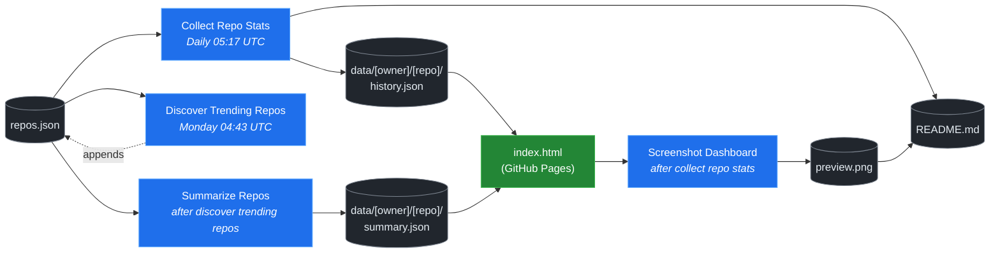

# 🚀 Rising Repos Tracker

> Automatically tracks daily GitHub stats (stars, forks, issues, velocity) for rising open source repos.

[](https://www.telosignal.com/)


**[→ View Live Dashboard](https://patrick-creates.github.io/rising-repos-tracker/)**

Built and maintained by [Telosignal](https://www.telosignal.com/).


<!-- AUTOGEN-STATS-START -->
## 📊 Current snapshot

> Auto-updated daily — last refreshed 2026-10-21

| Metric | Value |
|---|---|
| Repos tracked | **220** |
| Total stars | **11,440,525** |
| Total forks | **1,681,885** |
| Fastest growing | **rea** (+24259.2/day) |

### 🔥 Top 5 by velocity

| # | Repo | Stars | Stars/day |
|---|---|---:|---:|
| 1 | [morluto/rea](https://github.com/morluto/rea) | 352,562 | +24259.2 |
| 2 | [Ebony-Vinyl/dsh-our-free-model](https://github.com/Ebony-Vinyl/dsh-our-free-model) | 32,236 | +2844.0 |
| 3 | [debpalash/VoiceStudio](https://github.com/debpalash/VoiceStudio) | 79,551 | +1348.5 |
| 4 | [DietrichGebert/ponytail](https://github.com/DietrichGebert/ponytail) | 170,546 | +1012.6 |
| 5 | [stablyai/orca](https://github.com/stablyai/orca) | 100,401 | +820.7 |

### 🆕 Recently added

- [paperclipai/paperclip](https://github.com/paperclipai/paperclip) — added 2026-10-19 — The open-source app everyone uses to manage agents at work
- [Ebony-Vinyl/dsh-our-free-model](https://github.com/Ebony-Vinyl/dsh-our-free-model) — added 2026-10-19 — 在 dsh 里装上这个插件即可，无需登录、注册或填 API Key，就能使用包括 DeepSeek V4.1 Flash、Kimi K3 在内的前沿模型——完全免费，不限量。 All you do is install this plugin in dsh: no login, no sign-up, no API key — the frontier models are just there, DeepSeek V4.1 Flash and Kimi K3 among them. Completely free, with no usage cap.
- [trailhq/Trail-Code](https://github.com/trailhq/Trail-Code) — added 2026-10-19 — Turbocharge Claude Code, Cursor, Codex, Gemini & every coding agent: faster, cheaper, with contextual understanding specific to your codebase.
<!-- AUTOGEN-STATS-END -->

<!-- AUTOGEN-DIAGRAM-START -->
## 🔄 How it works


<!-- AUTOGEN-DIAGRAM-END -->

<!-- AUTOGEN-WORKFLOWS-START -->
## ⚙️ Workflows

| File | Schedule | Name |
|---|---|---|
| `collect.yml` | Daily 05:17 UTC | Collect Repo Stats |
| `discover.yml` | Monday 04:43 UTC | Discover Trending Repos |
| `screenshot.yml` | After Collect Repo Stats | Screenshot Dashboard |
| `summarize.yml` | After Discover Trending Repos | Summarize Repos |

> All workflows commit results directly back to the repo. Schedules are best-effort — GitHub Actions cron can drift by a few minutes.
<!-- AUTOGEN-WORKFLOWS-END -->

<!-- AUTOGEN-REPOS-START -->
## 📋 All tracked repos

| Repo | Stars | Forks | Stars/day |
|---|---:|---:|---:|
| [openclaw/openclaw](https://github.com/openclaw/openclaw) | 392,645 | 82,539 | +131.5 |
| [morluto/rea](https://github.com/morluto/rea) | 352,562 | 88,582 | +24259.2 |
| [obra/superpowers](https://github.com/obra/superpowers) | 302,818 | 26,985 | +555.7 |
| [affaan-m/ECC](https://github.com/affaan-m/ECC) | 285,160 | 42,297 | +623.7 |
| [affaan-m/everything-claude-code](https://github.com/affaan-m/everything-claude-code) | 285,159 | 42,297 | +646.7 |
| [NousResearch/hermes-agent](https://github.com/NousResearch/hermes-agent) | 255,727 | 55,734 | +668.8 |
| [microsoft/markitdown](https://github.com/microsoft/markitdown) | 191,385 | 14,253 | +424.7 |
| [Significant-Gravitas/AutoGPT](https://github.com/Significant-Gravitas/AutoGPT) | 187,688 | 45,913 | +21.2 |
| [f/prompts.chat](https://github.com/f/prompts.chat) | 173,772 | 22,221 | +72.0 |
| [DietrichGebert/ponytail](https://github.com/DietrichGebert/ponytail) | 170,546 | 9,278 | +1012.6 |
| [langgenius/dify](https://github.com/langgenius/dify) | 159,112 | 25,148 | +111.1 |
| [open-webui/open-webui](https://github.com/open-webui/open-webui) | 156,341 | 22,760 | +120.8 |
| [langchain-ai/langchain](https://github.com/langchain-ai/langchain) | 148,185 | 24,867 | +71.7 |
| [farion1231/cc-switch](https://github.com/farion1231/cc-switch) | 147,070 | 9,701 | +468.1 |
| [github/spec-kit](https://github.com/github/spec-kit) | 142,239 | 12,731 | +275.6 |
| [nextlevelbuilder/ui-ux-pro-max-skill](https://github.com/nextlevelbuilder/ui-ux-pro-max-skill) | 138,203 | 14,650 | +374.6 |
| [Graphify-Labs/graphify](https://github.com/Graphify-Labs/graphify) | 130,798 | 12,570 | +396.5 |
| [microsoft/generative-ai-for-beginners](https://github.com/microsoft/generative-ai-for-beginners) | 121,797 | 64,247 | +68.6 |
| [JuliusBrussee/caveman](https://github.com/JuliusBrussee/caveman) | 113,970 | 6,564 | +336.3 |
| [paperclipai/paperclip](https://github.com/paperclipai/paperclip) | 105,415 | 17,554 | +504.5 |
| [nexu-io/open-design](https://github.com/nexu-io/open-design) | 102,931 | 11,793 | +376.6 |
| [thedotmack/claude-mem](https://github.com/thedotmack/claude-mem) | 102,043 | 8,985 | +165.6 |
| [Panniantong/Agent-Reach](https://github.com/Panniantong/Agent-Reach) | 100,437 | 8,850 | +570.1 |
| [stablyai/orca](https://github.com/stablyai/orca) | 100,401 | 6,351 | +820.7 |
| [Leonxlnx/taste-skill](https://github.com/Leonxlnx/taste-skill) | 100,137 | 6,772 | +491.0 |
| [ruvnet/RuView](https://github.com/ruvnet/RuView) | 98,964 | 12,955 | +222.0 |
| [vllm-project/vllm](https://github.com/vllm-project/vllm) | 94,627 | 23,704 | +91.6 |
| [OpenHands/OpenHands](https://github.com/OpenHands/OpenHands) | 91,451 | 12,137 | +112.3 |
| [koala73/worldmonitor](https://github.com/koala73/worldmonitor) | 89,011 | 13,662 | +222.1 |
| [ChatGPTNextWeb/NextChat](https://github.com/ChatGPTNextWeb/NextChat) | 88,877 | 58,755 | +5.4 |
| [tt-a1i/archify](https://github.com/tt-a1i/archify) | 86,745 | 5,845 | +557.0 |
| [rtk-ai/rtk](https://github.com/rtk-ai/rtk) | 84,145 | 5,348 | +221.6 |
| [datawhalechina/hello-agents](https://github.com/datawhalechina/hello-agents) | 84,020 | 10,417 | +213.8 |
| [lobehub/lobehub](https://github.com/lobehub/lobehub) | 83,376 | 16,005 | +39.6 |
| [debpalash/VoiceStudio](https://github.com/debpalash/VoiceStudio) | 79,551 | 8,750 | +1348.5 |
| [dair-ai/Prompt-Engineering-Guide](https://github.com/dair-ai/Prompt-Engineering-Guide) | 79,400 | 8,715 | +30.1 |
| [diegosouzapw/OmniRoute](https://github.com/diegosouzapw/OmniRoute) | 79,135 | 11,513 | +626.0 |
| [shareAI-lab/learn-claude-code](https://github.com/shareAI-lab/learn-claude-code) | 78,936 | 12,622 | +114.5 |
| [unslothai/unsloth](https://github.com/unslothai/unsloth) | 78,347 | 7,250 | +88.8 |
| [ruvnet/ruflo](https://github.com/ruvnet/ruflo) | 78,049 | 9,180 | +259.9 |
| [ComposioHQ/awesome-claude-skills](https://github.com/ComposioHQ/awesome-claude-skills) | 77,566 | 9,245 | +110.1 |
| [chopratejas/headroom](https://github.com/chopratejas/headroom) | 76,941 | 5,972 | +381.1 |
| [headroomlabs-ai/headroom](https://github.com/headroomlabs-ai/headroom) | 76,941 | 5,972 | +256.5 |
| [openai/openai-cookbook](https://github.com/openai/openai-cookbook) | 76,729 | 12,962 | +20.0 |
| [santifer/career-ops](https://github.com/santifer/career-ops) | 76,181 | 14,133 | +198.3 |
| [career-ops-hq/career-ops](https://github.com/career-ops-hq/career-ops) | 76,181 | 14,134 | +131.8 |
| [Fission-AI/OpenSpec](https://github.com/Fission-AI/OpenSpec) | 72,602 | 4,959 | +152.7 |
| [rohitg00/ai-engineering-from-scratch](https://github.com/rohitg00/ai-engineering-from-scratch) | 71,935 | 12,665 | +320.9 |
| [usestrix/strix](https://github.com/usestrix/strix) | 70,593 | 7,831 | +316.1 |
| [calesthio/OpenMontage](https://github.com/calesthio/OpenMontage) | 70,460 | 9,089 | +373.8 |
| [code-yeongyu/oh-my-openagent](https://github.com/code-yeongyu/oh-my-openagent) | 70,236 | 5,779 | +76.3 |
| [asgeirtj/system_prompts_leaks](https://github.com/asgeirtj/system_prompts_leaks) | 69,969 | 11,345 | +189.6 |
| [heygen-com/hyperframes](https://github.com/heygen-com/hyperframes) | 68,793 | 6,219 | +320.2 |
| [shanraisshan/claude-code-best-practice](https://github.com/shanraisshan/claude-code-best-practice) | 67,856 | 6,754 | +92.0 |
| [xtekky/gpt4free](https://github.com/xtekky/gpt4free) | 66,914 | 13,466 | +4.3 |
| [ZhuLinsen/daily_stock_analysis](https://github.com/ZhuLinsen/daily_stock_analysis) | 66,814 | 55,502 | +187.8 |
| [mvanhorn/last30days-skill](https://github.com/mvanhorn/last30days-skill) | 64,923 | 5,648 | +238.9 |
| [tw93/Pake](https://github.com/tw93/Pake) | 62,236 | 12,801 | +86.3 |
| [MadsLorentzen/ai-job-search](https://github.com/MadsLorentzen/ai-job-search) | 61,908 | 19,140 | +403.3 |
| [BerriAI/litellm](https://github.com/BerriAI/litellm) | 61,706 | 12,534 | +91.8 |
| [MemPalace/mempalace](https://github.com/MemPalace/mempalace) | 59,674 | 7,570 | +46.6 |
| [blader/humanizer](https://github.com/blader/humanizer) | 59,070 | 4,686 | +285.1 |
| [jamiepine/voicebox](https://github.com/jamiepine/voicebox) | 58,139 | 7,296 | +205.0 |
| [hesreallyhim/awesome-claude-code](https://github.com/hesreallyhim/awesome-claude-code) | 56,145 | 4,847 | +77.2 |
| [router-for-me/CLIProxyAPI](https://github.com/router-for-me/CLIProxyAPI) | 55,867 | 8,538 | +141.8 |
| [coreyhaines31/marketingskills](https://github.com/coreyhaines31/marketingskills) | 55,744 | 8,249 | +171.2 |
| [FlowiseAI/Flowise](https://github.com/FlowiseAI/Flowise) | 55,512 | 25,071 | +16.7 |
| [bojieli/ai-agent-book](https://github.com/bojieli/ai-agent-book) | 55,232 | 6,322 | +508.4 |
| [ggml-org/whisper.cpp](https://github.com/ggml-org/whisper.cpp) | 54,531 | 6,227 | +30.2 |
| [ChromeDevTools/chrome-devtools-mcp](https://github.com/ChromeDevTools/chrome-devtools-mcp) | 53,922 | 6,549 | +90.0 |
| [K-Dense-AI/scientific-agent-skills](https://github.com/K-Dense-AI/scientific-agent-skills) | 53,428 | 4,720 | +226.2 |
| [Imbad0202/academic-research-skills](https://github.com/Imbad0202/academic-research-skills) | 53,264 | 4,086 | +157.8 |
| [elder-plinius/CL4R1T4S](https://github.com/elder-plinius/CL4R1T4S) | 51,426 | 10,522 | +97.9 |
| [QuantumNous/new-api](https://github.com/QuantumNous/new-api) | 50,390 | 12,170 | +100.9 |
| [kepano/obsidian-skills](https://github.com/kepano/obsidian-skills) | 49,846 | 3,527 | +112.4 |
| [Aider-AI/aider](https://github.com/Aider-AI/aider) | 49,678 | 5,091 | +30.2 |
| [HKUDS/nanobot](https://github.com/HKUDS/nanobot) | 49,239 | 8,657 | +42.0 |
| [sickn33/antigravity-awesome-skills](https://github.com/sickn33/antigravity-awesome-skills) | 48,235 | 7,025 | +64.1 |
| [sickn33/agentic-awesome-skills](https://github.com/sickn33/agentic-awesome-skills) | 48,235 | 7,025 | +51.9 |
| [alibaba/open-code-review](https://github.com/alibaba/open-code-review) | 47,788 | 3,490 | +353.3 |
| [zhayujie/CowAgent](https://github.com/zhayujie/CowAgent) | 47,495 | 10,397 | +18.8 |
| [DeusData/codebase-memory-mcp](https://github.com/DeusData/codebase-memory-mcp) | 47,075 | 3,865 | +232.0 |
| [danny-avila/LibreChat](https://github.com/danny-avila/LibreChat) | 46,105 | 9,476 | +58.0 |
| [LibreChat-AI/LibreChat](https://github.com/LibreChat-AI/LibreChat) | 46,105 | 9,476 | +47.0 |
| [ogulcancelik/herdr](https://github.com/ogulcancelik/herdr) | 45,099 | 3,565 | +305.6 |
| [herdrdev/herdr](https://github.com/herdrdev/herdr) | 45,099 | 3,565 | +269.7 |
| [chatanywhere/GPT_API_free](https://github.com/chatanywhere/GPT_API_free) | 44,597 | 2,749 | +43.2 |
| [langchain-ai/langgraph](https://github.com/langchain-ai/langgraph) | 43,633 | 7,466 | +67.9 |
| [anthropics/claude-plugins-official](https://github.com/anthropics/claude-plugins-official) | 43,497 | 4,595 | +102.0 |
| [AstrBotDevs/AstrBot](https://github.com/AstrBotDevs/AstrBot) | 42,549 | 3,109 | +63.1 |
| [tinyhumansai/openhuman](https://github.com/tinyhumansai/openhuman) | 42,202 | 4,170 | +61.7 |
| [chatboxai/chatbox](https://github.com/chatboxai/chatbox) | 42,085 | 4,280 | +13.4 |
| [wshobson/agents](https://github.com/wshobson/agents) | 41,390 | 4,400 | +36.6 |
| [Hmbown/CodeWhale](https://github.com/Hmbown/CodeWhale) | 41,103 | 3,568 | +43.2 |
| [Hmbown/Codewhale](https://github.com/Hmbown/Codewhale) | 41,103 | 3,568 | +4.3 |
| [codewhale-hq/Codewhale](https://github.com/codewhale-hq/Codewhale) | 41,103 | 3,568 | +3.4 |
| [volcengine/OpenViking](https://github.com/volcengine/OpenViking) | 40,494 | 3,262 | +112.3 |
| [github/awesome-copilot](https://github.com/github/awesome-copilot) | 40,259 | 5,172 | +43.3 |
| [Yeachan-Heo/oh-my-claudecode](https://github.com/Yeachan-Heo/oh-my-claudecode) | 40,136 | 3,594 | +35.7 |
| [mindsdb/mindshub](https://github.com/mindsdb/mindshub) | 39,800 | 6,242 | +4.0 |
| [google/langextract](https://github.com/google/langextract) | 38,982 | 2,721 | +16.3 |
| [AlexsJones/llmfit](https://github.com/AlexsJones/llmfit) | 38,183 | 2,464 | +78.7 |
| [PDFMathTranslate/PDFMathTranslate](https://github.com/PDFMathTranslate/PDFMathTranslate) | 37,720 | 3,377 | +24.9 |
| [songquanpeng/one-api](https://github.com/songquanpeng/one-api) | 37,215 | 6,889 | +20.2 |
| [JCodesMore/ai-website-cloner-template](https://github.com/JCodesMore/ai-website-cloner-template) | 37,084 | 5,441 | +157.0 |
| [HKUDS/Vibe-Trading](https://github.com/HKUDS/Vibe-Trading) | 36,101 | 5,848 | +187.4 |
| [can1357/oh-my-pi](https://github.com/can1357/oh-my-pi) | 36,099 | 4,002 | +182.7 |
| [p-e-w/heretic](https://github.com/p-e-w/heretic) | 36,047 | 4,081 | +89.4 |
| [esengine/DeepSeek-Reasonix](https://github.com/esengine/DeepSeek-Reasonix) | 35,897 | 2,470 | +121.3 |
| [agentscope-ai/QwenPaw](https://github.com/agentscope-ai/QwenPaw) | 35,896 | 3,197 | +141.5 |
| [virgiliojr94/book-to-skill](https://github.com/virgiliojr94/book-to-skill) | 35,532 | 3,756 | +184.5 |
| [Tencent/WeKnora](https://github.com/Tencent/WeKnora) | 34,951 | 4,677 | +145.8 |
| [mukul975/Anthropic-Cybersecurity-Skills](https://github.com/mukul975/Anthropic-Cybersecurity-Skills) | 34,781 | 4,233 | +137.7 |
| [Gitlawb/openclaude](https://github.com/Gitlawb/openclaude) | 34,060 | 9,129 | +41.7 |
| [Twigpine/openclaude](https://github.com/Twigpine/openclaude) | 34,060 | 9,129 | +25.9 |
| [iOfficeAI/AionUi](https://github.com/iOfficeAI/AionUi) | 33,670 | 3,498 | +44.5 |
| [zeroclaw-labs/zeroclaw](https://github.com/zeroclaw-labs/zeroclaw) | 33,021 | 4,986 | +9.5 |
| [tirth8205/code-review-graph](https://github.com/tirth8205/code-review-graph) | 32,295 | 2,975 | +107.7 |
| [iOfficeAI/OfficeCLI](https://github.com/iOfficeAI/OfficeCLI) | 32,253 | 2,200 | +223.0 |
| [Ebony-Vinyl/dsh-our-free-model](https://github.com/Ebony-Vinyl/dsh-our-free-model) | 32,236 | 712 | +2844.0 |
| [googleworkspace/cli](https://github.com/googleworkspace/cli) | 31,747 | 1,961 | +35.4 |
| [mksglu/context-mode](https://github.com/mksglu/context-mode) | 31,533 | 2,215 | +109.9 |
| [decolua/9router](https://github.com/decolua/9router) | 31,143 | 6,014 | +106.0 |
| [ifixai-ai/iFixAi](https://github.com/ifixai-ai/iFixAi) | 30,982 | 1,608 | +316.8 |
| [jackwener/OpenCLI](https://github.com/jackwener/OpenCLI) | 30,492 | 2,987 | +49.6 |
| [langchain-ai/deepagents](https://github.com/langchain-ai/deepagents) | 30,473 | 4,294 | +46.8 |
| [rohitg00/agentmemory](https://github.com/rohitg00/agentmemory) | 29,736 | 2,629 | +58.6 |
| [TencentCloud/TencentDB-Agent-Memory](https://github.com/TencentCloud/TencentDB-Agent-Memory) | 29,728 | 2,894 | +210.1 |
| [alibaba/page-agent](https://github.com/alibaba/page-agent) | 29,526 | 2,685 | +85.7 |
| [voideditor/void](https://github.com/voideditor/void) | 28,745 | 2,656 | — |
| [jarrodwatts/claude-hud](https://github.com/jarrodwatts/claude-hud) | 28,708 | 1,329 | +29.8 |
| [BloopAI/vibe-kanban](https://github.com/BloopAI/vibe-kanban) | 28,416 | 3,034 | +12.0 |
| [manaflow-ai/cmux](https://github.com/manaflow-ai/cmux) | 28,317 | 2,565 | +39.6 |
| [t8y2/dbx](https://github.com/t8y2/dbx) | 27,438 | 2,449 | +181.4 |
| [zai-org/Open-AutoGLM](https://github.com/zai-org/Open-AutoGLM) | 26,443 | 4,050 | +7.3 |
| [toon-format/toon](https://github.com/toon-format/toon) | 25,535 | 1,148 | +7.7 |
| [pascalorg/editor](https://github.com/pascalorg/editor) | 25,024 | 3,114 | +52.4 |
| [guillaumemeyer/watermarks-remover](https://github.com/guillaumemeyer/watermarks-remover) | 24,584 | 2,814 | +121.2 |
| [hypit-ai/hypit](https://github.com/hypit-ai/hypit) | 24,477 | 2,767 | +320.8 |
| [every-app/open-seo](https://github.com/every-app/open-seo) | 24,373 | 3,292 | +154.5 |
| [jundot/omlx](https://github.com/jundot/omlx) | 22,973 | 2,062 | +49.5 |
| [pranshuparmar/witr](https://github.com/pranshuparmar/witr) | 22,738 | 818 | +41.3 |
| [steipete/CodexBar](https://github.com/steipete/CodexBar) | 22,708 | 2,142 | +62.0 |
| [winfunc/opcode](https://github.com/winfunc/opcode) | 22,417 | 1,737 | +3.1 |
| [coze-dev/coze-studio](https://github.com/coze-dev/coze-studio) | 21,738 | 3,130 | +5.9 |
| [NirDiamant/agents-towards-production](https://github.com/NirDiamant/agents-towards-production) | 21,737 | 2,878 | +8.2 |
| [KKKKhazix/khazix-skills](https://github.com/KKKKhazix/khazix-skills) | 21,555 | 2,288 | +44.1 |
| [jnMetaCode/agency-agents-zh](https://github.com/jnMetaCode/agency-agents-zh) | 21,464 | 3,488 | +50.1 |
| [1jehuang/jcode](https://github.com/1jehuang/jcode) | 21,087 | 2,449 | +127.8 |
| [walkinglabs/learn-harness-engineering](https://github.com/walkinglabs/learn-harness-engineering) | 21,071 | 2,358 | +104.5 |
| [NVIDIA/SkillSpector](https://github.com/NVIDIA/SkillSpector) | 20,761 | 1,823 | +97.9 |
| [datawhalechina/easy-vibe](https://github.com/datawhalechina/easy-vibe) | 20,081 | 1,941 | +24.5 |
| [tanweai/pua](https://github.com/tanweai/pua) | 19,722 | 1,201 | +11.5 |
| [danielmiessler/LifeOS](https://github.com/danielmiessler/LifeOS) | 19,538 | 2,498 | +28.7 |
| [AgriciDaniel/claude-seo](https://github.com/AgriciDaniel/claude-seo) | 19,502 | 2,835 | +70.7 |
| [jlcodes99/cockpit-tools](https://github.com/jlcodes99/cockpit-tools) | 19,183 | 1,703 | +51.5 |
| [nesquena/hermes-webui](https://github.com/nesquena/hermes-webui) | 19,072 | 2,761 | +35.0 |
| [microsoft/agent-lightning](https://github.com/microsoft/agent-lightning) | 18,778 | 1,720 | +11.5 |
| [browser-use/browser-harness](https://github.com/browser-use/browser-harness) | 18,530 | 1,851 | +26.8 |
| [RightNow-AI/openfang](https://github.com/RightNow-AI/openfang) | 18,213 | 2,317 | +3.0 |
| [wanshuiyin/Auto-claude-code-research-in-sleep](https://github.com/wanshuiyin/Auto-claude-code-research-in-sleep) | 17,824 | 1,506 | +44.3 |
| [rocketride-org/rocketride-server](https://github.com/rocketride-org/rocketride-server) | 17,725 | 7,507 | — |
| [tradecatlabs/vibe-coding-cn](https://github.com/tradecatlabs/vibe-coding-cn) | 17,705 | 1,806 | +40.3 |
| [MemoriLabs/Memori](https://github.com/MemoriLabs/Memori) | 17,150 | 3,727 | +14.9 |
| [cft0808/edict](https://github.com/cft0808/edict) | 17,006 | 1,796 | +7.4 |
| [composio-community/awesome-codex-skills](https://github.com/composio-community/awesome-codex-skills) | 16,979 | 1,707 | +17.9 |
| [xbtlin/ai-berkshire](https://github.com/xbtlin/ai-berkshire) | 16,820 | 2,500 | +56.5 |
| [xpzouying/xiaohongshu-mcp](https://github.com/xpzouying/xiaohongshu-mcp) | 16,415 | 2,440 | +17.6 |
| [Anionex/banana-slides](https://github.com/Anionex/banana-slides) | 15,811 | 1,797 | +5.6 |
| [dataelement/dsh-desktop](https://github.com/dataelement/dsh-desktop) | 15,799 | 537 | +259.1 |
| [superset-sh/superset](https://github.com/superset-sh/superset) | 15,427 | 1,360 | +28.7 |
| [yusufkaraaslan/Skill_Seekers](https://github.com/yusufkaraaslan/Skill_Seekers) | 15,194 | 1,575 | +8.0 |
| [NanmiCoder/cc-haha](https://github.com/NanmiCoder/cc-haha) | 15,092 | 8,602 | +15.4 |
| [kyegomez/OpenMythos](https://github.com/kyegomez/OpenMythos) | 14,909 | 3,275 | +6.2 |
| [NevaMind-AI/memU](https://github.com/NevaMind-AI/memU) | 14,553 | 1,088 | +5.4 |
| [XiaomiMiMo/MiMo-Code](https://github.com/XiaomiMiMo/MiMo-Code) | 13,697 | 1,463 | +23.4 |
| [EverMind-AI/EverOS](https://github.com/EverMind-AI/EverOS) | 13,550 | 953 | +33.6 |
| [sirmalloc/ccstatusline](https://github.com/sirmalloc/ccstatusline) | 13,360 | 594 | +18.2 |
| [ConardLi/garden-skills](https://github.com/ConardLi/garden-skills) | 13,060 | 1,554 | +36.3 |
| [0x4m4/hexstrike-ai](https://github.com/0x4m4/hexstrike-ai) | 12,986 | 2,660 | +26.1 |
| [brokermr810/QuantDinger](https://github.com/brokermr810/QuantDinger) | 12,976 | 2,669 | +34.5 |
| [OpenByteInc/QuantDinger](https://github.com/OpenByteInc/QuantDinger) | 12,976 | 2,669 | +34.1 |
| [MemTensor/MemOS](https://github.com/MemTensor/MemOS) | 11,997 | 1,116 | +17.3 |
| [getagentseal/codeburn](https://github.com/getagentseal/codeburn) | 11,540 | 901 | +28.7 |
| [EKKOLearnAI/hermes-studio](https://github.com/EKKOLearnAI/hermes-studio) | 11,497 | 1,420 | +24.6 |
| [EKKOLearnAI/ekko-studio](https://github.com/EKKOLearnAI/ekko-studio) | 11,497 | 1,420 | +11.9 |
| [holaboss-ai/holaOS](https://github.com/holaboss-ai/holaOS) | 11,460 | 767 | +47.5 |
| [openai/codex-security](https://github.com/openai/codex-security) | 11,149 | 877 | +36.3 |
| [aden-hive/hive](https://github.com/aden-hive/hive) | 11,113 | 5,645 | +4.4 |
| [ValueCell-ai/valuecell](https://github.com/ValueCell-ai/valuecell) | 11,026 | 1,803 | +1.4 |
| [TencentCloud/Octop](https://github.com/TencentCloud/Octop) | 10,563 | 1,330 | +191.8 |
| [trailhq/Graft](https://github.com/trailhq/Graft) | 10,561 | 931 | +80.3 |
| [trailhq/Trail-Code](https://github.com/trailhq/Trail-Code) | 10,561 | 931 | +67.5 |
| [Kuberwastaken/claurst](https://github.com/Kuberwastaken/claurst) | 10,324 | 7,702 | +4.0 |
| [StarTrail-org/PixelRAG](https://github.com/StarTrail-org/PixelRAG) | 10,323 | 910 | +37.4 |
| [ykdojo/claude-code-tips](https://github.com/ykdojo/claude-code-tips) | 10,256 | 845 | +11.6 |
| [genspark-ai/genoffice](https://github.com/genspark-ai/genoffice) | 10,245 | 1,326 | +95.2 |
| [Companion-Inc/feynman](https://github.com/Companion-Inc/feynman) | 10,005 | 1,105 | +8.4 |
| [frankbria/ralph-claude-code](https://github.com/frankbria/ralph-claude-code) | 9,711 | 731 | +3.7 |
| [modem-dev/hunk](https://github.com/modem-dev/hunk) | 9,649 | 322 | +29.4 |
| [Nasiko-Labs/nasiko](https://github.com/Nasiko-Labs/nasiko) | 9,461 | 2,039 | +19.7 |
| [1weiho/open-slide](https://github.com/1weiho/open-slide) | 9,322 | 673 | +44.5 |
| [open-slide/open-slide](https://github.com/open-slide/open-slide) | 9,322 | 673 | +45.3 |
| [Tencent/BrowserSkill](https://github.com/Tencent/BrowserSkill) | 9,321 | 668 | +72.2 |
| [iflytek/astron-agent](https://github.com/iflytek/astron-agent) | 8,921 | 903 | +2.9 |
| [EvoMap/evolver](https://github.com/EvoMap/evolver) | 8,690 | 840 | — |
| [MiroMindAI/MiroThinker](https://github.com/MiroMindAI/MiroThinker) | 8,423 | 649 | +0.9 |
| [mmulet/term.everything](https://github.com/mmulet/term.everything) | 8,117 | 196 | +0.9 |
| [rorkai/App-Store-Connect-CLI](https://github.com/rorkai/App-Store-Connect-CLI) | 8,003 | 683 | +25.1 |
| [WenyuChiou/awesome-agentic-ai-zh](https://github.com/WenyuChiou/awesome-agentic-ai-zh) | 7,815 | 1,021 | +24.8 |
| [ValueCell-ai/ClawX](https://github.com/ValueCell-ai/ClawX) | 7,602 | 1,141 | +0.6 |
| [opensquilla/opensquilla](https://github.com/opensquilla/opensquilla) | 7,115 | 585 | +9.7 |
| [TokenRhythm/opensquilla](https://github.com/TokenRhythm/opensquilla) | 7,115 | 585 | +3.3 |
| [tech-leads-club/agent-skills](https://github.com/tech-leads-club/agent-skills) | 7,077 | 561 | +16.9 |
| [Andyyyy64/whichllm](https://github.com/Andyyyy64/whichllm) | 6,777 | 373 | +9.8 |
| [steipete/summarize](https://github.com/steipete/summarize) | 6,730 | 454 | +3.2 |
| [Arthur-Ficial/apfel](https://github.com/Arthur-Ficial/apfel) | 6,509 | 248 | +3.9 |
| [microsoft/fara](https://github.com/microsoft/fara) | 6,221 | 603 | +2.2 |
| [UfoMiao/zcf](https://github.com/UfoMiao/zcf) | 6,081 | 424 | +0.1 |
| [re4/LibreCode](https://github.com/re4/LibreCode) | 88 | 4 | — |
<!-- AUTOGEN-REPOS-END -->

---

## What it does

- Collects daily snapshots of stars, forks, watchers and open issues for every tracked repo
- Discovers new trending repos automatically every Monday using the GitHub Search API
- Generates AI summaries (use cases, similar tools, tags) for each tracked repo via GitHub Models
- Stores all history as plain JSON — no database, no backend
- Renders a live dashboard via GitHub Pages — updates daily, zero maintenance

## Tracked repos

Data lives in [`data/`](./data) — one folder per repo, one `history.json` per entry.  
The full watch list is in [`repos.json`](./repos.json).

## Fork & use it for yourself

This is my personal tracker — the watch list reflects what I find interesting. If you want to track different repos, the best path is to **fork this repo and run your own**.

### Setup

1. Fork this repo to your account
2. Replace the contents of [`repos.json`](./repos.json) with the repos you want to track (or just leave one entry — `discover.yml` will auto-add more every Monday)
3. Go to **Settings → Pages** and enable GitHub Pages from the `main` branch
4. Go to **Actions** and run **Collect Repo Stats** once manually to seed your first data point
5. Your dashboard will be live at `https://YOUR-USERNAME.github.io/rising-repos-tracker/`

That's it — daily collection and weekly discovery run automatically on schedule. Zero ongoing maintenance.

### Customizing what gets discovered

Edit [`scripts/discover.js`](./scripts/discover.js) to change:

- `MIN_STARS` — minimum star threshold for candidates
- `MAX_AGE_DAYS` — how recent a repo must be
- `MAX_NEW_REPOS` — how many to add per discovery run
- The `queries` array — GitHub Search API queries that define what "trending" means to you

### Adding a repo manually

Just edit `repos.json` directly:

```json
{
  "owner": "OWNER",
  "repo": "REPO",
  "added": "YYYY-MM-DD",
  "notes": "why you're tracking this"
}
```

The next daily collect run picks it up automatically.

## Stack

- **GitHub Actions** — scheduling and automation
- **GitHub Pages** — dashboard hosting
- **GitHub API** — data source
- **GitHub Models** — free AI summaries (gpt-4o-mini)
- **Chart.js** — star growth visualization
- **Mermaid** — architecture diagram (rendered by GitHub)
- No dependencies, no build step, no database

## License

MIT
