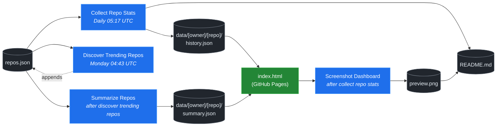

# 🚀 Rising Repos Tracker

> Automatically tracks daily GitHub stats (stars, forks, issues, velocity) for rising open source repos.

[](https://www.telosignal.com/)


**[→ View Live Dashboard](https://patrick-creates.github.io/rising-repos-tracker/)**

Built and maintained by [Telosignal](https://www.telosignal.com/).


<!-- AUTOGEN-STATS-START -->
## 📊 Current snapshot

> Auto-updated daily — last refreshed 2026-10-23

| Metric | Value |
|---|---|
| Repos tracked | **220** |
| Total stars | **11,519,870** |
| Total forks | **1,692,080** |
| Fastest growing | **rea** (+21389.5/day) |

### 🔥 Top 5 by velocity

| # | Repo | Stars | Stars/day |
|---|---|---:|---:|
| 1 | [morluto/rea](https://github.com/morluto/rea) | 369,513 | +21389.5 |
| 2 | [Ebony-Vinyl/dsh-our-free-model](https://github.com/Ebony-Vinyl/dsh-our-free-model) | 38,026 | +2869.5 |
| 3 | [debpalash/VoiceStudio](https://github.com/debpalash/VoiceStudio) | 82,267 | +1348.9 |
| 4 | [DietrichGebert/ponytail](https://github.com/DietrichGebert/ponytail) | 174,253 | +1026.3 |
| 5 | [stablyai/orca](https://github.com/stablyai/orca) | 103,249 | +831.8 |

### 🆕 Recently added

- [paperclipai/paperclip](https://github.com/paperclipai/paperclip) — added 2026-10-19 — The open-source app everyone uses to manage agents at work
- [Ebony-Vinyl/dsh-our-free-model](https://github.com/Ebony-Vinyl/dsh-our-free-model) — added 2026-10-19 — 在 dsh 里装上这个插件即可，无需登录、注册或填 API Key，就能使用包括 DeepSeek V4.1 Flash、Kimi K3 在内的前沿模型——完全免费，不限量。 All you do is install this plugin in dsh: no login, no sign-up, no API key — the frontier models are just there, DeepSeek V4.1 Flash and Kimi K3 among them. Completely free, with no usage cap.
- [trailhq/Trail-Code](https://github.com/trailhq/Trail-Code) — added 2026-10-19 — Turbocharge Claude Code, Cursor, Codex, Gemini & every coding agent: faster, cheaper, with contextual understanding specific to your codebase.
<!-- AUTOGEN-STATS-END -->

<!-- AUTOGEN-DIAGRAM-START -->
## 🔄 How it works


<!-- AUTOGEN-DIAGRAM-END -->

<!-- AUTOGEN-WORKFLOWS-START -->
## ⚙️ Workflows

| File | Schedule | Name |
|---|---|---|
| `collect.yml` | Daily 05:17 UTC | Collect Repo Stats |
| `discover.yml` | Monday 04:43 UTC | Discover Trending Repos |
| `screenshot.yml` | After Collect Repo Stats | Screenshot Dashboard |
| `summarize.yml` | After Discover Trending Repos | Summarize Repos |

> All workflows commit results directly back to the repo. Schedules are best-effort — GitHub Actions cron can drift by a few minutes.
<!-- AUTOGEN-WORKFLOWS-END -->

<!-- AUTOGEN-REPOS-START -->
## 📋 All tracked repos

| Repo | Stars | Forks | Stars/day |
|---|---:|---:|---:|
| [openclaw/openclaw](https://github.com/openclaw/openclaw) | 392,822 | 82,567 | +131.0 |
| [morluto/rea](https://github.com/morluto/rea) | 369,513 | 92,532 | +21389.5 |
| [obra/superpowers](https://github.com/obra/superpowers) | 303,943 | 27,071 | +555.8 |
| [affaan-m/everything-claude-code](https://github.com/affaan-m/everything-claude-code) | 286,837 | 42,542 | +649.0 |
| [affaan-m/ECC](https://github.com/affaan-m/ECC) | 286,837 | 42,542 | +626.5 |
| [NousResearch/hermes-agent](https://github.com/NousResearch/hermes-agent) | 256,374 | 56,022 | +664.6 |
| [microsoft/markitdown](https://github.com/microsoft/markitdown) | 191,734 | 14,293 | +421.6 |
| [Significant-Gravitas/AutoGPT](https://github.com/Significant-Gravitas/AutoGPT) | 187,714 | 45,905 | +21.1 |
| [DietrichGebert/ponytail](https://github.com/DietrichGebert/ponytail) | 174,253 | 9,487 | +1026.3 |
| [f/prompts.chat](https://github.com/f/prompts.chat) | 174,121 | 22,247 | +73.3 |
| [langgenius/dify](https://github.com/langgenius/dify) | 159,329 | 25,168 | +111.1 |
| [open-webui/open-webui](https://github.com/open-webui/open-webui) | 156,535 | 22,779 | +120.5 |
| [langchain-ai/langchain](https://github.com/langchain-ai/langchain) | 148,312 | 24,893 | +71.6 |
| [farion1231/cc-switch](https://github.com/farion1231/cc-switch) | 147,915 | 9,736 | +467.5 |
| [github/spec-kit](https://github.com/github/spec-kit) | 142,515 | 12,762 | +274.0 |
| [nextlevelbuilder/ui-ux-pro-max-skill](https://github.com/nextlevelbuilder/ui-ux-pro-max-skill) | 139,188 | 14,740 | +376.0 |
| [Graphify-Labs/graphify](https://github.com/Graphify-Labs/graphify) | 133,487 | 12,754 | +418.1 |
| [microsoft/generative-ai-for-beginners](https://github.com/microsoft/generative-ai-for-beginners) | 121,960 | 64,493 | +68.8 |
| [JuliusBrussee/caveman](https://github.com/JuliusBrussee/caveman) | 114,501 | 6,599 | +335.4 |
| [paperclipai/paperclip](https://github.com/paperclipai/paperclip) | 106,362 | 17,683 | +489.0 |
| [nexu-io/open-design](https://github.com/nexu-io/open-design) | 103,473 | 11,847 | +375.3 |
| [stablyai/orca](https://github.com/stablyai/orca) | 103,249 | 6,521 | +831.8 |
| [thedotmack/claude-mem](https://github.com/thedotmack/claude-mem) | 102,406 | 9,036 | +165.8 |
| [Leonxlnx/taste-skill](https://github.com/Leonxlnx/taste-skill) | 101,356 | 6,847 | +492.7 |
| [Panniantong/Agent-Reach](https://github.com/Panniantong/Agent-Reach) | 101,166 | 8,920 | +567.1 |
| [ruvnet/RuView](https://github.com/ruvnet/RuView) | 99,244 | 12,979 | +220.9 |
| [vllm-project/vllm](https://github.com/vllm-project/vllm) | 95,203 | 23,834 | +94.0 |
| [OpenHands/OpenHands](https://github.com/OpenHands/OpenHands) | 91,623 | 12,160 | +112.0 |
| [koala73/worldmonitor](https://github.com/koala73/worldmonitor) | 89,281 | 13,703 | +221.0 |
| [ChatGPTNextWeb/NextChat](https://github.com/ChatGPTNextWeb/NextChat) | 88,888 | 58,737 | +5.4 |
| [tt-a1i/archify](https://github.com/tt-a1i/archify) | 88,042 | 5,930 | +567.2 |
| [rtk-ai/rtk](https://github.com/rtk-ai/rtk) | 84,347 | 5,356 | +220.1 |
| [datawhalechina/hello-agents](https://github.com/datawhalechina/hello-agents) | 84,304 | 10,457 | +212.9 |
| [lobehub/lobehub](https://github.com/lobehub/lobehub) | 83,438 | 16,016 | +39.5 |
| [debpalash/VoiceStudio](https://github.com/debpalash/VoiceStudio) | 82,267 | 9,085 | +1348.9 |
| [diegosouzapw/OmniRoute](https://github.com/diegosouzapw/OmniRoute) | 80,058 | 11,668 | +623.0 |
| [dair-ai/Prompt-Engineering-Guide](https://github.com/dair-ai/Prompt-Engineering-Guide) | 79,453 | 8,713 | +30.1 |
| [shareAI-lab/learn-claude-code](https://github.com/shareAI-lab/learn-claude-code) | 79,076 | 12,645 | +113.9 |
| [ruvnet/ruflo](https://github.com/ruvnet/ruflo) | 78,609 | 9,239 | +262.1 |
| [unslothai/unsloth](https://github.com/unslothai/unsloth) | 78,460 | 7,269 | +88.4 |
| [ComposioHQ/awesome-claude-skills](https://github.com/ComposioHQ/awesome-claude-skills) | 77,726 | 9,293 | +109.7 |
| [chopratejas/headroom](https://github.com/chopratejas/headroom) | 77,607 | 6,022 | +380.3 |
| [headroomlabs-ai/headroom](https://github.com/headroomlabs-ai/headroom) | 77,607 | 6,022 | +257.8 |
| [openai/openai-cookbook](https://github.com/openai/openai-cookbook) | 76,772 | 12,961 | +20.0 |
| [santifer/career-ops](https://github.com/santifer/career-ops) | 76,699 | 14,205 | +199.1 |
| [career-ops-hq/career-ops](https://github.com/career-ops-hq/career-ops) | 76,699 | 14,205 | +137.3 |
| [Fission-AI/OpenSpec](https://github.com/Fission-AI/OpenSpec) | 72,820 | 4,973 | +152.1 |
| [rohitg00/ai-engineering-from-scratch](https://github.com/rohitg00/ai-engineering-from-scratch) | 72,605 | 12,767 | +321.1 |
| [usestrix/strix](https://github.com/usestrix/strix) | 71,269 | 7,932 | +316.4 |
| [calesthio/OpenMontage](https://github.com/calesthio/OpenMontage) | 71,029 | 9,182 | +372.2 |
| [heygen-com/hyperframes](https://github.com/heygen-com/hyperframes) | 70,317 | 6,366 | +326.7 |
| [code-yeongyu/oh-my-openagent](https://github.com/code-yeongyu/oh-my-openagent) | 70,287 | 5,779 | +75.7 |
| [asgeirtj/system_prompts_leaks](https://github.com/asgeirtj/system_prompts_leaks) | 70,087 | 11,352 | +188.0 |
| [shanraisshan/claude-code-best-practice](https://github.com/shanraisshan/claude-code-best-practice) | 67,929 | 6,759 | +91.3 |
| [ZhuLinsen/daily_stock_analysis](https://github.com/ZhuLinsen/daily_stock_analysis) | 66,929 | 55,570 | +186.0 |
| [xtekky/gpt4free](https://github.com/xtekky/gpt4free) | 66,925 | 13,462 | +4.3 |
| [mvanhorn/last30days-skill](https://github.com/mvanhorn/last30days-skill) | 65,172 | 5,651 | +237.2 |
| [MadsLorentzen/ai-job-search](https://github.com/MadsLorentzen/ai-job-search) | 63,790 | 19,735 | +413.8 |
| [tw93/Pake](https://github.com/tw93/Pake) | 62,278 | 12,818 | +85.4 |
| [BerriAI/litellm](https://github.com/BerriAI/litellm) | 61,885 | 12,590 | +91.8 |
| [blader/humanizer](https://github.com/blader/humanizer) | 59,800 | 4,743 | +291.5 |
| [MemPalace/mempalace](https://github.com/MemPalace/mempalace) | 59,708 | 7,574 | +46.3 |
| [jamiepine/voicebox](https://github.com/jamiepine/voicebox) | 58,304 | 7,319 | +203.3 |
| [hesreallyhim/awesome-claude-code](https://github.com/hesreallyhim/awesome-claude-code) | 56,298 | 4,852 | +77.2 |
| [coreyhaines31/marketingskills](https://github.com/coreyhaines31/marketingskills) | 56,138 | 8,294 | +171.5 |
| [router-for-me/CLIProxyAPI](https://github.com/router-for-me/CLIProxyAPI) | 56,046 | 8,575 | +141.1 |
| [bojieli/ai-agent-book](https://github.com/bojieli/ai-agent-book) | 55,561 | 6,364 | +501.1 |
| [FlowiseAI/Flowise](https://github.com/FlowiseAI/Flowise) | 55,520 | 25,074 | +16.6 |
| [ggml-org/whisper.cpp](https://github.com/ggml-org/whisper.cpp) | 54,581 | 6,235 | +30.1 |
| [K-Dense-AI/scientific-agent-skills](https://github.com/K-Dense-AI/scientific-agent-skills) | 54,042 | 4,767 | +229.7 |
| [ChromeDevTools/chrome-devtools-mcp](https://github.com/ChromeDevTools/chrome-devtools-mcp) | 54,021 | 6,638 | +89.5 |
| [Imbad0202/academic-research-skills](https://github.com/Imbad0202/academic-research-skills) | 53,540 | 4,107 | +157.3 |
| [elder-plinius/CL4R1T4S](https://github.com/elder-plinius/CL4R1T4S) | 51,458 | 10,523 | +96.7 |
| [QuantumNous/new-api](https://github.com/QuantumNous/new-api) | 50,553 | 12,227 | +100.6 |
| [kepano/obsidian-skills](https://github.com/kepano/obsidian-skills) | 49,955 | 3,534 | +111.6 |
| [Aider-AI/aider](https://github.com/Aider-AI/aider) | 49,708 | 5,099 | +30.0 |
| [HKUDS/nanobot](https://github.com/HKUDS/nanobot) | 49,299 | 8,673 | +41.9 |
| [sickn33/antigravity-awesome-skills](https://github.com/sickn33/antigravity-awesome-skills) | 48,364 | 7,036 | +64.1 |
| [sickn33/agentic-awesome-skills](https://github.com/sickn33/agentic-awesome-skills) | 48,364 | 7,036 | +52.2 |
| [alibaba/open-code-review](https://github.com/alibaba/open-code-review) | 48,124 | 3,519 | +349.9 |
| [zhayujie/CowAgent](https://github.com/zhayujie/CowAgent) | 47,516 | 10,405 | +18.7 |
| [DeusData/codebase-memory-mcp](https://github.com/DeusData/codebase-memory-mcp) | 47,293 | 3,882 | +229.9 |
| [danny-avila/LibreChat](https://github.com/danny-avila/LibreChat) | 46,181 | 9,490 | +57.7 |
| [LibreChat-AI/LibreChat](https://github.com/LibreChat-AI/LibreChat) | 46,181 | 9,490 | +46.3 |
| [ogulcancelik/herdr](https://github.com/ogulcancelik/herdr) | 45,468 | 3,611 | +303.4 |
| [herdrdev/herdr](https://github.com/herdrdev/herdr) | 45,468 | 3,611 | +267.6 |
| [chatanywhere/GPT_API_free](https://github.com/chatanywhere/GPT_API_free) | 44,726 | 2,750 | +43.5 |
| [anthropics/claude-plugins-official](https://github.com/anthropics/claude-plugins-official) | 44,003 | 4,631 | +104.1 |
| [langchain-ai/langgraph](https://github.com/langchain-ai/langgraph) | 43,767 | 7,508 | +67.9 |
| [AstrBotDevs/AstrBot](https://github.com/AstrBotDevs/AstrBot) | 42,906 | 3,140 | +64.7 |
| [tinyhumansai/openhuman](https://github.com/tinyhumansai/openhuman) | 42,241 | 4,173 | +59.8 |
| [chatboxai/chatbox](https://github.com/chatboxai/chatbox) | 42,113 | 4,286 | +13.4 |
| [wshobson/agents](https://github.com/wshobson/agents) | 41,589 | 4,411 | +37.4 |
| [Hmbown/CodeWhale](https://github.com/Hmbown/CodeWhale) | 41,112 | 3,566 | +42.7 |
| [Hmbown/Codewhale](https://github.com/Hmbown/Codewhale) | 41,112 | 3,566 | +4.3 |
| [codewhale-hq/Codewhale](https://github.com/codewhale-hq/Codewhale) | 41,112 | 3,566 | +3.6 |
| [volcengine/OpenViking](https://github.com/volcengine/OpenViking) | 40,654 | 3,284 | +111.9 |
| [github/awesome-copilot](https://github.com/github/awesome-copilot) | 40,340 | 5,200 | +43.3 |
| [Yeachan-Heo/oh-my-claudecode](https://github.com/Yeachan-Heo/oh-my-claudecode) | 40,195 | 3,597 | +35.6 |
| [mindsdb/mindshub](https://github.com/mindsdb/mindshub) | 39,808 | 6,241 | +4.0 |
| [google/langextract](https://github.com/google/langextract) | 39,013 | 2,723 | +16.3 |
| [AlexsJones/llmfit](https://github.com/AlexsJones/llmfit) | 38,283 | 2,472 | +78.3 |
| [Ebony-Vinyl/dsh-our-free-model](https://github.com/Ebony-Vinyl/dsh-our-free-model) | 38,026 | 1,087 | +2869.5 |
| [PDFMathTranslate/PDFMathTranslate](https://github.com/PDFMathTranslate/PDFMathTranslate) | 37,795 | 3,381 | +25.0 |
| [songquanpeng/one-api](https://github.com/songquanpeng/one-api) | 37,230 | 6,888 | +20.0 |
| [JCodesMore/ai-website-cloner-template](https://github.com/JCodesMore/ai-website-cloner-template) | 37,206 | 5,448 | +155.5 |
| [HKUDS/Vibe-Trading](https://github.com/HKUDS/Vibe-Trading) | 36,373 | 5,883 | +186.5 |
| [can1357/oh-my-pi](https://github.com/can1357/oh-my-pi) | 36,330 | 4,049 | +181.6 |
| [p-e-w/heretic](https://github.com/p-e-w/heretic) | 36,268 | 4,100 | +89.8 |
| [agentscope-ai/QwenPaw](https://github.com/agentscope-ai/QwenPaw) | 35,992 | 3,201 | +140.1 |
| [esengine/DeepSeek-Reasonix](https://github.com/esengine/DeepSeek-Reasonix) | 35,940 | 2,475 | +119.8 |
| [virgiliojr94/book-to-skill](https://github.com/virgiliojr94/book-to-skill) | 35,806 | 3,782 | +182.9 |
| [Tencent/WeKnora](https://github.com/Tencent/WeKnora) | 35,172 | 4,723 | +145.2 |
| [mukul975/Anthropic-Cybersecurity-Skills](https://github.com/mukul975/Anthropic-Cybersecurity-Skills) | 34,883 | 4,245 | +136.3 |
| [Gitlawb/openclaude](https://github.com/Gitlawb/openclaude) | 34,114 | 9,127 | +41.5 |
| [Twigpine/openclaude](https://github.com/Twigpine/openclaude) | 34,114 | 9,127 | +26.1 |
| [iOfficeAI/AionUi](https://github.com/iOfficeAI/AionUi) | 33,722 | 3,501 | +44.3 |
| [ifixai-ai/iFixAi](https://github.com/ifixai-ai/iFixAi) | 33,441 | 1,708 | +341.5 |
| [zeroclaw-labs/zeroclaw](https://github.com/zeroclaw-labs/zeroclaw) | 33,032 | 4,987 | +9.4 |
| [iOfficeAI/OfficeCLI](https://github.com/iOfficeAI/OfficeCLI) | 32,350 | 2,205 | +219.8 |
| [tirth8205/code-review-graph](https://github.com/tirth8205/code-review-graph) | 32,340 | 2,954 | +106.4 |
| [mksglu/context-mode](https://github.com/mksglu/context-mode) | 31,901 | 2,197 | +111.0 |
| [googleworkspace/cli](https://github.com/googleworkspace/cli) | 31,804 | 1,950 | +35.3 |
| [decolua/9router](https://github.com/decolua/9router) | 31,267 | 6,033 | +105.4 |
| [jackwener/OpenCLI](https://github.com/jackwener/OpenCLI) | 30,569 | 2,988 | +49.4 |
| [langchain-ai/deepagents](https://github.com/langchain-ai/deepagents) | 30,528 | 4,299 | +46.5 |
| [TencentCloud/TencentDB-Agent-Memory](https://github.com/TencentCloud/TencentDB-Agent-Memory) | 29,848 | 2,892 | +207.2 |
| [rohitg00/agentmemory](https://github.com/rohitg00/agentmemory) | 29,816 | 2,634 | +58.3 |
| [alibaba/page-agent](https://github.com/alibaba/page-agent) | 29,556 | 2,644 | +84.6 |
| [jarrodwatts/claude-hud](https://github.com/jarrodwatts/claude-hud) | 28,801 | 1,324 | +30.0 |
| [voideditor/void](https://github.com/voideditor/void) | 28,735 | 2,656 | — |
| [BloopAI/vibe-kanban](https://github.com/BloopAI/vibe-kanban) | 28,438 | 3,032 | +12.0 |
| [manaflow-ai/cmux](https://github.com/manaflow-ai/cmux) | 28,366 | 2,571 | +39.3 |
| [t8y2/dbx](https://github.com/t8y2/dbx) | 27,622 | 2,471 | +179.4 |
| [zai-org/Open-AutoGLM](https://github.com/zai-org/Open-AutoGLM) | 26,462 | 4,056 | +7.3 |
| [toon-format/toon](https://github.com/toon-format/toon) | 25,549 | 1,125 | +7.7 |
| [pascalorg/editor](https://github.com/pascalorg/editor) | 25,067 | 3,122 | +51.6 |
| [hypit-ai/hypit](https://github.com/hypit-ai/hypit) | 24,975 | 2,831 | +315.0 |
| [guillaumemeyer/watermarks-remover](https://github.com/guillaumemeyer/watermarks-remover) | 24,693 | 2,834 | +119.0 |
| [every-app/open-seo](https://github.com/every-app/open-seo) | 24,605 | 3,351 | +152.5 |
| [jundot/omlx](https://github.com/jundot/omlx) | 23,004 | 2,050 | +49.0 |
| [pranshuparmar/witr](https://github.com/pranshuparmar/witr) | 22,769 | 799 | +40.8 |
| [steipete/CodexBar](https://github.com/steipete/CodexBar) | 22,754 | 2,149 | +61.4 |
| [winfunc/opcode](https://github.com/winfunc/opcode) | 22,419 | 1,710 | +3.0 |
| [coze-dev/coze-studio](https://github.com/coze-dev/coze-studio) | 21,752 | 3,135 | +5.9 |
| [NirDiamant/agents-towards-production](https://github.com/NirDiamant/agents-towards-production) | 21,751 | 2,880 | +8.2 |
| [KKKKhazix/khazix-skills](https://github.com/KKKKhazix/khazix-skills) | 21,605 | 2,276 | +43.7 |
| [jnMetaCode/agency-agents-zh](https://github.com/jnMetaCode/agency-agents-zh) | 21,523 | 3,465 | +49.7 |
| [walkinglabs/learn-harness-engineering](https://github.com/walkinglabs/learn-harness-engineering) | 21,193 | 2,370 | +103.7 |
| [1jehuang/jcode](https://github.com/1jehuang/jcode) | 21,138 | 2,457 | +125.8 |
| [NVIDIA/SkillSpector](https://github.com/NVIDIA/SkillSpector) | 21,040 | 1,847 | +100.0 |
| [datawhalechina/easy-vibe](https://github.com/datawhalechina/easy-vibe) | 20,129 | 1,947 | +24.5 |
| [AgriciDaniel/claude-seo](https://github.com/AgriciDaniel/claude-seo) | 19,774 | 2,864 | +74.1 |
| [tanweai/pua](https://github.com/tanweai/pua) | 19,730 | 1,202 | +11.4 |
| [danielmiessler/LifeOS](https://github.com/danielmiessler/LifeOS) | 19,559 | 2,501 | +28.4 |
| [jlcodes99/cockpit-tools](https://github.com/jlcodes99/cockpit-tools) | 19,273 | 1,713 | +51.4 |
| [nesquena/hermes-webui](https://github.com/nesquena/hermes-webui) | 19,126 | 2,769 | +34.9 |
| [microsoft/agent-lightning](https://github.com/microsoft/agent-lightning) | 18,792 | 1,691 | +11.4 |
| [browser-use/browser-harness](https://github.com/browser-use/browser-harness) | 18,581 | 1,831 | +26.7 |
| [RightNow-AI/openfang](https://github.com/RightNow-AI/openfang) | 18,223 | 2,285 | +3.1 |
| [wanshuiyin/Auto-claude-code-research-in-sleep](https://github.com/wanshuiyin/Auto-claude-code-research-in-sleep) | 17,955 | 1,484 | +44.7 |
| [tradecatlabs/vibe-coding-cn](https://github.com/tradecatlabs/vibe-coding-cn) | 17,731 | 1,788 | +38.2 |
| [rocketride-org/rocketride-server](https://github.com/rocketride-org/rocketride-server) | 17,710 | 7,493 | — |
| [MemoriLabs/Memori](https://github.com/MemoriLabs/Memori) | 17,147 | 3,702 | +14.7 |
| [cft0808/edict](https://github.com/cft0808/edict) | 17,013 | 1,767 | +7.3 |
| [composio-community/awesome-codex-skills](https://github.com/composio-community/awesome-codex-skills) | 16,999 | 1,703 | +17.7 |
| [xbtlin/ai-berkshire](https://github.com/xbtlin/ai-berkshire) | 16,848 | 2,472 | +55.7 |
| [xpzouying/xiaohongshu-mcp](https://github.com/xpzouying/xiaohongshu-mcp) | 16,511 | 2,422 | +18.1 |
| [dataelement/dsh-desktop](https://github.com/dataelement/dsh-desktop) | 16,440 | 554 | +262.2 |
| [Anionex/banana-slides](https://github.com/Anionex/banana-slides) | 15,845 | 1,787 | +5.8 |
| [superset-sh/superset](https://github.com/superset-sh/superset) | 15,489 | 1,370 | +28.7 |
| [yusufkaraaslan/Skill_Seekers](https://github.com/yusufkaraaslan/Skill_Seekers) | 15,204 | 1,544 | +8.0 |
| [NanmiCoder/cc-haha](https://github.com/NanmiCoder/cc-haha) | 15,130 | 8,601 | +15.5 |
| [kyegomez/OpenMythos](https://github.com/kyegomez/OpenMythos) | 14,912 | 3,272 | +6.2 |
| [NevaMind-AI/memU](https://github.com/NevaMind-AI/memU) | 14,557 | 1,088 | +5.3 |
| [XiaomiMiMo/MiMo-Code](https://github.com/XiaomiMiMo/MiMo-Code) | 13,704 | 1,445 | +23.1 |
| [EverMind-AI/EverOS](https://github.com/EverMind-AI/EverOS) | 13,573 | 945 | +33.3 |
| [sirmalloc/ccstatusline](https://github.com/sirmalloc/ccstatusline) | 13,377 | 594 | +18.1 |
| [ConardLi/garden-skills](https://github.com/ConardLi/garden-skills) | 13,193 | 1,560 | +36.8 |
| [brokermr810/QuantDinger](https://github.com/brokermr810/QuantDinger) | 13,041 | 2,654 | +34.5 |
| [OpenByteInc/QuantDinger](https://github.com/OpenByteInc/QuantDinger) | 13,041 | 2,654 | +34.1 |
| [0x4m4/hexstrike-ai](https://github.com/0x4m4/hexstrike-ai) | 13,029 | 2,647 | +26.0 |
| [MemTensor/MemOS](https://github.com/MemTensor/MemOS) | 12,051 | 1,091 | +17.4 |
| [getagentseal/codeburn](https://github.com/getagentseal/codeburn) | 11,554 | 890 | +28.3 |
| [EKKOLearnAI/hermes-studio](https://github.com/EKKOLearnAI/hermes-studio) | 11,521 | 1,426 | +24.4 |
| [EKKOLearnAI/ekko-studio](https://github.com/EKKOLearnAI/ekko-studio) | 11,521 | 1,426 | +11.9 |
| [holaboss-ai/holaOS](https://github.com/holaboss-ai/holaOS) | 11,456 | 725 | +46.0 |
| [openai/codex-security](https://github.com/openai/codex-security) | 11,181 | 879 | +35.8 |
| [aden-hive/hive](https://github.com/aden-hive/hive) | 11,120 | 5,647 | +4.4 |
| [ValueCell-ai/valuecell](https://github.com/ValueCell-ai/valuecell) | 11,027 | 1,803 | +1.3 |
| [TencentCloud/Octop](https://github.com/TencentCloud/Octop) | 10,792 | 1,384 | +177.7 |
| [trailhq/Graft](https://github.com/trailhq/Graft) | 10,688 | 948 | +79.5 |
| [trailhq/Trail-Code](https://github.com/trailhq/Trail-Code) | 10,688 | 948 | +65.5 |
| [genspark-ai/genoffice](https://github.com/genspark-ai/genoffice) | 10,604 | 1,416 | +100.4 |
| [StarTrail-org/PixelRAG](https://github.com/StarTrail-org/PixelRAG) | 10,343 | 914 | +36.8 |
| [Kuberwastaken/claurst](https://github.com/Kuberwastaken/claurst) | 10,326 | 7,683 | +4.0 |
| [ykdojo/claude-code-tips](https://github.com/ykdojo/claude-code-tips) | 10,263 | 828 | +11.4 |
| [Companion-Inc/feynman](https://github.com/Companion-Inc/feynman) | 10,016 | 1,107 | +8.2 |
| [frankbria/ralph-claude-code](https://github.com/frankbria/ralph-claude-code) | 9,710 | 730 | +3.7 |
| [modem-dev/hunk](https://github.com/modem-dev/hunk) | 9,668 | 323 | +29.0 |
| [Nasiko-Labs/nasiko](https://github.com/Nasiko-Labs/nasiko) | 9,457 | 2,037 | +18.0 |
| [Tencent/BrowserSkill](https://github.com/Tencent/BrowserSkill) | 9,436 | 678 | +71.0 |
| [1weiho/open-slide](https://github.com/1weiho/open-slide) | 9,353 | 672 | +43.7 |
| [open-slide/open-slide](https://github.com/open-slide/open-slide) | 9,353 | 672 | +42.9 |
| [iflytek/astron-agent](https://github.com/iflytek/astron-agent) | 8,916 | 904 | +2.8 |
| [EvoMap/evolver](https://github.com/EvoMap/evolver) | 8,697 | 842 | — |
| [MiroMindAI/MiroThinker](https://github.com/MiroMindAI/MiroThinker) | 8,424 | 650 | +0.9 |
| [mmulet/term.everything](https://github.com/mmulet/term.everything) | 8,116 | 195 | +0.8 |
| [rorkai/App-Store-Connect-CLI](https://github.com/rorkai/App-Store-Connect-CLI) | 8,018 | 687 | +24.3 |
| [WenyuChiou/awesome-agentic-ai-zh](https://github.com/WenyuChiou/awesome-agentic-ai-zh) | 7,896 | 1,026 | +25.4 |
| [ValueCell-ai/ClawX](https://github.com/ValueCell-ai/ClawX) | 7,602 | 1,141 | +0.6 |
| [tech-leads-club/agent-skills](https://github.com/tech-leads-club/agent-skills) | 7,083 | 562 | +16.0 |
| [opensquilla/opensquilla](https://github.com/opensquilla/opensquilla) | 7,079 | 583 | +9.2 |
| [TokenRhythm/opensquilla](https://github.com/TokenRhythm/opensquilla) | 7,079 | 583 | +2.4 |
| [Andyyyy64/whichllm](https://github.com/Andyyyy64/whichllm) | 6,781 | 372 | +9.6 |
| [steipete/summarize](https://github.com/steipete/summarize) | 6,735 | 453 | +3.2 |
| [Arthur-Ficial/apfel](https://github.com/Arthur-Ficial/apfel) | 6,518 | 247 | +4.0 |
| [microsoft/fara](https://github.com/microsoft/fara) | 6,220 | 603 | +2.2 |
| [UfoMiao/zcf](https://github.com/UfoMiao/zcf) | 6,078 | 420 | +0.1 |
| [re4/LibreCode](https://github.com/re4/LibreCode) | 88 | 4 | — |
<!-- AUTOGEN-REPOS-END -->

---

## What it does

- Collects daily snapshots of stars, forks, watchers and open issues for every tracked repo
- Discovers new trending repos automatically every Monday using the GitHub Search API
- Generates AI summaries (use cases, similar tools, tags) for each tracked repo via GitHub Models
- Stores all history as plain JSON — no database, no backend
- Renders a live dashboard via GitHub Pages — updates daily, zero maintenance

## Tracked repos

Data lives in [`data/`](./data) — one folder per repo, one `history.json` per entry.  
The full watch list is in [`repos.json`](./repos.json).

## Fork & use it for yourself

This is my personal tracker — the watch list reflects what I find interesting. If you want to track different repos, the best path is to **fork this repo and run your own**.

### Setup

1. Fork this repo to your account
2. Replace the contents of [`repos.json`](./repos.json) with the repos you want to track (or just leave one entry — `discover.yml` will auto-add more every Monday)
3. Go to **Settings → Pages** and enable GitHub Pages from the `main` branch
4. Go to **Actions** and run **Collect Repo Stats** once manually to seed your first data point
5. Your dashboard will be live at `https://YOUR-USERNAME.github.io/rising-repos-tracker/`

That's it — daily collection and weekly discovery run automatically on schedule. Zero ongoing maintenance.

### Customizing what gets discovered

Edit [`scripts/discover.js`](./scripts/discover.js) to change:

- `MIN_STARS` — minimum star threshold for candidates
- `MAX_AGE_DAYS` — how recent a repo must be
- `MAX_NEW_REPOS` — how many to add per discovery run
- The `queries` array — GitHub Search API queries that define what "trending" means to you

### Adding a repo manually

Just edit `repos.json` directly:

```json
{
  "owner": "OWNER",
  "repo": "REPO",
  "added": "YYYY-MM-DD",
  "notes": "why you're tracking this"
}
```

The next daily collect run picks it up automatically.

## Stack

- **GitHub Actions** — scheduling and automation
- **GitHub Pages** — dashboard hosting
- **GitHub API** — data source
- **GitHub Models** — free AI summaries (gpt-4o-mini)
- **Chart.js** — star growth visualization
- **Mermaid** — architecture diagram (rendered by GitHub)
- No dependencies, no build step, no database

## License

MIT
