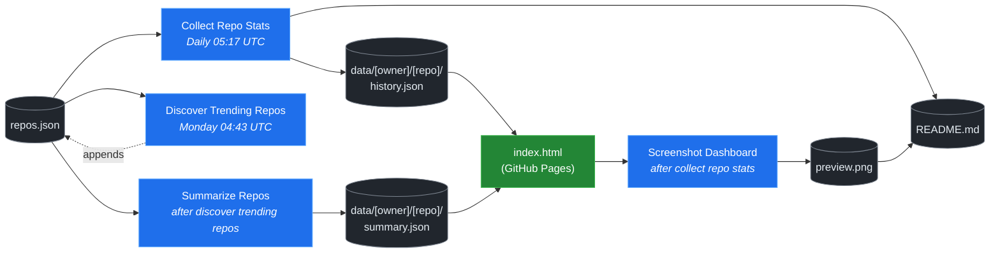

# 🚀 Rising Repos Tracker

> Automatically tracks daily GitHub stats (stars, forks, issues, velocity) for rising open source repos.

[](https://www.telosignal.com/)


**[→ View Live Dashboard](https://patrick-creates.github.io/rising-repos-tracker/)**

Built and maintained by [Telosignal](https://www.telosignal.com/).


<!-- AUTOGEN-STATS-START -->
## 📊 Current snapshot

> Auto-updated daily — last refreshed 2026-10-11

| Metric | Value |
|---|---|
| Repos tracked | **215** |
| Total stars | **10,656,355** |
| Total forks | **1,540,758** |
| Fastest growing | **VoiceStudio** (+1109.3/day) |

### 🔥 Top 5 by velocity

| # | Repo | Stars | Stars/day |
|---|---|---:|---:|
| 1 | [debpalash/VoiceStudio](https://github.com/debpalash/VoiceStudio) | 57,936 | +1109.3 |
| 2 | [DietrichGebert/ponytail](https://github.com/DietrichGebert/ponytail) | 160,761 | +1015.7 |
| 3 | [stablyai/orca](https://github.com/stablyai/orca) | 89,442 | +792.4 |
| 4 | [NousResearch/hermes-agent](https://github.com/NousResearch/hermes-agent) | 252,669 | +692.9 |
| 5 | [tt-a1i/archify](https://github.com/tt-a1i/archify) | 81,852 | +669.8 |

### 🆕 Recently added

- [tt-a1i/archify](https://github.com/tt-a1i/archify) — added 2026-10-05 — Turn any idea, plan, or codebase into a beautiful interactive diagram. An agent skill for Claude Code, Codex, and more.
- [ruvnet/ruflo](https://github.com/ruvnet/ruflo) — added 2026-10-05 — 🌊 The original agent harness. Deploy intelligent multi-player swarms, coordinate autonomous workflows, and build conversational AI systems. Features adaptive memory, self-learning intelligence, federation, vector RAG integration, and native Claude Code / Codex / Hermes and many more Integrated
- [codewhale-hq/Codewhale](https://github.com/codewhale-hq/Codewhale) — added 2026-10-05 — Open-source coding agent for your terminal, built in Rust and on a journey of continuous community improvement. Issues and PRs welcome.
<!-- AUTOGEN-STATS-END -->

<!-- AUTOGEN-DIAGRAM-START -->
## 🔄 How it works


<!-- AUTOGEN-DIAGRAM-END -->

<!-- AUTOGEN-WORKFLOWS-START -->
## ⚙️ Workflows

| File | Schedule | Name |
|---|---|---|
| `collect.yml` | Daily 05:17 UTC | Collect Repo Stats |
| `discover.yml` | Monday 04:43 UTC | Discover Trending Repos |
| `screenshot.yml` | After Collect Repo Stats | Screenshot Dashboard |
| `summarize.yml` | After Discover Trending Repos | Summarize Repos |

> All workflows commit results directly back to the repo. Schedules are best-effort — GitHub Actions cron can drift by a few minutes.
<!-- AUTOGEN-WORKFLOWS-END -->

<!-- AUTOGEN-REPOS-START -->
## 📋 All tracked repos

| Repo | Stars | Forks | Stars/day |
|---|---:|---:|---:|
| [openclaw/openclaw](https://github.com/openclaw/openclaw) | 391,666 | 82,339 | +133.7 |
| [obra/superpowers](https://github.com/obra/superpowers) | 297,388 | 26,541 | +556.9 |
| [affaan-m/everything-claude-code](https://github.com/affaan-m/everything-claude-code) | 276,810 | 41,271 | +634.2 |
| [affaan-m/ECC](https://github.com/affaan-m/ECC) | 276,810 | 41,271 | +608.5 |
| [NousResearch/hermes-agent](https://github.com/NousResearch/hermes-agent) | 252,669 | 54,653 | +692.9 |
| [microsoft/markitdown](https://github.com/microsoft/markitdown) | 189,472 | 14,069 | +440.2 |
| [Significant-Gravitas/AutoGPT](https://github.com/Significant-Gravitas/AutoGPT) | 187,517 | 45,926 | +21.4 |
| [f/prompts.chat](https://github.com/f/prompts.chat) | 172,563 | 22,105 | +68.8 |
| [DietrichGebert/ponytail](https://github.com/DietrichGebert/ponytail) | 160,761 | 8,646 | +1015.7 |
| [langgenius/dify](https://github.com/langgenius/dify) | 158,130 | 24,972 | +112.0 |
| [open-webui/open-webui](https://github.com/open-webui/open-webui) | 154,269 | 22,564 | +115.1 |
| [langchain-ai/langchain](https://github.com/langchain-ai/langchain) | 147,608 | 24,756 | +72.7 |
| [farion1231/cc-switch](https://github.com/farion1231/cc-switch) | 142,662 | 9,505 | +470.0 |
| [github/spec-kit](https://github.com/github/spec-kit) | 140,781 | 12,608 | +284.2 |
| [nextlevelbuilder/ui-ux-pro-max-skill](https://github.com/nextlevelbuilder/ui-ux-pro-max-skill) | 134,660 | 14,311 | +375.9 |
| [Graphify-Labs/graphify](https://github.com/Graphify-Labs/graphify) | 125,405 | 12,104 | +377.7 |
| [microsoft/generative-ai-for-beginners](https://github.com/microsoft/generative-ai-for-beginners) | 121,176 | 63,863 | +69.0 |
| [JuliusBrussee/caveman](https://github.com/JuliusBrussee/caveman) | 110,975 | 6,427 | +338.8 |
| [nexu-io/open-design](https://github.com/nexu-io/open-design) | 100,487 | 11,578 | +385.7 |
| [thedotmack/claude-mem](https://github.com/thedotmack/claude-mem) | 99,476 | 8,724 | +159.6 |
| [ruvnet/RuView](https://github.com/ruvnet/RuView) | 97,229 | 12,765 | +225.4 |
| [Panniantong/Agent-Reach](https://github.com/Panniantong/Agent-Reach) | 95,651 | 8,377 | +577.4 |
| [Leonxlnx/taste-skill](https://github.com/Leonxlnx/taste-skill) | 94,558 | 6,435 | +485.9 |
| [vllm-project/vllm](https://github.com/vllm-project/vllm) | 93,553 | 23,239 | +90.5 |
| [OpenHands/OpenHands](https://github.com/OpenHands/OpenHands) | 90,554 | 11,991 | +113.8 |
| [stablyai/orca](https://github.com/stablyai/orca) | 89,442 | 5,719 | +792.4 |
| [ChatGPTNextWeb/NextChat](https://github.com/ChatGPTNextWeb/NextChat) | 88,837 | 58,870 | +5.5 |
| [koala73/worldmonitor](https://github.com/koala73/worldmonitor) | 88,223 | 13,479 | +231.9 |
| [lobehub/lobehub](https://github.com/lobehub/lobehub) | 83,132 | 15,973 | +40.6 |
| [rtk-ai/rtk](https://github.com/rtk-ai/rtk) | 82,927 | 5,263 | +228.4 |
| [datawhalechina/hello-agents](https://github.com/datawhalechina/hello-agents) | 82,518 | 10,236 | +218.2 |
| [tt-a1i/archify](https://github.com/tt-a1i/archify) | 81,852 | 5,531 | +669.8 |
| [dair-ai/Prompt-Engineering-Guide](https://github.com/dair-ai/Prompt-Engineering-Guide) | 79,024 | 8,678 | +29.6 |
| [shareAI-lab/learn-claude-code](https://github.com/shareAI-lab/learn-claude-code) | 78,342 | 12,550 | +118.3 |
| [unslothai/unsloth](https://github.com/unslothai/unsloth) | 77,752 | 7,183 | +90.8 |
| [ComposioHQ/awesome-claude-skills](https://github.com/ComposioHQ/awesome-claude-skills) | 76,840 | 9,030 | +112.7 |
| [openai/openai-cookbook](https://github.com/openai/openai-cookbook) | 76,551 | 12,933 | +20.2 |
| [diegosouzapw/OmniRoute](https://github.com/diegosouzapw/OmniRoute) | 75,106 | 10,851 | +649.0 |
| [chopratejas/headroom](https://github.com/chopratejas/headroom) | 75,010 | 5,820 | +397.0 |
| [headroomlabs-ai/headroom](https://github.com/headroomlabs-ai/headroom) | 75,010 | 5,820 | +262.2 |
| [ruvnet/ruflo](https://github.com/ruvnet/ruflo) | 74,322 | 8,842 | +71.8 |
| [santifer/career-ops](https://github.com/santifer/career-ops) | 74,019 | 13,890 | +197.1 |
| [career-ops-hq/career-ops](https://github.com/career-ops-hq/career-ops) | 74,019 | 13,890 | +107.0 |
| [Fission-AI/OpenSpec](https://github.com/Fission-AI/OpenSpec) | 71,605 | 4,885 | +156.3 |
| [code-yeongyu/oh-my-openagent](https://github.com/code-yeongyu/oh-my-openagent) | 69,951 | 5,748 | +79.6 |
| [asgeirtj/system_prompts_leaks](https://github.com/asgeirtj/system_prompts_leaks) | 69,384 | 11,287 | +198.6 |
| [usestrix/strix](https://github.com/usestrix/strix) | 67,861 | 7,512 | +319.3 |
| [shanraisshan/claude-code-best-practice](https://github.com/shanraisshan/claude-code-best-practice) | 67,371 | 6,730 | +95.0 |
| [rohitg00/ai-engineering-from-scratch](https://github.com/rohitg00/ai-engineering-from-scratch) | 67,073 | 11,744 | +308.4 |
| [xtekky/gpt4free](https://github.com/xtekky/gpt4free) | 66,789 | 13,478 | +3.8 |
| [calesthio/OpenMontage](https://github.com/calesthio/OpenMontage) | 66,550 | 8,479 | +372.1 |
| [ZhuLinsen/daily_stock_analysis](https://github.com/ZhuLinsen/daily_stock_analysis) | 66,156 | 55,097 | +196.5 |
| [mvanhorn/last30days-skill](https://github.com/mvanhorn/last30days-skill) | 63,941 | 5,571 | +250.2 |
| [tw93/Pake](https://github.com/tw93/Pake) | 61,997 | 12,762 | +90.5 |
| [BerriAI/litellm](https://github.com/BerriAI/litellm) | 60,948 | 12,219 | +92.9 |
| [heygen-com/hyperframes](https://github.com/heygen-com/hyperframes) | 60,573 | 5,411 | +280.1 |
| [MemPalace/mempalace](https://github.com/MemPalace/mempalace) | 59,507 | 7,563 | +48.7 |
| [debpalash/VoiceStudio](https://github.com/debpalash/VoiceStudio) | 57,936 | 6,497 | +1109.3 |
| [jamiepine/voicebox](https://github.com/jamiepine/voicebox) | 56,855 | 7,083 | +210.9 |
| [blader/humanizer](https://github.com/blader/humanizer) | 55,559 | 4,376 | +234.3 |
| [FlowiseAI/Flowise](https://github.com/FlowiseAI/Flowise) | 55,495 | 25,059 | +17.8 |
| [hesreallyhim/awesome-claude-code](https://github.com/hesreallyhim/awesome-claude-code) | 55,420 | 4,807 | +77.6 |
| [router-for-me/CLIProxyAPI](https://github.com/router-for-me/CLIProxyAPI) | 54,796 | 8,359 | +144.3 |
| [ggml-org/whisper.cpp](https://github.com/ggml-org/whisper.cpp) | 54,290 | 6,224 | +30.6 |
| [coreyhaines31/marketingskills](https://github.com/coreyhaines31/marketingskills) | 54,132 | 8,039 | +171.9 |
| [bojieli/ai-agent-book](https://github.com/bojieli/ai-agent-book) | 53,456 | 6,051 | +548.2 |
| [ChromeDevTools/chrome-devtools-mcp](https://github.com/ChromeDevTools/chrome-devtools-mcp) | 53,262 | 6,197 | +91.6 |
| [Imbad0202/academic-research-skills](https://github.com/Imbad0202/academic-research-skills) | 51,284 | 3,948 | +152.5 |
| [elder-plinius/CL4R1T4S](https://github.com/elder-plinius/CL4R1T4S) | 51,129 | 10,482 | +103.7 |
| [QuantumNous/new-api](https://github.com/QuantumNous/new-api) | 49,690 | 11,944 | +103.1 |
| [Aider-AI/aider](https://github.com/Aider-AI/aider) | 49,466 | 5,045 | +30.9 |
| [kepano/obsidian-skills](https://github.com/kepano/obsidian-skills) | 49,387 | 3,497 | +117.4 |
| [HKUDS/nanobot](https://github.com/HKUDS/nanobot) | 48,956 | 8,619 | +43.0 |
| [K-Dense-AI/scientific-agent-skills](https://github.com/K-Dense-AI/scientific-agent-skills) | 48,355 | 4,349 | +143.5 |
| [sickn33/antigravity-awesome-skills](https://github.com/sickn33/antigravity-awesome-skills) | 47,449 | 6,918 | +63.1 |
| [sickn33/agentic-awesome-skills](https://github.com/sickn33/agentic-awesome-skills) | 47,449 | 6,918 | +49.0 |
| [zhayujie/CowAgent](https://github.com/zhayujie/CowAgent) | 47,343 | 10,381 | +19.1 |
| [DeusData/codebase-memory-mcp](https://github.com/DeusData/codebase-memory-mcp) | 46,337 | 3,809 | +247.2 |
| [alibaba/open-code-review](https://github.com/alibaba/open-code-review) | 45,997 | 3,339 | +371.2 |
| [MadsLorentzen/ai-job-search](https://github.com/MadsLorentzen/ai-job-search) | 45,956 | 15,891 | +270.8 |
| [danny-avila/LibreChat](https://github.com/danny-avila/LibreChat) | 45,511 | 9,348 | +57.9 |
| [LibreChat-AI/LibreChat](https://github.com/LibreChat-AI/LibreChat) | 45,511 | 9,348 | +37.5 |
| [chatanywhere/GPT_API_free](https://github.com/chatanywhere/GPT_API_free) | 43,992 | 2,747 | +42.0 |
| [ogulcancelik/herdr](https://github.com/ogulcancelik/herdr) | 43,330 | 3,417 | +318.9 |
| [herdrdev/herdr](https://github.com/herdrdev/herdr) | 43,330 | 3,417 | +283.2 |
| [langchain-ai/langgraph](https://github.com/langchain-ai/langgraph) | 43,056 | 7,318 | +68.8 |
| [chatboxai/chatbox](https://github.com/chatboxai/chatbox) | 41,993 | 4,271 | +13.7 |
| [tinyhumansai/openhuman](https://github.com/tinyhumansai/openhuman) | 41,814 | 4,114 | +68.4 |
| [AstrBotDevs/AstrBot](https://github.com/AstrBotDevs/AstrBot) | 41,706 | 3,042 | +61.5 |
| [Hmbown/CodeWhale](https://github.com/Hmbown/CodeWhale) | 41,081 | 3,568 | +46.1 |
| [Hmbown/Codewhale](https://github.com/Hmbown/Codewhale) | 41,081 | 3,568 | +4.9 |
| [codewhale-hq/Codewhale](https://github.com/codewhale-hq/Codewhale) | 41,081 | 3,568 | +5.5 |
| [wshobson/agents](https://github.com/wshobson/agents) | 40,367 | 4,298 | +31.9 |
| [github/awesome-copilot](https://github.com/github/awesome-copilot) | 39,902 | 5,096 | +43.9 |
| [mindsdb/mindshub](https://github.com/mindsdb/mindshub) | 39,787 | 6,239 | +4.3 |
| [Yeachan-Heo/oh-my-claudecode](https://github.com/Yeachan-Heo/oh-my-claudecode) | 39,784 | 3,563 | +35.7 |
| [volcengine/OpenViking](https://github.com/volcengine/OpenViking) | 39,642 | 3,131 | +114.5 |
| [google/langextract](https://github.com/google/langextract) | 38,936 | 2,719 | +17.1 |
| [AlexsJones/llmfit](https://github.com/AlexsJones/llmfit) | 37,796 | 2,426 | +81.8 |
| [anthropics/claude-plugins-official](https://github.com/anthropics/claude-plugins-official) | 37,653 | 4,239 | +65.5 |
| [PDFMathTranslate/PDFMathTranslate](https://github.com/PDFMathTranslate/PDFMathTranslate) | 37,482 | 3,351 | +24.9 |
| [songquanpeng/one-api](https://github.com/songquanpeng/one-api) | 37,109 | 6,878 | +20.9 |
| [JCodesMore/ai-website-cloner-template](https://github.com/JCodesMore/ai-website-cloner-template) | 36,470 | 5,348 | +165.1 |
| [esengine/DeepSeek-Reasonix](https://github.com/esengine/DeepSeek-Reasonix) | 35,758 | 2,439 | +129.9 |
| [agentscope-ai/QwenPaw](https://github.com/agentscope-ai/QwenPaw) | 35,590 | 3,169 | +150.9 |
| [HKUDS/Vibe-Trading](https://github.com/HKUDS/Vibe-Trading) | 35,178 | 5,713 | +196.5 |
| [can1357/oh-my-pi](https://github.com/can1357/oh-my-pi) | 34,987 | 3,809 | +189.1 |
| [p-e-w/heretic](https://github.com/p-e-w/heretic) | 34,552 | 3,866 | +84.6 |
| [virgiliojr94/book-to-skill](https://github.com/virgiliojr94/book-to-skill) | 34,486 | 3,625 | +201.2 |
| [mukul975/Anthropic-Cybersecurity-Skills](https://github.com/mukul975/Anthropic-Cybersecurity-Skills) | 34,210 | 4,161 | +144.9 |
| [Gitlawb/openclaude](https://github.com/Gitlawb/openclaude) | 33,721 | 9,108 | +42.3 |
| [Twigpine/openclaude](https://github.com/Twigpine/openclaude) | 33,721 | 9,108 | +12.7 |
| [iOfficeAI/AionUi](https://github.com/iOfficeAI/AionUi) | 33,425 | 3,471 | +46.0 |
| [Tencent/WeKnora](https://github.com/Tencent/WeKnora) | 33,092 | 4,403 | +142.4 |
| [zeroclaw-labs/zeroclaw](https://github.com/zeroclaw-labs/zeroclaw) | 32,955 | 4,964 | +9.7 |
| [tirth8205/code-review-graph](https://github.com/tirth8205/code-review-graph) | 32,032 | 2,936 | +114.6 |
| [iOfficeAI/OfficeCLI](https://github.com/iOfficeAI/OfficeCLI) | 31,835 | 2,166 | +241.6 |
| [googleworkspace/cli](https://github.com/googleworkspace/cli) | 31,291 | 1,861 | +34.6 |
| [decolua/9router](https://github.com/decolua/9router) | 30,596 | 5,840 | +110.4 |
| [langchain-ai/deepagents](https://github.com/langchain-ai/deepagents) | 30,118 | 4,219 | +47.7 |
| [jackwener/OpenCLI](https://github.com/jackwener/OpenCLI) | 30,045 | 2,932 | +50.0 |
| [alibaba/page-agent](https://github.com/alibaba/page-agent) | 29,373 | 2,641 | +91.7 |
| [rohitg00/agentmemory](https://github.com/rohitg00/agentmemory) | 29,297 | 2,569 | +59.8 |
| [voideditor/void](https://github.com/voideditor/void) | 28,760 | 2,654 | — |
| [jarrodwatts/claude-hud](https://github.com/jarrodwatts/claude-hud) | 28,452 | 1,315 | +30.1 |
| [BloopAI/vibe-kanban](https://github.com/BloopAI/vibe-kanban) | 28,327 | 3,032 | +12.3 |
| [manaflow-ai/cmux](https://github.com/manaflow-ai/cmux) | 28,093 | 2,486 | +41.5 |
| [TencentCloud/TencentDB-Agent-Memory](https://github.com/TencentCloud/TencentDB-Agent-Memory) | 27,915 | 2,713 | +213.3 |
| [mksglu/context-mode](https://github.com/mksglu/context-mode) | 26,550 | 1,908 | +77.0 |
| [zai-org/Open-AutoGLM](https://github.com/zai-org/Open-AutoGLM) | 26,375 | 4,051 | +7.3 |
| [t8y2/dbx](https://github.com/t8y2/dbx) | 25,750 | 2,337 | +183.1 |
| [toon-format/toon](https://github.com/toon-format/toon) | 25,485 | 1,120 | +7.9 |
| [pascalorg/editor](https://github.com/pascalorg/editor) | 24,788 | 3,074 | +57.1 |
| [guillaumemeyer/watermarks-remover](https://github.com/guillaumemeyer/watermarks-remover) | 23,824 | 2,736 | +130.7 |
| [ifixai-ai/iFixAi](https://github.com/ifixai-ai/iFixAi) | 23,709 | 1,444 | +250.6 |
| [every-app/open-seo](https://github.com/every-app/open-seo) | 23,013 | 3,009 | +161.4 |
| [jundot/omlx](https://github.com/jundot/omlx) | 22,707 | 2,002 | +51.5 |
| [pranshuparmar/witr](https://github.com/pranshuparmar/witr) | 22,645 | 792 | +44.4 |
| [winfunc/opcode](https://github.com/winfunc/opcode) | 22,414 | 1,712 | +3.3 |
| [steipete/CodexBar](https://github.com/steipete/CodexBar) | 22,384 | 2,086 | +64.7 |
| [coze-dev/coze-studio](https://github.com/coze-dev/coze-studio) | 21,697 | 3,128 | +6.0 |
| [NirDiamant/agents-towards-production](https://github.com/NirDiamant/agents-towards-production) | 21,629 | 2,874 | +8.0 |
| [KKKKhazix/khazix-skills](https://github.com/KKKKhazix/khazix-skills) | 21,299 | 2,253 | +46.3 |
| [jnMetaCode/agency-agents-zh](https://github.com/jnMetaCode/agency-agents-zh) | 21,177 | 3,403 | +52.0 |
| [hypit-ai/hypit](https://github.com/hypit-ai/hypit) | 20,979 | 2,306 | +298.5 |
| [1jehuang/jcode](https://github.com/1jehuang/jcode) | 20,395 | 2,377 | +134.3 |
| [NVIDIA/SkillSpector](https://github.com/NVIDIA/SkillSpector) | 19,904 | 1,743 | +102.4 |
| [tanweai/pua](https://github.com/tanweai/pua) | 19,708 | 1,202 | +12.4 |
| [walkinglabs/learn-harness-engineering](https://github.com/walkinglabs/learn-harness-engineering) | 19,681 | 2,156 | +101.0 |
| [datawhalechina/easy-vibe](https://github.com/datawhalechina/easy-vibe) | 19,675 | 1,880 | +23.2 |
| [danielmiessler/LifeOS](https://github.com/danielmiessler/LifeOS) | 19,399 | 2,491 | +30.0 |
| [nesquena/hermes-webui](https://github.com/nesquena/hermes-webui) | 18,854 | 2,707 | +36.2 |
| [jlcodes99/cockpit-tools](https://github.com/jlcodes99/cockpit-tools) | 18,817 | 1,674 | +54.0 |
| [AgriciDaniel/claude-seo](https://github.com/AgriciDaniel/claude-seo) | 18,682 | 2,739 | +66.6 |
| [microsoft/agent-lightning](https://github.com/microsoft/agent-lightning) | 18,651 | 1,666 | +11.4 |
| [browser-use/browser-harness](https://github.com/browser-use/browser-harness) | 18,384 | 1,800 | +27.9 |
| [RightNow-AI/openfang](https://github.com/RightNow-AI/openfang) | 18,216 | 2,292 | +3.3 |
| [rocketride-org/rocketride-server](https://github.com/rocketride-org/rocketride-server) | 17,810 | 7,575 | — |
| [tradecatlabs/vibe-coding-cn](https://github.com/tradecatlabs/vibe-coding-cn) | 17,433 | 1,759 | +50.5 |
| [wanshuiyin/Auto-claude-code-research-in-sleep](https://github.com/wanshuiyin/Auto-claude-code-research-in-sleep) | 17,258 | 1,447 | +43.1 |
| [MemoriLabs/Memori](https://github.com/MemoriLabs/Memori) | 17,146 | 3,713 | +16.2 |
| [cft0808/edict](https://github.com/cft0808/edict) | 16,987 | 1,767 | +7.8 |
| [composio-community/awesome-codex-skills](https://github.com/composio-community/awesome-codex-skills) | 16,856 | 1,660 | +18.7 |
| [xbtlin/ai-berkshire](https://github.com/xbtlin/ai-berkshire) | 16,698 | 2,484 | +61.0 |
| [xpzouying/xiaohongshu-mcp](https://github.com/xpzouying/xiaohongshu-mcp) | 16,200 | 2,379 | +17.2 |
| [Anionex/banana-slides](https://github.com/Anionex/banana-slides) | 15,735 | 1,787 | +5.3 |
| [yusufkaraaslan/Skill_Seekers](https://github.com/yusufkaraaslan/Skill_Seekers) | 15,129 | 1,541 | +8.1 |
| [superset-sh/superset](https://github.com/superset-sh/superset) | 15,065 | 1,343 | +27.9 |
| [NanmiCoder/cc-haha](https://github.com/NanmiCoder/cc-haha) | 14,960 | 8,603 | +15.7 |
| [kyegomez/OpenMythos](https://github.com/kyegomez/OpenMythos) | 14,909 | 3,280 | +6.8 |
| [NevaMind-AI/memU](https://github.com/NevaMind-AI/memU) | 14,525 | 1,087 | +5.6 |
| [XiaomiMiMo/MiMo-Code](https://github.com/XiaomiMiMo/MiMo-Code) | 13,623 | 1,427 | +25.0 |
| [EverMind-AI/EverOS](https://github.com/EverMind-AI/EverOS) | 13,400 | 928 | +35.4 |
| [sirmalloc/ccstatusline](https://github.com/sirmalloc/ccstatusline) | 13,243 | 591 | +18.9 |
| [dataelement/dsh-desktop](https://github.com/dataelement/dsh-desktop) | 13,197 | 473 | +258.6 |
| [ConardLi/garden-skills](https://github.com/ConardLi/garden-skills) | 12,823 | 1,538 | +37.5 |
| [brokermr810/QuantDinger](https://github.com/brokermr810/QuantDinger) | 12,660 | 2,569 | +34.8 |
| [OpenByteInc/QuantDinger](https://github.com/OpenByteInc/QuantDinger) | 12,660 | 2,569 | +34.4 |
| [0x4m4/hexstrike-ai](https://github.com/0x4m4/hexstrike-ai) | 12,627 | 2,560 | +25.2 |
| [MemTensor/MemOS](https://github.com/MemTensor/MemOS) | 11,805 | 1,073 | +17.1 |
| [holaboss-ai/holaOS](https://github.com/holaboss-ai/holaOS) | 11,450 | 728 | +56.0 |
| [getagentseal/codeburn](https://github.com/getagentseal/codeburn) | 11,377 | 879 | +30.0 |
| [EKKOLearnAI/hermes-studio](https://github.com/EKKOLearnAI/hermes-studio) | 11,356 | 1,397 | +25.7 |
| [EKKOLearnAI/ekko-studio](https://github.com/EKKOLearnAI/ekko-studio) | 11,356 | 1,397 | +10.2 |
| [aden-hive/hive](https://github.com/aden-hive/hive) | 11,094 | 5,646 | +4.6 |
| [openai/codex-security](https://github.com/openai/codex-security) | 11,059 | 857 | +40.2 |
| [ValueCell-ai/valuecell](https://github.com/ValueCell-ai/valuecell) | 11,019 | 1,802 | +1.4 |
| [Kuberwastaken/claurst](https://github.com/Kuberwastaken/claurst) | 10,320 | 7,701 | +4.4 |
| [StarTrail-org/PixelRAG](https://github.com/StarTrail-org/PixelRAG) | 10,247 | 900 | +40.7 |
| [ykdojo/claude-code-tips](https://github.com/ykdojo/claude-code-tips) | 10,210 | 828 | +12.3 |
| [Companion-Inc/feynman](https://github.com/Companion-Inc/feynman) | 9,930 | 1,097 | +9.1 |
| [trailhq/Graft](https://github.com/trailhq/Graft) | 9,847 | 872 | +83.6 |
| [frankbria/ralph-claude-code](https://github.com/frankbria/ralph-claude-code) | 9,677 | 731 | +3.7 |
| [modem-dev/hunk](https://github.com/modem-dev/hunk) | 9,571 | 312 | +31.8 |
| [Nasiko-Labs/nasiko](https://github.com/Nasiko-Labs/nasiko) | 9,504 | 2,063 | +38.2 |
| [genspark-ai/genoffice](https://github.com/genspark-ai/genoffice) | 9,262 | 1,179 | +93.6 |
| [1weiho/open-slide](https://github.com/1weiho/open-slide) | 9,165 | 656 | +49.1 |
| [open-slide/open-slide](https://github.com/open-slide/open-slide) | 9,165 | 656 | +68.0 |
| [EvoMap/evolver](https://github.com/EvoMap/evolver) | 9,141 | 849 | +2.9 |
| [iflytek/astron-agent](https://github.com/iflytek/astron-agent) | 8,889 | 895 | +2.9 |
| [Tencent/BrowserSkill](https://github.com/Tencent/BrowserSkill) | 8,599 | 615 | +72.2 |
| [MiroMindAI/MiroThinker](https://github.com/MiroMindAI/MiroThinker) | 8,427 | 645 | +1.0 |
| [mmulet/term.everything](https://github.com/mmulet/term.everything) | 8,114 | 195 | +0.9 |
| [rorkai/App-Store-Connect-CLI](https://github.com/rorkai/App-Store-Connect-CLI) | 7,750 | 656 | +25.1 |
| [ValueCell-ai/ClawX](https://github.com/ValueCell-ai/ClawX) | 7,607 | 1,140 | +0.7 |
| [WenyuChiou/awesome-agentic-ai-zh](https://github.com/WenyuChiou/awesome-agentic-ai-zh) | 7,469 | 993 | +22.4 |
| [opensquilla/opensquilla](https://github.com/opensquilla/opensquilla) | 7,096 | 580 | +10.7 |
| [TokenRhythm/opensquilla](https://github.com/TokenRhythm/opensquilla) | 7,096 | 580 | +3.8 |
| [tech-leads-club/agent-skills](https://github.com/tech-leads-club/agent-skills) | 7,047 | 559 | +23.8 |
| [Andyyyy64/whichllm](https://github.com/Andyyyy64/whichllm) | 6,746 | 375 | +10.6 |
| [steipete/summarize](https://github.com/steipete/summarize) | 6,694 | 450 | +3.2 |
| [Arthur-Ficial/apfel](https://github.com/Arthur-Ficial/apfel) | 6,464 | 246 | +3.9 |
| [microsoft/fara](https://github.com/microsoft/fara) | 6,217 | 606 | +2.4 |
| [UfoMiao/zcf](https://github.com/UfoMiao/zcf) | 6,077 | 423 | +0.1 |
| [re4/LibreCode](https://github.com/re4/LibreCode) | 89 | 5 | — |
<!-- AUTOGEN-REPOS-END -->

---

## What it does

- Collects daily snapshots of stars, forks, watchers and open issues for every tracked repo
- Discovers new trending repos automatically every Monday using the GitHub Search API
- Generates AI summaries (use cases, similar tools, tags) for each tracked repo via GitHub Models
- Stores all history as plain JSON — no database, no backend
- Renders a live dashboard via GitHub Pages — updates daily, zero maintenance

## Tracked repos

Data lives in [`data/`](./data) — one folder per repo, one `history.json` per entry.  
The full watch list is in [`repos.json`](./repos.json).

## Fork & use it for yourself

This is my personal tracker — the watch list reflects what I find interesting. If you want to track different repos, the best path is to **fork this repo and run your own**.

### Setup

1. Fork this repo to your account
2. Replace the contents of [`repos.json`](./repos.json) with the repos you want to track (or just leave one entry — `discover.yml` will auto-add more every Monday)
3. Go to **Settings → Pages** and enable GitHub Pages from the `main` branch
4. Go to **Actions** and run **Collect Repo Stats** once manually to seed your first data point
5. Your dashboard will be live at `https://YOUR-USERNAME.github.io/rising-repos-tracker/`

That's it — daily collection and weekly discovery run automatically on schedule. Zero ongoing maintenance.

### Customizing what gets discovered

Edit [`scripts/discover.js`](./scripts/discover.js) to change:

- `MIN_STARS` — minimum star threshold for candidates
- `MAX_AGE_DAYS` — how recent a repo must be
- `MAX_NEW_REPOS` — how many to add per discovery run
- The `queries` array — GitHub Search API queries that define what "trending" means to you

### Adding a repo manually

Just edit `repos.json` directly:

```json
{
  "owner": "OWNER",
  "repo": "REPO",
  "added": "YYYY-MM-DD",
  "notes": "why you're tracking this"
}
```

The next daily collect run picks it up automatically.

## Stack

- **GitHub Actions** — scheduling and automation
- **GitHub Pages** — dashboard hosting
- **GitHub API** — data source
- **GitHub Models** — free AI summaries (gpt-4o-mini)
- **Chart.js** — star growth visualization
- **Mermaid** — architecture diagram (rendered by GitHub)
- No dependencies, no build step, no database

## License

MIT
