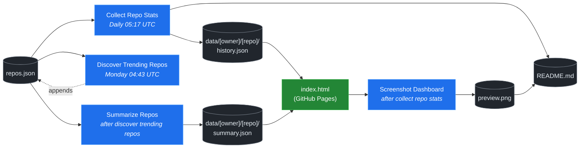

# 🚀 Rising Repos Tracker

> Automatically tracks daily GitHub stats (stars, forks, issues, velocity) for rising open source repos.

[](https://www.telosignal.com/)


**[→ View Live Dashboard](https://patrick-creates.github.io/rising-repos-tracker/)**

Built and maintained by [Telosignal](https://www.telosignal.com/).


<!-- AUTOGEN-STATS-START -->
## 📊 Current snapshot

> Auto-updated daily — last refreshed 2026-10-14

| Metric | Value |
|---|---|
| Repos tracked | **217** |
| Total stars | **10,965,110** |
| Total forks | **1,606,852** |
| Fastest growing | **rea** (+44810.5/day) |

### 🔥 Top 5 by velocity

| # | Repo | Stars | Stars/day |
|---|---|---:|---:|
| 1 | [morluto/rea](https://github.com/morluto/rea) | 223,850 | +44810.5 |
| 2 | [debpalash/VoiceStudio](https://github.com/debpalash/VoiceStudio) | 64,662 | +1201.2 |
| 3 | [DietrichGebert/ponytail](https://github.com/DietrichGebert/ponytail) | 163,099 | +1009.5 |
| 4 | [stablyai/orca](https://github.com/stablyai/orca) | 92,000 | +794.2 |
| 5 | [NousResearch/hermes-agent](https://github.com/NousResearch/hermes-agent) | 253,622 | +685.6 |

### 🆕 Recently added

- [morluto/rea](https://github.com/morluto/rea) — added 2026-10-12 — Reverse engineer anything with agents, from app behavior down to native binaries.
- [TencentCloud/Octop](https://github.com/TencentCloud/Octop) — added 2026-10-12 — A smarter, self-hosted AI assistant — multi-user, multi-agent.
- [tt-a1i/archify](https://github.com/tt-a1i/archify) — added 2026-10-05 — Turn any idea, plan, or codebase into a beautiful interactive diagram. An agent skill for Claude Code, Codex, and more.
<!-- AUTOGEN-STATS-END -->

<!-- AUTOGEN-DIAGRAM-START -->
## 🔄 How it works


<!-- AUTOGEN-DIAGRAM-END -->

<!-- AUTOGEN-WORKFLOWS-START -->
## ⚙️ Workflows

| File | Schedule | Name |
|---|---|---|
| `collect.yml` | Daily 05:17 UTC | Collect Repo Stats |
| `discover.yml` | Monday 04:43 UTC | Discover Trending Repos |
| `screenshot.yml` | After Collect Repo Stats | Screenshot Dashboard |
| `summarize.yml` | After Discover Trending Repos | Summarize Repos |

> All workflows commit results directly back to the repo. Schedules are best-effort — GitHub Actions cron can drift by a few minutes.
<!-- AUTOGEN-WORKFLOWS-END -->

<!-- AUTOGEN-REPOS-START -->
## 📋 All tracked repos

| Repo | Stars | Forks | Stars/day |
|---|---:|---:|---:|
| [openclaw/openclaw](https://github.com/openclaw/openclaw) | 391,938 | 82,432 | +132.9 |
| [obra/superpowers](https://github.com/obra/superpowers) | 298,869 | 26,727 | +555.2 |
| [affaan-m/everything-claude-code](https://github.com/affaan-m/everything-claude-code) | 278,854 | 41,526 | +635.1 |
| [affaan-m/ECC](https://github.com/affaan-m/ECC) | 278,854 | 41,526 | +610.0 |
| [NousResearch/hermes-agent](https://github.com/NousResearch/hermes-agent) | 253,622 | 55,026 | +685.6 |
| [morluto/rea](https://github.com/morluto/rea) | 223,850 | 55,536 | +44810.5 |
| [microsoft/markitdown](https://github.com/microsoft/markitdown) | 190,141 | 14,149 | +435.9 |
| [Significant-Gravitas/AutoGPT](https://github.com/Significant-Gravitas/AutoGPT) | 187,565 | 45,943 | +21.3 |
| [f/prompts.chat](https://github.com/f/prompts.chat) | 172,917 | 22,162 | +69.8 |
| [DietrichGebert/ponytail](https://github.com/DietrichGebert/ponytail) | 163,099 | 8,818 | +1009.5 |
| [langgenius/dify](https://github.com/langgenius/dify) | 158,428 | 25,056 | +111.7 |
| [open-webui/open-webui](https://github.com/open-webui/open-webui) | 155,617 | 22,686 | +121.6 |
| [langchain-ai/langchain](https://github.com/langchain-ai/langchain) | 147,832 | 24,794 | +72.7 |
| [farion1231/cc-switch](https://github.com/farion1231/cc-switch) | 144,087 | 9,569 | +470.1 |
| [github/spec-kit](https://github.com/github/spec-kit) | 141,199 | 12,635 | +281.4 |
| [nextlevelbuilder/ui-ux-pro-max-skill](https://github.com/nextlevelbuilder/ui-ux-pro-max-skill) | 135,654 | 14,423 | +375.1 |
| [Graphify-Labs/graphify](https://github.com/Graphify-Labs/graphify) | 126,292 | 12,188 | +374.6 |
| [microsoft/generative-ai-for-beginners](https://github.com/microsoft/generative-ai-for-beginners) | 121,335 | 63,956 | +68.7 |
| [JuliusBrussee/caveman](https://github.com/JuliusBrussee/caveman) | 111,626 | 6,478 | +336.3 |
| [nexu-io/open-design](https://github.com/nexu-io/open-design) | 101,060 | 11,637 | +381.8 |
| [thedotmack/claude-mem](https://github.com/thedotmack/claude-mem) | 100,579 | 8,814 | +163.6 |
| [ruvnet/RuView](https://github.com/ruvnet/RuView) | 97,891 | 12,831 | +225.3 |
| [Panniantong/Agent-Reach](https://github.com/Panniantong/Agent-Reach) | 97,156 | 8,504 | +575.6 |
| [Leonxlnx/taste-skill](https://github.com/Leonxlnx/taste-skill) | 95,833 | 6,516 | +484.6 |
| [vllm-project/vllm](https://github.com/vllm-project/vllm) | 93,758 | 23,366 | +90.1 |
| [stablyai/orca](https://github.com/stablyai/orca) | 92,000 | 5,879 | +794.2 |
| [OpenHands/OpenHands](https://github.com/OpenHands/OpenHands) | 90,859 | 12,042 | +113.6 |
| [ChatGPTNextWeb/NextChat](https://github.com/ChatGPTNextWeb/NextChat) | 88,840 | 58,832 | +5.4 |
| [koala73/worldmonitor](https://github.com/koala73/worldmonitor) | 88,421 | 13,528 | +228.5 |
| [tt-a1i/archify](https://github.com/tt-a1i/archify) | 83,309 | 5,629 | +608.4 |
| [rtk-ai/rtk](https://github.com/rtk-ai/rtk) | 83,286 | 5,289 | +226.2 |
| [lobehub/lobehub](https://github.com/lobehub/lobehub) | 83,223 | 15,982 | +40.4 |
| [datawhalechina/hello-agents](https://github.com/datawhalechina/hello-agents) | 83,064 | 10,302 | +217.5 |
| [dair-ai/Prompt-Engineering-Guide](https://github.com/dair-ai/Prompt-Engineering-Guide) | 79,154 | 8,694 | +29.9 |
| [shareAI-lab/learn-claude-code](https://github.com/shareAI-lab/learn-claude-code) | 78,556 | 12,576 | +117.3 |
| [unslothai/unsloth](https://github.com/unslothai/unsloth) | 77,983 | 7,202 | +90.5 |
| [ComposioHQ/awesome-claude-skills](https://github.com/ComposioHQ/awesome-claude-skills) | 77,061 | 9,090 | +111.9 |
| [openai/openai-cookbook](https://github.com/openai/openai-cookbook) | 76,597 | 12,932 | +20.1 |
| [diegosouzapw/OmniRoute](https://github.com/diegosouzapw/OmniRoute) | 76,298 | 11,019 | +641.5 |
| [chopratejas/headroom](https://github.com/chopratejas/headroom) | 75,311 | 5,844 | +389.7 |
| [headroomlabs-ai/headroom](https://github.com/headroomlabs-ai/headroom) | 75,311 | 5,844 | +258.0 |
| [ruvnet/ruflo](https://github.com/ruvnet/ruflo) | 74,614 | 8,873 | +80.3 |
| [santifer/career-ops](https://github.com/santifer/career-ops) | 74,456 | 13,959 | +196.0 |
| [career-ops-hq/career-ops](https://github.com/career-ops-hq/career-ops) | 74,456 | 13,959 | +110.1 |
| [Fission-AI/OpenSpec](https://github.com/Fission-AI/OpenSpec) | 71,894 | 4,912 | +155.1 |
| [code-yeongyu/oh-my-openagent](https://github.com/code-yeongyu/oh-my-openagent) | 70,011 | 5,764 | +78.4 |
| [asgeirtj/system_prompts_leaks](https://github.com/asgeirtj/system_prompts_leaks) | 69,599 | 11,314 | +196.1 |
| [rohitg00/ai-engineering-from-scratch](https://github.com/rohitg00/ai-engineering-from-scratch) | 68,875 | 12,058 | +314.9 |
| [usestrix/strix](https://github.com/usestrix/strix) | 68,486 | 7,595 | +316.9 |
| [calesthio/OpenMontage](https://github.com/calesthio/OpenMontage) | 68,116 | 8,730 | +376.3 |
| [shanraisshan/claude-code-best-practice](https://github.com/shanraisshan/claude-code-best-practice) | 67,530 | 6,735 | +94.2 |
| [xtekky/gpt4free](https://github.com/xtekky/gpt4free) | 66,843 | 13,482 | +4.0 |
| [ZhuLinsen/daily_stock_analysis](https://github.com/ZhuLinsen/daily_stock_analysis) | 66,334 | 55,219 | +193.6 |
| [debpalash/VoiceStudio](https://github.com/debpalash/VoiceStudio) | 64,662 | 7,174 | +1201.2 |
| [mvanhorn/last30days-skill](https://github.com/mvanhorn/last30days-skill) | 64,197 | 5,606 | +246.3 |
| [heygen-com/hyperframes](https://github.com/heygen-com/hyperframes) | 63,183 | 5,668 | +293.9 |
| [tw93/Pake](https://github.com/tw93/Pake) | 62,064 | 12,784 | +89.2 |
| [BerriAI/litellm](https://github.com/BerriAI/litellm) | 61,214 | 12,321 | +92.8 |
| [MemPalace/mempalace](https://github.com/MemPalace/mempalace) | 59,560 | 7,565 | +48.1 |
| [jamiepine/voicebox](https://github.com/jamiepine/voicebox) | 57,420 | 7,186 | +210.4 |
| [blader/humanizer](https://github.com/blader/humanizer) | 56,743 | 4,482 | +264.4 |
| [hesreallyhim/awesome-claude-code](https://github.com/hesreallyhim/awesome-claude-code) | 55,653 | 4,818 | +77.6 |
| [FlowiseAI/Flowise](https://github.com/FlowiseAI/Flowise) | 55,498 | 25,059 | +17.4 |
| [router-for-me/CLIProxyAPI](https://github.com/router-for-me/CLIProxyAPI) | 55,168 | 8,440 | +143.8 |
| [coreyhaines31/marketingskills](https://github.com/coreyhaines31/marketingskills) | 54,642 | 8,103 | +171.9 |
| [ggml-org/whisper.cpp](https://github.com/ggml-org/whisper.cpp) | 54,365 | 6,251 | +30.5 |
| [bojieli/ai-agent-book](https://github.com/bojieli/ai-agent-book) | 54,147 | 6,157 | +537.1 |
| [ChromeDevTools/chrome-devtools-mcp](https://github.com/ChromeDevTools/chrome-devtools-mcp) | 53,508 | 6,555 | +91.4 |
| [Imbad0202/academic-research-skills](https://github.com/Imbad0202/academic-research-skills) | 51,912 | 3,973 | +154.7 |
| [elder-plinius/CL4R1T4S](https://github.com/elder-plinius/CL4R1T4S) | 51,222 | 10,500 | +101.9 |
| [QuantumNous/new-api](https://github.com/QuantumNous/new-api) | 49,928 | 12,012 | +102.6 |
| [Aider-AI/aider](https://github.com/Aider-AI/aider) | 49,541 | 5,054 | +30.7 |
| [kepano/obsidian-skills](https://github.com/kepano/obsidian-skills) | 49,531 | 3,511 | +115.9 |
| [HKUDS/nanobot](https://github.com/HKUDS/nanobot) | 49,015 | 8,630 | +42.5 |
| [K-Dense-AI/scientific-agent-skills](https://github.com/K-Dense-AI/scientific-agent-skills) | 48,806 | 4,385 | +144.1 |
| [sickn33/antigravity-awesome-skills](https://github.com/sickn33/antigravity-awesome-skills) | 47,573 | 6,938 | +62.6 |
| [sickn33/agentic-awesome-skills](https://github.com/sickn33/agentic-awesome-skills) | 47,573 | 6,938 | +48.7 |
| [zhayujie/CowAgent](https://github.com/zhayujie/CowAgent) | 47,392 | 10,391 | +19.0 |
| [alibaba/open-code-review](https://github.com/alibaba/open-code-review) | 47,068 | 3,422 | +370.8 |
| [MadsLorentzen/ai-job-search](https://github.com/MadsLorentzen/ai-job-search) | 46,711 | 16,152 | +270.2 |
| [DeusData/codebase-memory-mcp](https://github.com/DeusData/codebase-memory-mcp) | 46,552 | 3,834 | +242.3 |
| [danny-avila/LibreChat](https://github.com/danny-avila/LibreChat) | 45,658 | 9,387 | +57.7 |
| [LibreChat-AI/LibreChat](https://github.com/LibreChat-AI/LibreChat) | 45,658 | 9,387 | +39.6 |
| [chatanywhere/GPT_API_free](https://github.com/chatanywhere/GPT_API_free) | 44,162 | 2,746 | +42.3 |
| [ogulcancelik/herdr](https://github.com/ogulcancelik/herdr) | 43,920 | 3,471 | +315.2 |
| [herdrdev/herdr](https://github.com/herdrdev/herdr) | 43,920 | 3,471 | +279.6 |
| [langchain-ai/langgraph](https://github.com/langchain-ai/langgraph) | 43,245 | 7,351 | +68.6 |
| [chatboxai/chatbox](https://github.com/chatboxai/chatbox) | 42,016 | 4,278 | +13.6 |
| [tinyhumansai/openhuman](https://github.com/tinyhumansai/openhuman) | 41,967 | 4,129 | +67.0 |
| [AstrBotDevs/AstrBot](https://github.com/AstrBotDevs/AstrBot) | 41,855 | 3,061 | +61.2 |
| [Hmbown/CodeWhale](https://github.com/Hmbown/CodeWhale) | 41,088 | 3,569 | +45.2 |
| [Hmbown/Codewhale](https://github.com/Hmbown/Codewhale) | 41,088 | 3,569 | +4.6 |
| [codewhale-hq/Codewhale](https://github.com/codewhale-hq/Codewhale) | 41,088 | 3,569 | +4.4 |
| [wshobson/agents](https://github.com/wshobson/agents) | 40,659 | 4,320 | +33.3 |
| [github/awesome-copilot](https://github.com/github/awesome-copilot) | 39,998 | 5,116 | +43.6 |
| [Yeachan-Heo/oh-my-claudecode](https://github.com/Yeachan-Heo/oh-my-claudecode) | 39,891 | 3,577 | +35.7 |
| [volcengine/OpenViking](https://github.com/volcengine/OpenViking) | 39,882 | 3,166 | +113.7 |
| [mindsdb/mindshub](https://github.com/mindsdb/mindshub) | 39,792 | 6,240 | +4.2 |
| [google/langextract](https://github.com/google/langextract) | 38,945 | 2,717 | +16.8 |
| [anthropics/claude-plugins-official](https://github.com/anthropics/claude-plugins-official) | 37,921 | 4,263 | +66.0 |
| [AlexsJones/llmfit](https://github.com/AlexsJones/llmfit) | 37,910 | 2,436 | +80.8 |
| [PDFMathTranslate/PDFMathTranslate](https://github.com/PDFMathTranslate/PDFMathTranslate) | 37,543 | 3,358 | +24.9 |
| [songquanpeng/one-api](https://github.com/songquanpeng/one-api) | 37,144 | 6,888 | +20.7 |
| [JCodesMore/ai-website-cloner-template](https://github.com/JCodesMore/ai-website-cloner-template) | 36,750 | 5,397 | +163.3 |
| [esengine/DeepSeek-Reasonix](https://github.com/esengine/DeepSeek-Reasonix) | 35,785 | 2,452 | +127.0 |
| [agentscope-ai/QwenPaw](https://github.com/agentscope-ai/QwenPaw) | 35,675 | 3,182 | +147.9 |
| [HKUDS/Vibe-Trading](https://github.com/HKUDS/Vibe-Trading) | 35,452 | 5,751 | +193.6 |
| [can1357/oh-my-pi](https://github.com/can1357/oh-my-pi) | 35,384 | 3,856 | +187.6 |
| [p-e-w/heretic](https://github.com/p-e-w/heretic) | 35,184 | 3,980 | +87.6 |
| [virgiliojr94/book-to-skill](https://github.com/virgiliojr94/book-to-skill) | 34,814 | 3,658 | +195.8 |
| [mukul975/Anthropic-Cybersecurity-Skills](https://github.com/mukul975/Anthropic-Cybersecurity-Skills) | 34,421 | 4,185 | +143.0 |
| [Tencent/WeKnora](https://github.com/Tencent/WeKnora) | 33,894 | 4,507 | +145.5 |
| [Gitlawb/openclaude](https://github.com/Gitlawb/openclaude) | 33,843 | 9,122 | +42.3 |
| [Twigpine/openclaude](https://github.com/Twigpine/openclaude) | 33,843 | 9,122 | +22.0 |
| [iOfficeAI/AionUi](https://github.com/iOfficeAI/AionUi) | 33,514 | 3,480 | +45.7 |
| [zeroclaw-labs/zeroclaw](https://github.com/zeroclaw-labs/zeroclaw) | 32,977 | 4,974 | +9.6 |
| [tirth8205/code-review-graph](https://github.com/tirth8205/code-review-graph) | 32,132 | 2,944 | +112.5 |
| [iOfficeAI/OfficeCLI](https://github.com/iOfficeAI/OfficeCLI) | 31,978 | 2,182 | +235.8 |
| [googleworkspace/cli](https://github.com/googleworkspace/cli) | 31,483 | 1,891 | +35.3 |
| [decolua/9router](https://github.com/decolua/9router) | 30,777 | 5,908 | +109.1 |
| [jackwener/OpenCLI](https://github.com/jackwener/OpenCLI) | 30,252 | 2,958 | +50.4 |
| [langchain-ai/deepagents](https://github.com/langchain-ai/deepagents) | 30,246 | 4,247 | +47.6 |
| [alibaba/page-agent](https://github.com/alibaba/page-agent) | 29,429 | 2,658 | +89.8 |
| [rohitg00/agentmemory](https://github.com/rohitg00/agentmemory) | 29,404 | 2,594 | +59.2 |
| [TencentCloud/TencentDB-Agent-Memory](https://github.com/TencentCloud/TencentDB-Agent-Memory) | 29,076 | 2,818 | +218.9 |
| [voideditor/void](https://github.com/voideditor/void) | 28,759 | 2,653 | — |
| [mksglu/context-mode](https://github.com/mksglu/context-mode) | 28,637 | 2,015 | +92.3 |
| [jarrodwatts/claude-hud](https://github.com/jarrodwatts/claude-hud) | 28,509 | 1,321 | +29.8 |
| [BloopAI/vibe-kanban](https://github.com/BloopAI/vibe-kanban) | 28,355 | 3,034 | +12.2 |
| [manaflow-ai/cmux](https://github.com/manaflow-ai/cmux) | 28,168 | 2,503 | +41.0 |
| [t8y2/dbx](https://github.com/t8y2/dbx) | 26,630 | 2,404 | +187.3 |
| [ifixai-ai/iFixAi](https://github.com/ifixai-ai/iFixAi) | 26,451 | 1,470 | +281.2 |
| [zai-org/Open-AutoGLM](https://github.com/zai-org/Open-AutoGLM) | 26,396 | 4,057 | +7.3 |
| [toon-format/toon](https://github.com/toon-format/toon) | 25,497 | 1,128 | +7.8 |
| [pascalorg/editor](https://github.com/pascalorg/editor) | 24,855 | 3,083 | +55.5 |
| [guillaumemeyer/watermarks-remover](https://github.com/guillaumemeyer/watermarks-remover) | 24,048 | 2,760 | +127.4 |
| [every-app/open-seo](https://github.com/every-app/open-seo) | 23,537 | 3,114 | +162.7 |
| [jundot/omlx](https://github.com/jundot/omlx) | 22,782 | 2,015 | +50.8 |
| [pranshuparmar/witr](https://github.com/pranshuparmar/witr) | 22,678 | 794 | +43.4 |
| [steipete/CodexBar](https://github.com/steipete/CodexBar) | 22,475 | 2,108 | +63.8 |
| [winfunc/opcode](https://github.com/winfunc/opcode) | 22,411 | 1,722 | +3.2 |
| [hypit-ai/hypit](https://github.com/hypit-ai/hypit) | 22,124 | 2,457 | +314.1 |
| [coze-dev/coze-studio](https://github.com/coze-dev/coze-studio) | 21,708 | 3,129 | +5.9 |
| [NirDiamant/agents-towards-production](https://github.com/NirDiamant/agents-towards-production) | 21,694 | 2,876 | +8.3 |
| [KKKKhazix/khazix-skills](https://github.com/KKKKhazix/khazix-skills) | 21,392 | 2,264 | +45.7 |
| [jnMetaCode/agency-agents-zh](https://github.com/jnMetaCode/agency-agents-zh) | 21,247 | 3,415 | +51.2 |
| [1jehuang/jcode](https://github.com/1jehuang/jcode) | 20,702 | 2,408 | +133.3 |
| [NVIDIA/SkillSpector](https://github.com/NVIDIA/SkillSpector) | 20,158 | 1,774 | +100.6 |
| [walkinglabs/learn-harness-engineering](https://github.com/walkinglabs/learn-harness-engineering) | 19,845 | 2,176 | +99.6 |
| [datawhalechina/easy-vibe](https://github.com/datawhalechina/easy-vibe) | 19,721 | 1,885 | +23.0 |
| [tanweai/pua](https://github.com/tanweai/pua) | 19,710 | 1,201 | +12.1 |
| [danielmiessler/LifeOS](https://github.com/danielmiessler/LifeOS) | 19,440 | 2,494 | +29.6 |
| [jlcodes99/cockpit-tools](https://github.com/jlcodes99/cockpit-tools) | 18,960 | 1,678 | +53.7 |
| [nesquena/hermes-webui](https://github.com/nesquena/hermes-webui) | 18,914 | 2,730 | +35.8 |
| [AgriciDaniel/claude-seo](https://github.com/AgriciDaniel/claude-seo) | 18,894 | 2,761 | +67.0 |
| [microsoft/agent-lightning](https://github.com/microsoft/agent-lightning) | 18,689 | 1,676 | +11.4 |
| [browser-use/browser-harness](https://github.com/browser-use/browser-harness) | 18,428 | 1,813 | +27.6 |
| [RightNow-AI/openfang](https://github.com/RightNow-AI/openfang) | 18,217 | 2,292 | +3.2 |
| [rocketride-org/rocketride-server](https://github.com/rocketride-org/rocketride-server) | 17,778 | 7,544 | — |
| [tradecatlabs/vibe-coding-cn](https://github.com/tradecatlabs/vibe-coding-cn) | 17,542 | 1,767 | +47.8 |
| [wanshuiyin/Auto-claude-code-research-in-sleep](https://github.com/wanshuiyin/Auto-claude-code-research-in-sleep) | 17,450 | 1,463 | +43.7 |
| [MemoriLabs/Memori](https://github.com/MemoriLabs/Memori) | 17,147 | 3,714 | +15.8 |
| [cft0808/edict](https://github.com/cft0808/edict) | 16,988 | 1,768 | +7.7 |
| [composio-community/awesome-codex-skills](https://github.com/composio-community/awesome-codex-skills) | 16,895 | 1,668 | +18.5 |
| [xbtlin/ai-berkshire](https://github.com/xbtlin/ai-berkshire) | 16,738 | 2,501 | +59.6 |
| [xpzouying/xiaohongshu-mcp](https://github.com/xpzouying/xiaohongshu-mcp) | 16,269 | 2,396 | +17.4 |
| [Anionex/banana-slides](https://github.com/Anionex/banana-slides) | 15,749 | 1,787 | +5.3 |
| [superset-sh/superset](https://github.com/superset-sh/superset) | 15,156 | 1,351 | +28.0 |
| [yusufkaraaslan/Skill_Seekers](https://github.com/yusufkaraaslan/Skill_Seekers) | 15,144 | 1,548 | +8.1 |
| [NanmiCoder/cc-haha](https://github.com/NanmiCoder/cc-haha) | 15,006 | 8,609 | +15.7 |
| [kyegomez/OpenMythos](https://github.com/kyegomez/OpenMythos) | 14,908 | 3,276 | +6.6 |
| [NevaMind-AI/memU](https://github.com/NevaMind-AI/memU) | 14,540 | 1,090 | +5.6 |
| [dataelement/dsh-desktop](https://github.com/dataelement/dsh-desktop) | 13,927 | 498 | +257.1 |
| [XiaomiMiMo/MiMo-Code](https://github.com/XiaomiMiMo/MiMo-Code) | 13,653 | 1,437 | +24.6 |
| [EverMind-AI/EverOS](https://github.com/EverMind-AI/EverOS) | 13,411 | 932 | +34.5 |
| [sirmalloc/ccstatusline](https://github.com/sirmalloc/ccstatusline) | 13,284 | 597 | +18.7 |
| [ConardLi/garden-skills](https://github.com/ConardLi/garden-skills) | 12,880 | 1,546 | +37.0 |
| [0x4m4/hexstrike-ai](https://github.com/0x4m4/hexstrike-ai) | 12,776 | 2,608 | +25.9 |
| [brokermr810/QuantDinger](https://github.com/brokermr810/QuantDinger) | 12,767 | 2,601 | +34.8 |
| [OpenByteInc/QuantDinger](https://github.com/OpenByteInc/QuantDinger) | 12,767 | 2,601 | +34.5 |
| [MemTensor/MemOS](https://github.com/MemTensor/MemOS) | 11,856 | 1,081 | +17.1 |
| [holaboss-ai/holaOS](https://github.com/holaboss-ai/holaOS) | 11,446 | 733 | +53.0 |
| [getagentseal/codeburn](https://github.com/getagentseal/codeburn) | 11,439 | 888 | +29.7 |
| [EKKOLearnAI/hermes-studio](https://github.com/EKKOLearnAI/hermes-studio) | 11,405 | 1,406 | +25.4 |
| [EKKOLearnAI/ekko-studio](https://github.com/EKKOLearnAI/ekko-studio) | 11,405 | 1,406 | +11.3 |
| [aden-hive/hive](https://github.com/aden-hive/hive) | 11,106 | 5,651 | +4.6 |
| [openai/codex-security](https://github.com/openai/codex-security) | 11,098 | 863 | +39.1 |
| [ValueCell-ai/valuecell](https://github.com/ValueCell-ai/valuecell) | 11,022 | 1,802 | +1.4 |
| [Kuberwastaken/claurst](https://github.com/Kuberwastaken/claurst) | 10,316 | 7,699 | +4.2 |
| [StarTrail-org/PixelRAG](https://github.com/StarTrail-org/PixelRAG) | 10,268 | 905 | +39.6 |
| [ykdojo/claude-code-tips](https://github.com/ykdojo/claude-code-tips) | 10,223 | 836 | +12.1 |
| [trailhq/Graft](https://github.com/trailhq/Graft) | 9,988 | 883 | +80.0 |
| [Companion-Inc/feynman](https://github.com/Companion-Inc/feynman) | 9,969 | 1,100 | +9.8 |
| [frankbria/ralph-claude-code](https://github.com/frankbria/ralph-claude-code) | 9,679 | 735 | +3.7 |
| [genspark-ai/genoffice](https://github.com/genspark-ai/genoffice) | 9,645 | 1,232 | +98.0 |
| [modem-dev/hunk](https://github.com/modem-dev/hunk) | 9,604 | 315 | +31.2 |
| [Nasiko-Labs/nasiko](https://github.com/Nasiko-Labs/nasiko) | 9,491 | 2,057 | +30.2 |
| [TencentCloud/Octop](https://github.com/TencentCloud/Octop) | 9,267 | 1,141 | +215.0 |
| [1weiho/open-slide](https://github.com/1weiho/open-slide) | 9,242 | 663 | +48.1 |
| [open-slide/open-slide](https://github.com/open-slide/open-slide) | 9,242 | 663 | +60.1 |
| [iflytek/astron-agent](https://github.com/iflytek/astron-agent) | 8,896 | 900 | +2.9 |
| [Tencent/BrowserSkill](https://github.com/Tencent/BrowserSkill) | 8,845 | 634 | +74.1 |
| [EvoMap/evolver](https://github.com/EvoMap/evolver) | 8,683 | 842 | — |
| [MiroMindAI/MiroThinker](https://github.com/MiroMindAI/MiroThinker) | 8,422 | 645 | +1.0 |
| [mmulet/term.everything](https://github.com/mmulet/term.everything) | 8,112 | 195 | +0.9 |
| [rorkai/App-Store-Connect-CLI](https://github.com/rorkai/App-Store-Connect-CLI) | 7,826 | 664 | +25.1 |
| [ValueCell-ai/ClawX](https://github.com/ValueCell-ai/ClawX) | 7,607 | 1,143 | +0.7 |
| [WenyuChiou/awesome-agentic-ai-zh](https://github.com/WenyuChiou/awesome-agentic-ai-zh) | 7,573 | 1,005 | +23.2 |
| [opensquilla/opensquilla](https://github.com/opensquilla/opensquilla) | 7,096 | 581 | +10.3 |
| [TokenRhythm/opensquilla](https://github.com/TokenRhythm/opensquilla) | 7,096 | 581 | +3.5 |
| [tech-leads-club/agent-skills](https://github.com/tech-leads-club/agent-skills) | 7,056 | 560 | +21.1 |
| [Andyyyy64/whichllm](https://github.com/Andyyyy64/whichllm) | 6,757 | 374 | +10.3 |
| [steipete/summarize](https://github.com/steipete/summarize) | 6,711 | 450 | +3.2 |
| [Arthur-Ficial/apfel](https://github.com/Arthur-Ficial/apfel) | 6,476 | 247 | +3.9 |
| [microsoft/fara](https://github.com/microsoft/fara) | 6,218 | 606 | +2.4 |
| [UfoMiao/zcf](https://github.com/UfoMiao/zcf) | 6,077 | 424 | +0.1 |
| [re4/LibreCode](https://github.com/re4/LibreCode) | 88 | 4 | — |
<!-- AUTOGEN-REPOS-END -->

---

## What it does

- Collects daily snapshots of stars, forks, watchers and open issues for every tracked repo
- Discovers new trending repos automatically every Monday using the GitHub Search API
- Generates AI summaries (use cases, similar tools, tags) for each tracked repo via GitHub Models
- Stores all history as plain JSON — no database, no backend
- Renders a live dashboard via GitHub Pages — updates daily, zero maintenance

## Tracked repos

Data lives in [`data/`](./data) — one folder per repo, one `history.json` per entry.  
The full watch list is in [`repos.json`](./repos.json).

## Fork & use it for yourself

This is my personal tracker — the watch list reflects what I find interesting. If you want to track different repos, the best path is to **fork this repo and run your own**.

### Setup

1. Fork this repo to your account
2. Replace the contents of [`repos.json`](./repos.json) with the repos you want to track (or just leave one entry — `discover.yml` will auto-add more every Monday)
3. Go to **Settings → Pages** and enable GitHub Pages from the `main` branch
4. Go to **Actions** and run **Collect Repo Stats** once manually to seed your first data point
5. Your dashboard will be live at `https://YOUR-USERNAME.github.io/rising-repos-tracker/`

That's it — daily collection and weekly discovery run automatically on schedule. Zero ongoing maintenance.

### Customizing what gets discovered

Edit [`scripts/discover.js`](./scripts/discover.js) to change:

- `MIN_STARS` — minimum star threshold for candidates
- `MAX_AGE_DAYS` — how recent a repo must be
- `MAX_NEW_REPOS` — how many to add per discovery run
- The `queries` array — GitHub Search API queries that define what "trending" means to you

### Adding a repo manually

Just edit `repos.json` directly:

```json
{
  "owner": "OWNER",
  "repo": "REPO",
  "added": "YYYY-MM-DD",
  "notes": "why you're tracking this"
}
```

The next daily collect run picks it up automatically.

## Stack

- **GitHub Actions** — scheduling and automation
- **GitHub Pages** — dashboard hosting
- **GitHub API** — data source
- **GitHub Models** — free AI summaries (gpt-4o-mini)
- **Chart.js** — star growth visualization
- **Mermaid** — architecture diagram (rendered by GitHub)
- No dependencies, no build step, no database

## License

MIT
