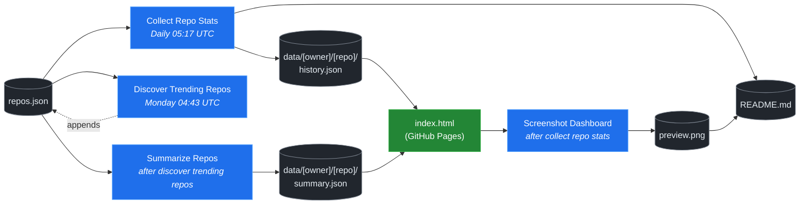

# 🚀 Rising Repos Tracker

> Automatically tracks daily GitHub stats (stars, forks, issues, velocity) for rising open source repos.

[](https://www.telosignal.com/)


**[→ View Live Dashboard](https://patrick-creates.github.io/rising-repos-tracker/)**

Built and maintained by [Telosignal](https://www.telosignal.com/).


<!-- AUTOGEN-STATS-START -->
## 📊 Current snapshot

> Auto-updated daily — last refreshed 2026-10-13

| Metric | Value |
|---|---|
| Repos tracked | **217** |
| Total stars | **10,905,016** |
| Total forks | **1,593,826** |
| Fastest growing | **rea** (+53850.0/day) |

### 🔥 Top 5 by velocity

| # | Repo | Stars | Stars/day |
|---|---|---:|---:|
| 1 | [morluto/rea](https://github.com/morluto/rea) | 188,079 | +53850.0 |
| 2 | [debpalash/VoiceStudio](https://github.com/debpalash/VoiceStudio) | 61,538 | +1147.8 |
| 3 | [DietrichGebert/ponytail](https://github.com/DietrichGebert/ponytail) | 162,295 | +1011.3 |
| 4 | [stablyai/orca](https://github.com/stablyai/orca) | 91,184 | +793.9 |
| 5 | [NousResearch/hermes-agent](https://github.com/NousResearch/hermes-agent) | 253,331 | +688.1 |

### 🆕 Recently added

- [morluto/rea](https://github.com/morluto/rea) — added 2026-10-12 — Reverse engineer anything with agents, from app behavior down to native binaries.
- [TencentCloud/Octop](https://github.com/TencentCloud/Octop) — added 2026-10-12 — A smarter, self-hosted AI assistant — multi-user, multi-agent.
- [tt-a1i/archify](https://github.com/tt-a1i/archify) — added 2026-10-05 — Turn any idea, plan, or codebase into a beautiful interactive diagram. An agent skill for Claude Code, Codex, and more.
<!-- AUTOGEN-STATS-END -->

<!-- AUTOGEN-DIAGRAM-START -->
## 🔄 How it works


<!-- AUTOGEN-DIAGRAM-END -->

<!-- AUTOGEN-WORKFLOWS-START -->
## ⚙️ Workflows

| File | Schedule | Name |
|---|---|---|
| `collect.yml` | Daily 05:17 UTC | Collect Repo Stats |
| `discover.yml` | Monday 04:43 UTC | Discover Trending Repos |
| `screenshot.yml` | After Collect Repo Stats | Screenshot Dashboard |
| `summarize.yml` | After Discover Trending Repos | Summarize Repos |

> All workflows commit results directly back to the repo. Schedules are best-effort — GitHub Actions cron can drift by a few minutes.
<!-- AUTOGEN-WORKFLOWS-END -->

<!-- AUTOGEN-REPOS-START -->
## 📋 All tracked repos

| Repo | Stars | Forks | Stars/day |
|---|---:|---:|---:|
| [openclaw/openclaw](https://github.com/openclaw/openclaw) | 391,848 | 82,395 | +133.2 |
| [obra/superpowers](https://github.com/obra/superpowers) | 298,459 | 26,673 | +556.5 |
| [affaan-m/everything-claude-code](https://github.com/affaan-m/everything-claude-code) | 278,246 | 41,458 | +635.3 |
| [affaan-m/ECC](https://github.com/affaan-m/ECC) | 278,246 | 41,458 | +610.0 |
| [NousResearch/hermes-agent](https://github.com/NousResearch/hermes-agent) | 253,331 | 54,921 | +688.1 |
| [microsoft/markitdown](https://github.com/microsoft/markitdown) | 189,912 | 14,126 | +437.3 |
| [morluto/rea](https://github.com/morluto/rea) | 188,079 | 45,674 | +53850.0 |
| [Significant-Gravitas/AutoGPT](https://github.com/Significant-Gravitas/AutoGPT) | 187,548 | 45,941 | +21.4 |
| [f/prompts.chat](https://github.com/f/prompts.chat) | 172,808 | 22,159 | +69.5 |
| [DietrichGebert/ponytail](https://github.com/DietrichGebert/ponytail) | 162,295 | 8,764 | +1011.3 |
| [langgenius/dify](https://github.com/langgenius/dify) | 158,354 | 25,031 | +112.0 |
| [open-webui/open-webui](https://github.com/open-webui/open-webui) | 155,519 | 22,670 | +121.7 |
| [langchain-ai/langchain](https://github.com/langchain-ai/langchain) | 147,751 | 24,781 | +72.7 |
| [farion1231/cc-switch](https://github.com/farion1231/cc-switch) | 143,672 | 9,552 | +470.5 |
| [github/spec-kit](https://github.com/github/spec-kit) | 141,064 | 12,621 | +282.4 |
| [nextlevelbuilder/ui-ux-pro-max-skill](https://github.com/nextlevelbuilder/ui-ux-pro-max-skill) | 135,366 | 14,381 | +375.6 |
| [Graphify-Labs/graphify](https://github.com/Graphify-Labs/graphify) | 126,044 | 12,161 | +376.2 |
| [microsoft/generative-ai-for-beginners](https://github.com/microsoft/generative-ai-for-beginners) | 121,290 | 63,920 | +68.9 |
| [JuliusBrussee/caveman](https://github.com/JuliusBrussee/caveman) | 111,364 | 6,452 | +336.8 |
| [nexu-io/open-design](https://github.com/nexu-io/open-design) | 100,889 | 11,622 | +383.2 |
| [thedotmack/claude-mem](https://github.com/thedotmack/claude-mem) | 100,271 | 8,786 | +162.7 |
| [ruvnet/RuView](https://github.com/ruvnet/RuView) | 97,725 | 12,808 | +225.8 |
| [Panniantong/Agent-Reach](https://github.com/Panniantong/Agent-Reach) | 96,811 | 8,470 | +577.4 |
| [Leonxlnx/taste-skill](https://github.com/Leonxlnx/taste-skill) | 95,375 | 6,495 | +484.8 |
| [vllm-project/vllm](https://github.com/vllm-project/vllm) | 93,710 | 23,319 | +90.4 |
| [stablyai/orca](https://github.com/stablyai/orca) | 91,184 | 5,821 | +793.9 |
| [OpenHands/OpenHands](https://github.com/OpenHands/OpenHands) | 90,790 | 12,030 | +113.9 |
| [ChatGPTNextWeb/NextChat](https://github.com/ChatGPTNextWeb/NextChat) | 88,842 | 58,843 | +5.4 |
| [koala73/worldmonitor](https://github.com/koala73/worldmonitor) | 88,358 | 13,509 | +229.7 |
| [lobehub/lobehub](https://github.com/lobehub/lobehub) | 83,200 | 15,977 | +40.5 |
| [rtk-ai/rtk](https://github.com/rtk-ai/rtk) | 83,175 | 5,278 | +227.0 |
| [datawhalechina/hello-agents](https://github.com/datawhalechina/hello-agents) | 82,904 | 10,280 | +217.9 |
| [tt-a1i/archify](https://github.com/tt-a1i/archify) | 82,863 | 5,586 | +628.8 |
| [dair-ai/Prompt-Engineering-Guide](https://github.com/dair-ai/Prompt-Engineering-Guide) | 79,119 | 8,689 | +29.9 |
| [shareAI-lab/learn-claude-code](https://github.com/shareAI-lab/learn-claude-code) | 78,495 | 12,572 | +117.7 |
| [unslothai/unsloth](https://github.com/unslothai/unsloth) | 77,928 | 7,195 | +90.7 |
| [ComposioHQ/awesome-claude-skills](https://github.com/ComposioHQ/awesome-claude-skills) | 76,986 | 9,074 | +112.1 |
| [openai/openai-cookbook](https://github.com/openai/openai-cookbook) | 76,594 | 12,934 | +20.2 |
| [diegosouzapw/OmniRoute](https://github.com/diegosouzapw/OmniRoute) | 75,950 | 10,973 | +644.4 |
| [chopratejas/headroom](https://github.com/chopratejas/headroom) | 75,179 | 5,836 | +391.8 |
| [headroomlabs-ai/headroom](https://github.com/headroomlabs-ai/headroom) | 75,179 | 5,836 | +259.1 |
| [ruvnet/ruflo](https://github.com/ruvnet/ruflo) | 74,491 | 8,860 | +75.0 |
| [santifer/career-ops](https://github.com/santifer/career-ops) | 74,248 | 13,923 | +196.0 |
| [career-ops-hq/career-ops](https://github.com/career-ops-hq/career-ops) | 74,248 | 13,924 | +107.4 |
| [Fission-AI/OpenSpec](https://github.com/Fission-AI/OpenSpec) | 71,800 | 4,903 | +155.5 |
| [code-yeongyu/oh-my-openagent](https://github.com/code-yeongyu/oh-my-openagent) | 69,988 | 5,753 | +78.8 |
| [asgeirtj/system_prompts_leaks](https://github.com/asgeirtj/system_prompts_leaks) | 69,541 | 11,305 | +197.0 |
| [rohitg00/ai-engineering-from-scratch](https://github.com/rohitg00/ai-engineering-from-scratch) | 68,413 | 11,978 | +313.8 |
| [usestrix/strix](https://github.com/usestrix/strix) | 68,306 | 7,570 | +317.9 |
| [calesthio/OpenMontage](https://github.com/calesthio/OpenMontage) | 67,794 | 8,661 | +376.8 |
| [shanraisshan/claude-code-best-practice](https://github.com/shanraisshan/claude-code-best-practice) | 67,489 | 6,732 | +94.5 |
| [xtekky/gpt4free](https://github.com/xtekky/gpt4free) | 66,810 | 13,478 | +3.8 |
| [ZhuLinsen/daily_stock_analysis](https://github.com/ZhuLinsen/daily_stock_analysis) | 66,275 | 55,174 | +194.6 |
| [mvanhorn/last30days-skill](https://github.com/mvanhorn/last30days-skill) | 64,130 | 5,595 | +247.7 |
| [heygen-com/hyperframes](https://github.com/heygen-com/hyperframes) | 62,226 | 5,576 | +288.7 |
| [tw93/Pake](https://github.com/tw93/Pake) | 62,044 | 12,777 | +89.6 |
| [debpalash/VoiceStudio](https://github.com/debpalash/VoiceStudio) | 61,538 | 6,889 | +1147.8 |
| [BerriAI/litellm](https://github.com/BerriAI/litellm) | 61,137 | 12,290 | +92.9 |
| [MemPalace/mempalace](https://github.com/MemPalace/mempalace) | 59,540 | 7,560 | +48.2 |
| [jamiepine/voicebox](https://github.com/jamiepine/voicebox) | 57,307 | 7,155 | +211.1 |
| [blader/humanizer](https://github.com/blader/humanizer) | 56,411 | 4,460 | +259.9 |
| [hesreallyhim/awesome-claude-code](https://github.com/hesreallyhim/awesome-claude-code) | 55,566 | 4,814 | +77.5 |
| [FlowiseAI/Flowise](https://github.com/FlowiseAI/Flowise) | 55,498 | 25,052 | +17.6 |
| [router-for-me/CLIProxyAPI](https://github.com/router-for-me/CLIProxyAPI) | 55,045 | 8,420 | +144.0 |
| [coreyhaines31/marketingskills](https://github.com/coreyhaines31/marketingskills) | 54,478 | 8,087 | +171.9 |
| [ggml-org/whisper.cpp](https://github.com/ggml-org/whisper.cpp) | 54,346 | 6,245 | +30.5 |
| [bojieli/ai-agent-book](https://github.com/bojieli/ai-agent-book) | 53,956 | 6,111 | +541.2 |
| [ChromeDevTools/chrome-devtools-mcp](https://github.com/ChromeDevTools/chrome-devtools-mcp) | 53,437 | 6,405 | +91.6 |
| [Imbad0202/academic-research-skills](https://github.com/Imbad0202/academic-research-skills) | 51,724 | 3,967 | +154.2 |
| [elder-plinius/CL4R1T4S](https://github.com/elder-plinius/CL4R1T4S) | 51,181 | 10,491 | +102.4 |
| [QuantumNous/new-api](https://github.com/QuantumNous/new-api) | 49,853 | 11,993 | +102.8 |
| [Aider-AI/aider](https://github.com/Aider-AI/aider) | 49,524 | 5,050 | +30.8 |
| [kepano/obsidian-skills](https://github.com/kepano/obsidian-skills) | 49,485 | 3,505 | +116.4 |
| [HKUDS/nanobot](https://github.com/HKUDS/nanobot) | 48,992 | 8,628 | +42.6 |
| [K-Dense-AI/scientific-agent-skills](https://github.com/K-Dense-AI/scientific-agent-skills) | 48,680 | 4,374 | +144.6 |
| [sickn33/antigravity-awesome-skills](https://github.com/sickn33/antigravity-awesome-skills) | 47,535 | 6,930 | +62.8 |
| [sickn33/agentic-awesome-skills](https://github.com/sickn33/agentic-awesome-skills) | 47,535 | 6,930 | +48.8 |
| [zhayujie/CowAgent](https://github.com/zhayujie/CowAgent) | 47,376 | 10,386 | +19.1 |
| [alibaba/open-code-review](https://github.com/alibaba/open-code-review) | 46,762 | 3,398 | +371.5 |
| [DeusData/codebase-memory-mcp](https://github.com/DeusData/codebase-memory-mcp) | 46,484 | 3,821 | +243.9 |
| [MadsLorentzen/ai-job-search](https://github.com/MadsLorentzen/ai-job-search) | 46,476 | 16,075 | +270.6 |
| [danny-avila/LibreChat](https://github.com/danny-avila/LibreChat) | 45,621 | 9,380 | +57.8 |
| [LibreChat-AI/LibreChat](https://github.com/LibreChat-AI/LibreChat) | 45,621 | 9,380 | +39.8 |
| [chatanywhere/GPT_API_free](https://github.com/chatanywhere/GPT_API_free) | 44,115 | 2,746 | +42.3 |
| [ogulcancelik/herdr](https://github.com/ogulcancelik/herdr) | 43,743 | 3,450 | +316.6 |
| [herdrdev/herdr](https://github.com/herdrdev/herdr) | 43,743 | 3,450 | +281.0 |
| [langchain-ai/langgraph](https://github.com/langchain-ai/langgraph) | 43,195 | 7,342 | +68.8 |
| [chatboxai/chatbox](https://github.com/chatboxai/chatbox) | 42,008 | 4,274 | +13.6 |
| [tinyhumansai/openhuman](https://github.com/tinyhumansai/openhuman) | 41,933 | 4,125 | +67.9 |
| [AstrBotDevs/AstrBot](https://github.com/AstrBotDevs/AstrBot) | 41,825 | 3,056 | +61.5 |
| [Hmbown/CodeWhale](https://github.com/Hmbown/CodeWhale) | 41,078 | 3,568 | +45.4 |
| [Hmbown/Codewhale](https://github.com/Hmbown/Codewhale) | 41,078 | 3,568 | +4.5 |
| [codewhale-hq/Codewhale](https://github.com/codewhale-hq/Codewhale) | 41,078 | 3,568 | +3.8 |
| [wshobson/agents](https://github.com/wshobson/agents) | 40,575 | 4,317 | +32.9 |
| [github/awesome-copilot](https://github.com/github/awesome-copilot) | 39,977 | 5,112 | +43.8 |
| [Yeachan-Heo/oh-my-claudecode](https://github.com/Yeachan-Heo/oh-my-claudecode) | 39,860 | 3,575 | +35.7 |
| [volcengine/OpenViking](https://github.com/volcengine/OpenViking) | 39,811 | 3,155 | +114.0 |
| [mindsdb/mindshub](https://github.com/mindsdb/mindshub) | 39,790 | 6,240 | +4.2 |
| [google/langextract](https://github.com/google/langextract) | 38,935 | 2,718 | +16.9 |
| [AlexsJones/llmfit](https://github.com/AlexsJones/llmfit) | 37,870 | 2,431 | +81.1 |
| [anthropics/claude-plugins-official](https://github.com/anthropics/claude-plugins-official) | 37,777 | 4,259 | +65.4 |
| [PDFMathTranslate/PDFMathTranslate](https://github.com/PDFMathTranslate/PDFMathTranslate) | 37,528 | 3,353 | +24.9 |
| [songquanpeng/one-api](https://github.com/songquanpeng/one-api) | 37,132 | 6,884 | +20.7 |
| [JCodesMore/ai-website-cloner-template](https://github.com/JCodesMore/ai-website-cloner-template) | 36,684 | 5,386 | +164.1 |
| [esengine/DeepSeek-Reasonix](https://github.com/esengine/DeepSeek-Reasonix) | 35,775 | 2,449 | +127.9 |
| [agentscope-ai/QwenPaw](https://github.com/agentscope-ai/QwenPaw) | 35,646 | 3,179 | +148.9 |
| [HKUDS/Vibe-Trading](https://github.com/HKUDS/Vibe-Trading) | 35,380 | 5,742 | +194.7 |
| [can1357/oh-my-pi](https://github.com/can1357/oh-my-pi) | 35,276 | 3,845 | +188.3 |
| [p-e-w/heretic](https://github.com/p-e-w/heretic) | 35,016 | 3,940 | +87.0 |
| [virgiliojr94/book-to-skill](https://github.com/virgiliojr94/book-to-skill) | 34,733 | 3,647 | +198.1 |
| [mukul975/Anthropic-Cybersecurity-Skills](https://github.com/mukul975/Anthropic-Cybersecurity-Skills) | 34,353 | 4,179 | +143.6 |
| [Gitlawb/openclaude](https://github.com/Gitlawb/openclaude) | 33,814 | 9,115 | +42.4 |
| [Twigpine/openclaude](https://github.com/Twigpine/openclaude) | 33,814 | 9,115 | +21.1 |
| [Tencent/WeKnora](https://github.com/Tencent/WeKnora) | 33,689 | 4,485 | +145.0 |
| [iOfficeAI/AionUi](https://github.com/iOfficeAI/AionUi) | 33,486 | 3,476 | +45.8 |
| [zeroclaw-labs/zeroclaw](https://github.com/zeroclaw-labs/zeroclaw) | 32,971 | 4,972 | +9.7 |
| [tirth8205/code-review-graph](https://github.com/tirth8205/code-review-graph) | 32,106 | 2,937 | +113.3 |
| [iOfficeAI/OfficeCLI](https://github.com/iOfficeAI/OfficeCLI) | 31,939 | 2,179 | +237.8 |
| [googleworkspace/cli](https://github.com/googleworkspace/cli) | 31,437 | 1,882 | +35.2 |
| [decolua/9router](https://github.com/decolua/9router) | 30,721 | 5,869 | +109.6 |
| [langchain-ai/deepagents](https://github.com/langchain-ai/deepagents) | 30,205 | 4,235 | +47.6 |
| [jackwener/OpenCLI](https://github.com/jackwener/OpenCLI) | 30,168 | 2,941 | +50.1 |
| [alibaba/page-agent](https://github.com/alibaba/page-agent) | 29,419 | 2,646 | +90.5 |
| [rohitg00/agentmemory](https://github.com/rohitg00/agentmemory) | 29,379 | 2,588 | +59.5 |
| [voideditor/void](https://github.com/voideditor/void) | 28,760 | 2,654 | — |
| [jarrodwatts/claude-hud](https://github.com/jarrodwatts/claude-hud) | 28,486 | 1,316 | +29.9 |
| [TencentCloud/TencentDB-Agent-Memory](https://github.com/TencentCloud/TencentDB-Agent-Memory) | 28,457 | 2,757 | +214.6 |
| [BloopAI/vibe-kanban](https://github.com/BloopAI/vibe-kanban) | 28,345 | 3,034 | +12.2 |
| [manaflow-ai/cmux](https://github.com/manaflow-ai/cmux) | 28,145 | 2,494 | +41.2 |
| [mksglu/context-mode](https://github.com/mksglu/context-mode) | 27,798 | 1,972 | +86.1 |
| [zai-org/Open-AutoGLM](https://github.com/zai-org/Open-AutoGLM) | 26,389 | 4,055 | +7.3 |
| [t8y2/dbx](https://github.com/t8y2/dbx) | 26,335 | 2,385 | +185.9 |
| [toon-format/toon](https://github.com/toon-format/toon) | 25,494 | 1,123 | +7.9 |
| [ifixai-ai/iFixAi](https://github.com/ifixai-ai/iFixAi) | 25,148 | 1,459 | +265.2 |
| [pascalorg/editor](https://github.com/pascalorg/editor) | 24,838 | 3,079 | +56.1 |
| [guillaumemeyer/watermarks-remover](https://github.com/guillaumemeyer/watermarks-remover) | 23,983 | 2,751 | +128.6 |
| [every-app/open-seo](https://github.com/every-app/open-seo) | 23,407 | 3,087 | +163.8 |
| [jundot/omlx](https://github.com/jundot/omlx) | 22,755 | 2,012 | +51.0 |
| [pranshuparmar/witr](https://github.com/pranshuparmar/witr) | 22,663 | 795 | +43.7 |
| [steipete/CodexBar](https://github.com/steipete/CodexBar) | 22,452 | 2,103 | +64.2 |
| [winfunc/opcode](https://github.com/winfunc/opcode) | 22,413 | 1,715 | +3.2 |
| [hypit-ai/hypit](https://github.com/hypit-ai/hypit) | 21,834 | 2,406 | +315.7 |
| [coze-dev/coze-studio](https://github.com/coze-dev/coze-studio) | 21,703 | 3,129 | +5.9 |
| [NirDiamant/agents-towards-production](https://github.com/NirDiamant/agents-towards-production) | 21,674 | 2,875 | +8.2 |
| [KKKKhazix/khazix-skills](https://github.com/KKKKhazix/khazix-skills) | 21,364 | 2,257 | +46.0 |
| [jnMetaCode/agency-agents-zh](https://github.com/jnMetaCode/agency-agents-zh) | 21,235 | 3,407 | +51.6 |
| [1jehuang/jcode](https://github.com/1jehuang/jcode) | 20,647 | 2,402 | +134.2 |
| [NVIDIA/SkillSpector](https://github.com/NVIDIA/SkillSpector) | 20,105 | 1,768 | +102.2 |
| [walkinglabs/learn-harness-engineering](https://github.com/walkinglabs/learn-harness-engineering) | 19,798 | 2,168 | +100.1 |
| [tanweai/pua](https://github.com/tanweai/pua) | 19,715 | 1,202 | +12.2 |
| [datawhalechina/easy-vibe](https://github.com/datawhalechina/easy-vibe) | 19,713 | 1,882 | +23.1 |
| [danielmiessler/LifeOS](https://github.com/danielmiessler/LifeOS) | 19,425 | 2,492 | +29.7 |
| [jlcodes99/cockpit-tools](https://github.com/jlcodes99/cockpit-tools) | 18,912 | 1,678 | +53.8 |
| [nesquena/hermes-webui](https://github.com/nesquena/hermes-webui) | 18,897 | 2,719 | +35.9 |
| [AgriciDaniel/claude-seo](https://github.com/AgriciDaniel/claude-seo) | 18,821 | 2,756 | +66.8 |
| [microsoft/agent-lightning](https://github.com/microsoft/agent-lightning) | 18,678 | 1,673 | +11.4 |
| [browser-use/browser-harness](https://github.com/browser-use/browser-harness) | 18,411 | 1,807 | +27.7 |
| [RightNow-AI/openfang](https://github.com/RightNow-AI/openfang) | 18,218 | 2,290 | +3.3 |
| [rocketride-org/rocketride-server](https://github.com/rocketride-org/rocketride-server) | 17,783 | 7,550 | — |
| [tradecatlabs/vibe-coding-cn](https://github.com/tradecatlabs/vibe-coding-cn) | 17,517 | 1,764 | +49.3 |
| [wanshuiyin/Auto-claude-code-research-in-sleep](https://github.com/wanshuiyin/Auto-claude-code-research-in-sleep) | 17,397 | 1,459 | +43.6 |
| [MemoriLabs/Memori](https://github.com/MemoriLabs/Memori) | 17,147 | 3,709 | +16.0 |
| [cft0808/edict](https://github.com/cft0808/edict) | 16,990 | 1,765 | +7.7 |
| [composio-community/awesome-codex-skills](https://github.com/composio-community/awesome-codex-skills) | 16,888 | 1,663 | +18.6 |
| [xbtlin/ai-berkshire](https://github.com/xbtlin/ai-berkshire) | 16,731 | 2,489 | +60.1 |
| [xpzouying/xiaohongshu-mcp](https://github.com/xpzouying/xiaohongshu-mcp) | 16,252 | 2,386 | +17.4 |
| [Anionex/banana-slides](https://github.com/Anionex/banana-slides) | 15,742 | 1,786 | +5.2 |
| [yusufkaraaslan/Skill_Seekers](https://github.com/yusufkaraaslan/Skill_Seekers) | 15,139 | 1,540 | +8.1 |
| [superset-sh/superset](https://github.com/superset-sh/superset) | 15,120 | 1,349 | +27.9 |
| [NanmiCoder/cc-haha](https://github.com/NanmiCoder/cc-haha) | 14,987 | 8,610 | +15.6 |
| [kyegomez/OpenMythos](https://github.com/kyegomez/OpenMythos) | 14,909 | 3,277 | +6.7 |
| [NevaMind-AI/memU](https://github.com/NevaMind-AI/memU) | 14,537 | 1,089 | +5.6 |
| [XiaomiMiMo/MiMo-Code](https://github.com/XiaomiMiMo/MiMo-Code) | 13,647 | 1,431 | +24.7 |
| [dataelement/dsh-desktop](https://github.com/dataelement/dsh-desktop) | 13,646 | 494 | +256.3 |
| [EverMind-AI/EverOS](https://github.com/EverMind-AI/EverOS) | 13,411 | 930 | +34.9 |
| [sirmalloc/ccstatusline](https://github.com/sirmalloc/ccstatusline) | 13,269 | 594 | +18.8 |
| [ConardLi/garden-skills](https://github.com/ConardLi/garden-skills) | 12,859 | 1,544 | +37.2 |
| [0x4m4/hexstrike-ai](https://github.com/0x4m4/hexstrike-ai) | 12,744 | 2,600 | +25.8 |
| [brokermr810/QuantDinger](https://github.com/brokermr810/QuantDinger) | 12,738 | 2,590 | +34.9 |
| [OpenByteInc/QuantDinger](https://github.com/OpenByteInc/QuantDinger) | 12,738 | 2,590 | +34.5 |
| [MemTensor/MemOS](https://github.com/MemTensor/MemOS) | 11,845 | 1,075 | +17.2 |
| [holaboss-ai/holaOS](https://github.com/holaboss-ai/holaOS) | 11,452 | 729 | +54.1 |
| [getagentseal/codeburn](https://github.com/getagentseal/codeburn) | 11,424 | 884 | +29.8 |
| [EKKOLearnAI/hermes-studio](https://github.com/EKKOLearnAI/hermes-studio) | 11,384 | 1,403 | +25.5 |
| [EKKOLearnAI/ekko-studio](https://github.com/EKKOLearnAI/ekko-studio) | 11,384 | 1,403 | +10.7 |
| [aden-hive/hive](https://github.com/aden-hive/hive) | 11,098 | 5,649 | +4.6 |
| [openai/codex-security](https://github.com/openai/codex-security) | 11,083 | 863 | +39.5 |
| [ValueCell-ai/valuecell](https://github.com/ValueCell-ai/valuecell) | 11,022 | 1,802 | +1.4 |
| [Kuberwastaken/claurst](https://github.com/Kuberwastaken/claurst) | 10,321 | 7,699 | +4.3 |
| [StarTrail-org/PixelRAG](https://github.com/StarTrail-org/PixelRAG) | 10,259 | 903 | +39.9 |
| [ykdojo/claude-code-tips](https://github.com/ykdojo/claude-code-tips) | 10,219 | 829 | +12.1 |
| [Companion-Inc/feynman](https://github.com/Companion-Inc/feynman) | 9,954 | 1,098 | +9.5 |
| [trailhq/Graft](https://github.com/trailhq/Graft) | 9,946 | 879 | +81.3 |
| [frankbria/ralph-claude-code](https://github.com/frankbria/ralph-claude-code) | 9,679 | 732 | +3.7 |
| [modem-dev/hunk](https://github.com/modem-dev/hunk) | 9,593 | 315 | +31.4 |
| [genspark-ai/genoffice](https://github.com/genspark-ai/genoffice) | 9,525 | 1,222 | +97.0 |
| [Nasiko-Labs/nasiko](https://github.com/Nasiko-Labs/nasiko) | 9,495 | 2,056 | +32.5 |
| [open-slide/open-slide](https://github.com/open-slide/open-slide) | 9,224 | 664 | +62.9 |
| [1weiho/open-slide](https://github.com/1weiho/open-slide) | 9,223 | 664 | +48.5 |
| [EvoMap/evolver](https://github.com/EvoMap/evolver) | 9,143 | 849 | +2.9 |
| [TencentCloud/Octop](https://github.com/TencentCloud/Octop) | 9,059 | 1,120 | +222.0 |
| [iflytek/astron-agent](https://github.com/iflytek/astron-agent) | 8,894 | 897 | +2.9 |
| [Tencent/BrowserSkill](https://github.com/Tencent/BrowserSkill) | 8,785 | 628 | +75.0 |
| [MiroMindAI/MiroThinker](https://github.com/MiroMindAI/MiroThinker) | 8,423 | 645 | +1.0 |
| [mmulet/term.everything](https://github.com/mmulet/term.everything) | 8,113 | 195 | +0.9 |
| [rorkai/App-Store-Connect-CLI](https://github.com/rorkai/App-Store-Connect-CLI) | 7,820 | 663 | +25.6 |
| [ValueCell-ai/ClawX](https://github.com/ValueCell-ai/ClawX) | 7,606 | 1,142 | +0.7 |
| [WenyuChiou/awesome-agentic-ai-zh](https://github.com/WenyuChiou/awesome-agentic-ai-zh) | 7,564 | 1,006 | +23.6 |
| [opensquilla/opensquilla](https://github.com/opensquilla/opensquilla) | 7,105 | 581 | +10.5 |
| [TokenRhythm/opensquilla](https://github.com/TokenRhythm/opensquilla) | 7,105 | 581 | +3.8 |
| [tech-leads-club/agent-skills](https://github.com/tech-leads-club/agent-skills) | 7,052 | 560 | +21.9 |
| [Andyyyy64/whichllm](https://github.com/Andyyyy64/whichllm) | 6,750 | 374 | +10.4 |
| [steipete/summarize](https://github.com/steipete/summarize) | 6,707 | 450 | +3.2 |
| [Arthur-Ficial/apfel](https://github.com/Arthur-Ficial/apfel) | 6,474 | 247 | +3.9 |
| [microsoft/fara](https://github.com/microsoft/fara) | 6,217 | 606 | +2.4 |
| [UfoMiao/zcf](https://github.com/UfoMiao/zcf) | 6,076 | 424 | +0.1 |
| [re4/LibreCode](https://github.com/re4/LibreCode) | 88 | 4 | — |
<!-- AUTOGEN-REPOS-END -->

---

## What it does

- Collects daily snapshots of stars, forks, watchers and open issues for every tracked repo
- Discovers new trending repos automatically every Monday using the GitHub Search API
- Generates AI summaries (use cases, similar tools, tags) for each tracked repo via GitHub Models
- Stores all history as plain JSON — no database, no backend
- Renders a live dashboard via GitHub Pages — updates daily, zero maintenance

## Tracked repos

Data lives in [`data/`](./data) — one folder per repo, one `history.json` per entry.  
The full watch list is in [`repos.json`](./repos.json).

## Fork & use it for yourself

This is my personal tracker — the watch list reflects what I find interesting. If you want to track different repos, the best path is to **fork this repo and run your own**.

### Setup

1. Fork this repo to your account
2. Replace the contents of [`repos.json`](./repos.json) with the repos you want to track (or just leave one entry — `discover.yml` will auto-add more every Monday)
3. Go to **Settings → Pages** and enable GitHub Pages from the `main` branch
4. Go to **Actions** and run **Collect Repo Stats** once manually to seed your first data point
5. Your dashboard will be live at `https://YOUR-USERNAME.github.io/rising-repos-tracker/`

That's it — daily collection and weekly discovery run automatically on schedule. Zero ongoing maintenance.

### Customizing what gets discovered

Edit [`scripts/discover.js`](./scripts/discover.js) to change:

- `MIN_STARS` — minimum star threshold for candidates
- `MAX_AGE_DAYS` — how recent a repo must be
- `MAX_NEW_REPOS` — how many to add per discovery run
- The `queries` array — GitHub Search API queries that define what "trending" means to you

### Adding a repo manually

Just edit `repos.json` directly:

```json
{
  "owner": "OWNER",
  "repo": "REPO",
  "added": "YYYY-MM-DD",
  "notes": "why you're tracking this"
}
```

The next daily collect run picks it up automatically.

## Stack

- **GitHub Actions** — scheduling and automation
- **GitHub Pages** — dashboard hosting
- **GitHub API** — data source
- **GitHub Models** — free AI summaries (gpt-4o-mini)
- **Chart.js** — star growth visualization
- **Mermaid** — architecture diagram (rendered by GitHub)
- No dependencies, no build step, no database

## License

MIT
